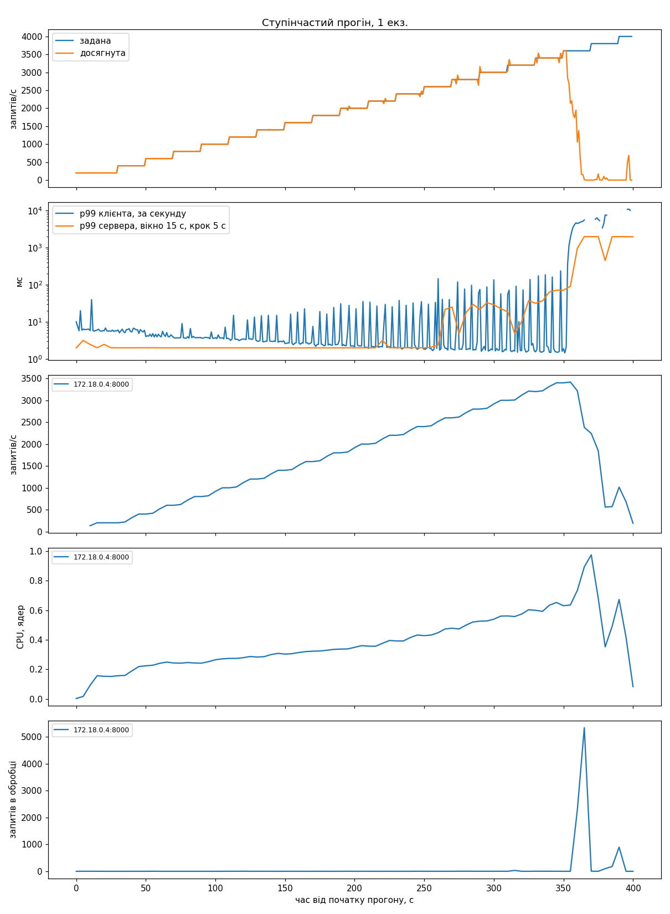
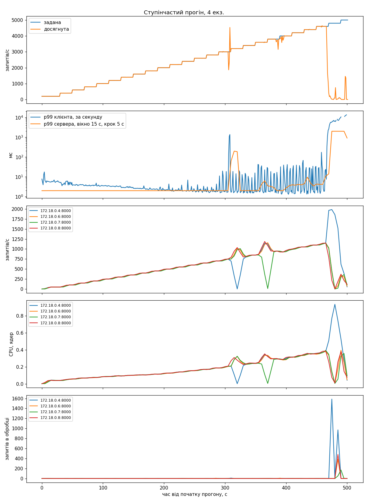
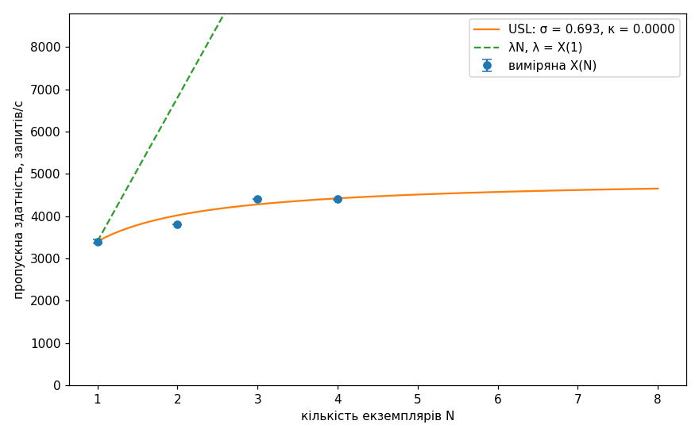
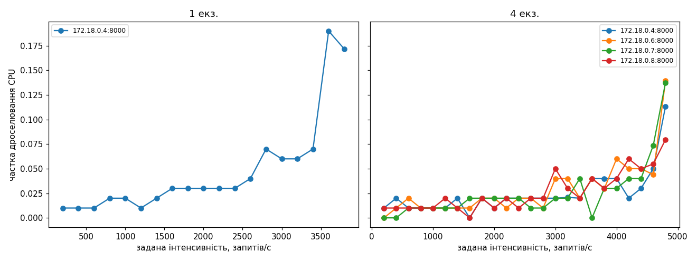

<div align="center">

Міністерство освіти і науки України<br>
Національний технічний університет України «Київський політехнічний інститут імені Ігоря Сікорського»

Факультет біомедичної інженерії<br>
Кафедра біомедичної кібернетики

# Звіт

**про виконання лабораторної роботи №2<br>
з дисципліни «Високопродуктивні розподілені обчислювальні системи»**

Тема роботи: «Метрики сервісу і межа масштабованості»<br>
Варіант № 8

</div>

**Виконав:** студент гр. ЗК-61мп Євтушенко Єгор<br>
**Прийняв:** Матвійчук О. В.

<div align="center">

Київ<br>
КПІ ім. Ігоря Сікорського<br>
2026

</div>

---

## Мета роботи

Доповнити сервіс із лабораторної роботи 1 метриками у форматі Prometheus, додати до стенду Docker Compose сервер Prometheus, виміряти пропускну здатність і затримку сервісу ступінчастим навантаженням на 1, 2, 3 і 4 екземплярах і за результатами вимірювань визначити параметри універсального закону масштабованості.

## Варіант

Номер варіанта збігається з номером у лабораторній роботі 1.

| № | Розмір пулу | Набір бакетів | Додаткова метрика |
|---|---|---|---|
| 8 | 10 | Г2 | М3 |

| Набір | Межі бакетів, мс |
|---|---|
| Г2 | 2, 5, 10, 20, 50, 100, 200, 500, 1000, 2000 |

| Метрика | Що додати | Що показати |
|---|---|---|
| М3 | у сервісі: значення `nr_periods` і `nr_throttled` з файла `/sys/fs/cgroup/cpu.stat` (для cgroup v1 `/sys/fs/cgroup/cpu,cpuacct/cpu.stat`) як лічильники | залежність частки дроселювання CPU кожного екземпляра від заданої інтенсивності; частка дорівнює приросту `nr_throttled`, поділеному на приріст `nr_periods` |

Ліміти контейнера web узято з варіанта 8 лабораторної роботи 1 і не змінювались: 1 CPU, 384 МБ.

## Середовище

Усі прогони виконано на одному ноутбуці: Apple M3 Pro (5 продуктивних і 6 енергоефективних ядер), 18 ГБ памʼяті, macOS 27.0.1. Docker Desktop 29.8.2 виділяє віртуальній машині **11 CPU і 8 319 369 216 байт (7,75 ГіБ) памʼяті** (`results/docker_resources.txt`). Сервіс написано на Python 3.12 (FastAPI 0.143.0, Uvicorn 0.54.0, asyncpg 0.32.0, prometheus-client 0.26.0), база PostgreSQL 16, балансувальник nginx 1.28, Prometheus 3.5.0. Генератор навантаження працює на Python 3.13 на тій самій машині і конкурує зі стендом за ядра процесора.

## Крок 1. Метрики Prometheus

До сервісу підключено бібліотеку `prometheus_client`. Метрики реєструються один раз під час імпорту модуля і оновлюються в проміжному обробнику `MetricsMiddleware` (додаток А):

- лічильник `http_requests_total` з мітками `method`, `path` і `code`; у мітці шляху записується шаблон маршруту з `scope["route"].path`, тобто `/donations/{donation_id}`, а не конкретний ідентифікатор;
- гістограма `http_request_duration_seconds` тривалості обробки в секундах з межами набору Г2: `0.002, 0.005, 0.01, 0.02, 0.05, 0.1, 0.2, 0.5, 1.0, 2.0`;
- вимірювач `http_requests_in_progress` кількості запитів в обробці.

Запити до самого `/metrics` не потрапляють у гістограму і вимірювач, інакше кожен збір Prometheus додавав би до вимірювача одиницю. Метрики віддаються за запитом `GET /metrics`, сервіс запускається одним процесом Uvicorn у контейнері.

Метрика варіанта М3 реалізована окремим колектором `CgroupCpuCollector`: під час кожного збору він читає `/sys/fs/cgroup/cpu.stat` (або шлях cgroup v1) і віддає значення `nr_periods` і `nr_throttled` як лічильники `cgroup_cpu_nr_periods_total` і `cgroup_cpu_nr_throttled_total`. Також бібліотека сама віддає `process_cpu_seconds_total`, за яким рахується використання CPU екземпляра.

Фрагмент `/metrics` одного екземпляра:

```
process_cpu_seconds_total 0.63
http_requests_total{code="200",method="GET",path="/donations/{donation_id}"} 1.0
http_requests_total{code="201",method="POST",path="/donations"} 1.0
http_requests_total{code="400",method="POST",path="/donations"} 2.0
http_requests_in_progress 0.0
cgroup_cpu_nr_periods_total 17.0
cgroup_cpu_nr_throttled_total 2.0
```

## Крок 2. `/livez`, `X-Pod` і розмір пулу

- `GET /livez` повертає 200 і не звертається до бази.
- Імʼя екземпляра береться зі змінної `POD_NAME`, а якщо її не задано, з імені хоста контейнера (`socket.gethostname()`). Проміжний обробник додає його в заголовок `X-Pod` кожної відповіді.
- Розмір пулу зчитується зі змінної `DB_POOL_SIZE`, у `docker-compose.yml` для варіанта 8 задано `DB_POOL_SIZE: 10`. Пул створюється з `max_size = DB_POOL_SIZE`, тому екземпляр ніколи не відкриває до бази більше 10 зʼєднань.

```
$ curl -i http://localhost:8080/livez
HTTP/1.1 200 OK
x-pod: 199b35a49da2
```

## Крок 3. Коректна зупинка

Інструкція `CMD` у `Dockerfile` записана в exec-формі, тому SIGTERM отримує саме процес Uvicorn:

```dockerfile
CMD ["uvicorn", "app.main:app", "--host", "0.0.0.0", "--port", "8000", "--no-access-log"]
```

За SIGTERM Uvicorn припиняє приймати нові зʼєднання, дочікується завершення запитів в обробці і виконує завершальну частину `lifespan`, яка закриває пул зʼєднань з базою, після чого процес завершується з кодом 0.

Перевірка (`scripts/sigterm_check.sh`): на двох екземплярах генератор подає 500 запитів/с протягом 40 с, на 22-й секунді один контейнер зупиняється командою `docker stop`. Після прогону скрипт виводить код завершення контейнера і посекундні дані генератора за 10 секунд навколо зупинки:

```
stopped container: /lab2-web-2
stop issued at unix 1793911021.597
exit code: 0
unix second sent ok_2xx non_2xx conn_errors
1793911016.559 15 501 500 0 0
1793911017.559 16 500 501 0 0
1793911018.559 17 500 500 0 0
1793911019.559 18 500 500 0 0
1793911020.559 19 500 499 0 0
1793911021.559 20 500 500 0 0
1793911022.559 21 500 500 0 0
1793911023.559 22 500 499 0 0
1793911024.559 23 500 500 0 0
1793911025.559 24 500 502 0 0
total non-2xx: 0 connection errors: 0
```

Код завершення 0, а за 10 секунд навколо зупинки генератор не зафіксував жодної відповіді з кодом не 2xx і жодної помилки зʼєднання.

## Крок 4. Prometheus у Docker Compose

До `docker-compose.yml` додано сервіс `prometheus` з іменованим томом `prometheus-data` і опублікованим портом 9090. Екземпляри web Prometheus знаходить через `dns_sd_configs`: DNS-запит за іменем сервісу `web` повертає адреси всіх його контейнерів. Додаткова метрика варіанта М3 віддається самим сервісом, тому експортер не потрібен. Після кожної зміни кількості екземплярів балансувальник перезапускається командою `docker compose restart balancer`. Ступінчастий ендпоінт `/noop` у nginx повертає 204 без звернення до web.

`prometheus/prometheus.yml`:

```yaml
global:
  scrape_interval: 5s
  evaluation_interval: 5s

scrape_configs:
  - job_name: web
    dns_sd_configs:
      - names: [web]
        type: A
        port: 8000
        refresh_interval: 5s
```

`docker-compose.yml`:

```yaml
services:
  db:
    image: postgres:16
    environment:
      POSTGRES_DB: ${POSTGRES_DB}
      POSTGRES_USER: ${POSTGRES_USER}
      POSTGRES_PASSWORD: ${POSTGRES_PASSWORD}
    volumes:
      - db-data:/var/lib/postgresql/data
      - ./db/init.sql:/docker-entrypoint-initdb.d/init.sql:ro
    healthcheck:
      test: ["CMD-SHELL", "pg_isready -h 127.0.0.1 -U $${POSTGRES_USER} -d $${POSTGRES_DB}"]
      interval: 5s
      timeout: 3s
      retries: 20
      start_period: 30s
      start_interval: 1s
    networks:
      - backend
    restart: unless-stopped

  web:
    build: .
    image: donations-api:2.0
    environment:
      PGHOST: db
      PGPORT: 5432
      PGDATABASE: ${POSTGRES_DB}
      PGUSER: ${POSTGRES_USER}
      PGPASSWORD: ${POSTGRES_PASSWORD}
      DB_POOL_SIZE: 10
    depends_on:
      db:
        condition: service_healthy
    healthcheck:
      test: ["CMD", "python", "-c", "import urllib.request; urllib.request.urlopen('http://127.0.0.1:8000/healthz', timeout=2)"]
      interval: 5s
      timeout: 3s
      retries: 3
      start_period: 30s
      start_interval: 1s
    deploy:
      resources:
        limits:
          cpus: "1"
          memory: 384M
    restart: always
    networks:
      - backend

  balancer:
    image: nginx:1.28-alpine
    ports:
      - "${HTTP_PORT}:80"
    volumes:
      - ./nginx/nginx.conf:/etc/nginx/nginx.conf:ro
    depends_on:
      web:
        condition: service_healthy
    networks:
      - backend
    restart: unless-stopped

  prometheus:
    image: prom/prometheus:v3.5.0
    ports:
      - "9090:9090"
    volumes:
      - ./prometheus/prometheus.yml:/etc/prometheus/prometheus.yml:ro
      - prometheus-data:/prometheus
    networks:
      - backend
    restart: unless-stopped

networks:
  backend:

volumes:
  db-data:
  prometheus-data:
```

`nginx/nginx.conf`:

```nginx
worker_processes auto;

events {
    worker_connections 4096;
}

http {
    log_format upstream '$time_iso8601 "$request" $status $upstream_addr $request_time';
    access_log /var/log/nginx/access.log upstream;

    resolver 127.0.0.11 valid=2s ipv6=off;

    upstream web {
        zone web 64k;
        server web:8000 resolve;
        keepalive 64;
    }

    server {
        listen 80;

        location = /noop {
            access_log off;
            return 204;
        }

        location / {
            proxy_pass http://web;
            proxy_http_version 1.1;
            proxy_set_header Connection "";
            proxy_set_header Host $host;
        }
    }
}
```

Після запуску з `--scale web=4` усі чотири екземпляри мають стан UP:

```
$ curl -s localhost:9090/api/v1/targets (instance, health)
web 172.18.0.8:8000 up
web 172.18.0.4:8000 up
web 172.18.0.6:8000 up
web 172.18.0.7:8000 up
```

## Крок 5. Ступінчасте навантаження

Генератор `loadgen/loadgen.py` (додаток Б) переписано на асинхронний клієнт: кожен з 11 процесів має власний цикл подій asyncio і тримає пул keep-alive зʼєднань. Нове зʼєднання відкривається, коли вільного немає, тож кількість одночасних запитів не обмежена і фактична інтенсивність надсилання дорівнює заданій. Запит із номером j заплановано на момент `t0 + j/λ` у межах сходинки; процес з номером i надсилає запити з номерами i, i + 11 і так далі. Затримка рахується від запланованого моменту надсилання. Тайм-аут запиту 5 с, запит, що перевищив тайм-аут, рахується як відповідь з кодом не 2xx; обрив чи відмова зʼєднання рахуються окремо як помилки зʼєднання.

Профіль: прогрів 10 с на рівні 200 запитів/с, далі сходинки по 20 с від 200 запитів/с з приростом 200 запитів/с. Прогін зупиняється, коли на двох сходинках поспіль досягнута інтенсивність нижча за 0,9 заданої, або після сходинки, задана інтенсивність якої досягла межі генератора G. Сценарій: читання одного запису `GET /donations/{id}` зі ста записів, занесених перед серією.

Щосекунди генератор записує (`results/*_seconds.csv`): задану інтенсивність, фактичну інтенсивність надсилання, досягнуту інтенсивність (кількість відповідей 2xx, завершених у цю секунду), кількість відповідей 2xx і не 2xx, кількість помилок зʼєднання, p50, p95 і p99 клієнта за відповідями, завершеними в цю секунду. Для кожної сходинки середні значення рахуються за останні 15 с (перші 5 с перехідні і не враховуються) і записуються в `results/*_steps.json`.

## Крок 6. Межа генератора

Ступінчастий прогін проти `/noop` через той самий опублікований порт 8080 без обмеження межею G (`results/noop_steps.json`). Останні сходинки:

| Задана, запитів/с | Досягнута, запитів/с | Фактична відправка, запитів/с | p99 клієнта, мс |
|---|---|---|---|
| 11 200 | 11 200,00 | 11 200,00 | 0,59 |
| 11 400 | 11 400,00 | 11 400,00 | 0,57 |
| 11 600 | 3 101,80 | 6 625,40 | 8 949,10 |
| 11 800 | 0,13 | 5 852,87 | 15 320,80 |

**Межа генератора G = 11 400 запитів/с.**

## Крок 7. Прогони на 1, 2, 3 і 4 екземплярах

Серію знято скриптом `scripts/run_series.sh` за один прохід: стенд піднімається з нуля, генератор заносить 100 записів, виконує прогін на `/noop`, а потім по одному ступінчастому прогону для N = 1, 2, 3 і 4 з межею G. Точка N обмежена генератором, якщо X(N) ≥ 0,9 · G = 10 260 запитів/с або на останній сходинці досягнута інтенсивність не нижча за 0,9 заданої. Жодна точка цю умову не виконала: усі X(N) значно менші за 10 260, а кожен прогін закінчився двома сходинками, на яких сервіс не тримав задану інтенсивність. Ліміт CPU тому не змінювався.

| N | X(N), запитів/с | Розкид, запитів/с | Сходинка X(N), запитів/с | p99 клієнта, мс | p99 сервера, мс (бакет) | Не 2xx | CPU одного екземпляра, ядер | Запитів в обробці на екземпляр |
|---|---|---|---|---|---|---|---|---|
| 1 | 3 400,07 | 48,21 | 3 400 | 129,81 | 71,19 (50–100) | 0 % | 0,630 | 1,33 |
| 2 | 3 799,87 | 1,41 | 3 800 | 9,77 | 2,74 (2–5) | 0 % | 0,460 | 0,50 |
| 3 | 4 399,87 | 1,89 | 4 400 | 34,43 | 15,91 (10–20) | 0 % | 0,434 | 0,22 |
| 4 | 4 400,00 | 6,29 | 4 400 | 19,18 | 4,27 (2–5) | 0 % | 0,355 | 0,33 |

Розкид дорівнює стандартному відхиленню посекундної досягнутої інтенсивності за 15 с сходинки X(N). CPU одного екземпляра це середнє по екземплярах `rate(process_cpu_seconds_total[15s])`, запити в обробці це середнє по екземплярах `avg_over_time(http_requests_in_progress[15s])`, обидва на кінець сходинки. Docker виділяє віртуальній машині 11 CPU і 7,75 ГіБ памʼяті.

## Крок 8. Діаграми прогонів на 1 і 4 екземплярах

Діаграми побудовано скриптом `loadgen/analyze.py` до видалення томів Compose. На кожній діаграмі спільна вісь часу і пʼять панелей: задана і досягнута інтенсивність; p99 клієнта за секунду і p99 сервера за вікно 15 с з кроком 5 с; кількість запитів за секунду, використання CPU і кількість запитів в обробці для кожного екземпляра.





На діаграмі для чотирьох екземплярів видно два короткі провали близько 320-ї і 370-ї секунди, коли nginx кілька секунд не надсилав запитів одному з екземплярів, а p99 клієнта в цей момент підскакував до сотень мілісекунд.

## Крок 9. p99 клієнта і p99 сервера на одному екземплярі

p99 сервера для кожної сходинки оцінено за приростами лічильників бакетів за останні 15 с сходинки, просумованими по екземплярах, з лінійною інтерполяцією всередині бакета за формулою з теоретичних відомостей. Максимальна похибка дорівнює ширині бакета.

| Задана, запитів/с | p99 клієнта, мс | p99 сервера, мс | Бакет, мс | Максимальна похибка, мс |
|---|---|---|---|---|
| 200 | 5,84 | 1,99 | 0–2 | 2 |
| 400 | 5,95 | 2,00 | 0–2 | 2 |
| 600 | 4,40 | 1,98 | 0–2 | 2 |
| 800 | 3,79 | 1,98 | 0–2 | 2 |
| 1000 | 3,67 | 1,98 | 0–2 | 2 |
| 1200 | 3,41 | 1,98 | 0–2 | 2 |
| 1400 | 3,00 | 1,98 | 0–2 | 2 |
| 1600 | 2,73 | 1,98 | 0–2 | 2 |
| 1800 | 2,54 | 1,98 | 0–2 | 2 |
| 2000 | 3,60 | 1,99 | 0–2 | 2 |
| 2200 | 2,91 | 1,99 | 0–2 | 2 |
| 2400 | 4,42 | 1,99 | 0–2 | 2 |
| 2600 | 40,37 | 25,10 | 20–50 | 30 |
| 2800 | 46,43 | 21,61 | 20–50 | 30 |
| 3000 | 51,31 | 18,59 | 10–20 | 10 |
| 3200 | 61,16 | 31,64 | 20–50 | 30 |
| 3400 | 129,81 | 71,19 | 50–100 | 50 |
| 3600 | 4 684,22 | > 2000 | понад 2000 | не обмежена |
| 3800 | 7 548,96 | > 2000 | понад 2000 | не обмежена |

До 2400 запитів/с p99 сервера лежить у першому бакеті 0–2 мс, а p99 клієнта становить 2,5–6 мс: різницю дає шлях через перенаправлення порту Docker Desktop, балансувальник і мережу. Далі обидва p99 зростають разом, причому p99 клієнта завжди більший за p99 сервера. На сходинках 3600 і 3800 запитів/с p99 сервера вийшов за останню скінченну межу 2000 мс, тож оцінка дорівнює «> 2000 мс», а похибка зверху не обмежена; p99 клієнта при цьому 4,7 і 7,5 с.

## Крок 10. Універсальний закон масштабованості

C(N) = X(N) / X(1), λ = X(1) = 3400,07 запитів/с. Для підбору взято всі N > 1, бо жодна точка не обмежена генератором.

| N | X(N) | C(N) | u = N − 1 | v = N(N − 1) | y = N / C(N) − 1 |
|---|---|---|---|---|---|
| 1 | 3 400,07 | 1,0000 | | | |
| 2 | 3 799,87 | 1,1176 | 1 | 2 | 0,7896 |
| 3 | 4 399,87 | 1,2941 | 2 | 6 | 1,3183 |
| 4 | 4 400,00 | 1,2941 | 3 | 12 | 2,0910 |

Суми: Σu² = 14, Σv² = 184, Σuv = 50, Σuy = 9,6991, Σvy = 34,5806; знаменник Σu² · Σv² − (Σuv)² = 14 · 184 − 50² = 76.

σ = (184 · 9,6991 − 50 · 34,5806) / 76 = (1784,63 − 1729,03) / 76 = 0,7316

κ = (14 · 34,5806 − 50 · 9,6991) / 76 = (484,13 − 484,95) / 76 = −0,0108

Оцінка κ вийшла відʼємною, тому за правилом κ = 0, а σ обчислено за однопараметричною формулою:

**σ = Σuy / Σu² = 9,6991 / 14 = 0,693, κ = 0.**

За κ = 0 функція X(N) не має максимуму, тож N* не існує, і пропускна здатність наближається до межі λ / σ = 3400,07 / 0,693 = 4908 запитів/с. Отже, близько 69 % роботи на один запит виконується послідовно на спільному ресурсі, і додавання екземплярів понад чотири майже нічого не дасть.



## Крок 11. Спільний ресурс

Знімок `docker stats --no-stream`, процесу генератора і процесора хоста на сходинці, де досягнуто X(4) (4400 запитів/с, `results/sampler_n4.txt`):

| Компонент | CPU | Памʼять |
|---|---|---|
| web-1 | 32,40 % | 166,3 МіБ / 384 МіБ |
| web-2 | 30,96 % | 92,79 МіБ / 384 МіБ |
| web-3 | 31,38 % | 149,2 МіБ / 384 МіБ |
| web-4 | 31,74 % | 46,24 МіБ / 384 МіБ |
| balancer (nginx) | 32,38 % | 27,71 МіБ |
| db (PostgreSQL) | 33,58 % | 89,27 МіБ |
| генератор | 68,0 % | 296,0 МіБ |
| хост | 31,77 % user, 18,72 % sys, 49,49 % idle | |

На сходинці X(4) жоден компонент не працює на межі: кожен екземпляр web використовує близько третини свого ліміту 1 CPU, а частка дроселювання CPU (М3) 3–5 %. Пул зʼєднань не вичерпується: у середньому 0,33 запиту в обробці на екземпляр при пулі 10. Тобто чотири екземпляри впираються не у власний процесор, а в спільне для всіх оточення.

Що відбувається на наступних сходинках, видно з того самого запису. На один екземпляр межу ставить сам екземпляр: на сходинці 3600 запитів/с його CPU зростає до 0,97 ядра, частка дроселювання до 0,19, а запитів в обробці накопичується 2545. На чотирьох екземплярах на сходинці 4800 запитів/с CPU екземплярів лишається 0,33–0,52 ядра, дроселювання 0,08–0,14, база використовує 44 % одного ядра, а nginx 208 %, генератор 219 %, і процесор хоста завантажений повністю (0,0 % idle):

```
lab2-web-1 43.66%   lab2-web-2 24.12%   lab2-web-3 17.88%   lab2-web-4 5.87%
lab2-balancer-1 207.96%   lab2-db-1 43.97%   loadgen 219.1%
host CPU usage: 59.8% user, 40.91% sys, 0.0% idle
```

**Спільний ресурс, що обмежує зростання X(N), це процесор хоста.** На ньому одночасно працюють генератор, віртуальна машина Docker з nginx, базою і всіма екземплярами web, а також перенаправлення порту Docker Desktop. Коли затримка починає зростати, генератор відкриває нові зʼєднання для кожного запиту, що чекає, nginx обробляє тисячі нових зʼєднань, і процесор хоста закінчується раніше, ніж процесори екземплярів. Тому другий, третій і четвертий екземпляри додали лише 12–29 % пропускної здатності, а σ = 0,69.

Залежність частки дроселювання CPU кожного екземпляра від заданої інтенсивності (метрика М3):



На одному екземплярі частка дроселювання повільно зростає з 0,01 до 0,07 до сходинки X(1) і стрибає до 0,19, коли екземпляр перевантажується. На чотирьох екземплярах вона до X(4) не перевищує 0,06 у кожного екземпляра і зростає до 0,08–0,14 лише після того, як стенд перевантажився.

## Висновки

У цій лабораторній роботі ми доповнили сервіс донацій крові метриками Prometheus і перевірили, як він масштабується. Сервіс тепер рахує запити, тривалість обробки за бакетами Г2 і запити в обробці, а також віддає лічильники дроселювання CPU з `cpu.stat` (метрика М3). Додано `/livez`, заголовок `X-Pod` і розмір пулу 10 зі змінної `DB_POOL_SIZE`. Сервіс коректно зупиняється за SIGTERM: код завершення 0 і жодної помилки під навантаженням.

Межа генератора на `/noop` становить 11 400 запитів/с, тому жоден прогін не був обмежений генератором. Один екземпляр витримав 3400 запитів/с, два 3800, три і чотири по 4400. Тобто чотири екземпляри дали лише в 1,29 раза більше, ніж один. За універсальним законом масштабованості вийшло σ = 0,69 і κ = 0, тому максимуму немає, а пропускна здатність прямує до приблизно 4900 запитів/с.

Обмежує зростання процесор ноутбука, який ділять генератор, nginx, база і всі екземпляри. На сходинці X(4) кожен екземпляр використовує лише третину свого ліміту CPU і майже не дроселюється, а коли навантаження зростає далі, процесор хоста завантажується на 100 %. Також видно, що p99 сервера за гістограмою завжди менший за p99 клієнта, бо не враховує час у мережі й балансувальнику, і що його точність обмежена шириною бакета.

## ДОДАТОК А. Лістинг `app/main.py`

```python
import asyncio
import os
import socket
import time
from contextlib import asynccontextmanager
from datetime import date
from typing import Literal

import asyncpg
from fastapi import FastAPI, Path, Query, Response
from fastapi.exceptions import RequestValidationError
from fastapi.responses import JSONResponse
from prometheus_client import CONTENT_TYPE_LATEST, REGISTRY, Counter, Gauge, Histogram, generate_latest
from prometheus_client.core import CounterMetricFamily
from pydantic import BaseModel, ConfigDict, Field

DEFAULT_LIMIT = 20
MAX_LIMIT = 100
COLUMNS = "id, donor_code, blood_group, rh_factor, volume_ml, donation_date, is_suitable"
POD_NAME = os.environ.get("POD_NAME") or socket.gethostname()
DB_POOL_SIZE = int(os.environ.get("DB_POOL_SIZE", "10"))
BUCKETS = (0.002, 0.005, 0.01, 0.02, 0.05, 0.1, 0.2, 0.5, 1.0, 2.0)
CGROUP_CPU_STAT = ("/sys/fs/cgroup/cpu.stat", "/sys/fs/cgroup/cpu,cpuacct/cpu.stat")

REQUESTS = Counter("http_requests", "HTTP requests", ["method", "path", "code"])
DURATION = Histogram("http_request_duration_seconds", "Request processing time", buckets=BUCKETS)
IN_PROGRESS = Gauge("http_requests_in_progress", "Requests being processed")

BloodGroup = Literal["O", "A", "B", "AB"]


class CgroupCpuCollector:
    def collect(self):
        for path in CGROUP_CPU_STAT:
            try:
                with open(path) as f:
                    stats = dict(line.split() for line in f if line.strip())
            except OSError:
                continue
            yield CounterMetricFamily("cgroup_cpu_nr_periods", "CFS periods", value=int(stats["nr_periods"]))
            yield CounterMetricFamily("cgroup_cpu_nr_throttled", "Throttled CFS periods", value=int(stats["nr_throttled"]))
            return


REGISTRY.register(CgroupCpuCollector())


class DonationIn(BaseModel):
    model_config = ConfigDict(extra="forbid")

    donor_code: str = Field(min_length=1, max_length=32, pattern=r"^[^\x00-\x1f\x7f]+$")
    blood_group: BloodGroup
    rh_factor: Literal["+", "-"]
    volume_ml: int = Field(ge=200, le=500)
    donation_date: date
    is_suitable: bool


state = {"pool": None}


async def connect():
    while state["pool"] is None:
        try:
            state["pool"] = await asyncpg.create_pool(min_size=min(2, DB_POOL_SIZE), max_size=DB_POOL_SIZE)
        except (OSError, asyncpg.PostgresError):
            await asyncio.sleep(1)


@asynccontextmanager
async def lifespan(app):
    task = asyncio.create_task(connect())
    yield
    task.cancel()
    if state["pool"] is not None:
        await state["pool"].close()


class MetricsMiddleware:
    def __init__(self, app):
        self.app = app
        self.pod_header = (b"x-pod", POD_NAME.encode())

    async def __call__(self, scope, receive, send):
        if scope["type"] != "http":
            return await self.app(scope, receive, send)
        status = [500]

        async def send_with_pod(message):
            if message["type"] == "http.response.start":
                status[0] = message["status"]
                message["headers"] = [*message.get("headers", []), self.pod_header]
            await send(message)

        track = scope["path"] != "/metrics"
        if track:
            IN_PROGRESS.inc()
        start = time.perf_counter()
        try:
            await self.app(scope, receive, send_with_pod)
        finally:
            if track:
                DURATION.observe(time.perf_counter() - start)
                IN_PROGRESS.dec()
            route = scope.get("route")
            REQUESTS.labels(scope["method"], route.path if route else "unmatched", str(status[0])).inc()


app = FastAPI(lifespan=lifespan)
app.add_middleware(MetricsMiddleware)


@app.exception_handler(RequestValidationError)
async def validation_error(request, exc):
    errors = [
        {
            "field": ".".join(str(p) for p in e["loc"][1:]) if e["type"] != "json_invalid" and len(e["loc"]) > 1 else None,
            "message": e["msg"],
        }
        for e in exc.errors()
    ]
    return JSONResponse(status_code=400, content={"errors": errors})


def unavailable():
    return JSONResponse(status_code=503, content={"error": "database unavailable"})


def not_found():
    return JSONResponse(status_code=404, content={"error": "donation not found"})


def to_dict(row):
    d = dict(row)
    d["donation_date"] = d["donation_date"].isoformat()
    return d


RecordId = Path(ge=1, le=2**63 - 1)


@app.post("/donations", status_code=201)
async def create_donation(body: DonationIn):
    pool = state["pool"]
    if pool is None:
        return unavailable()
    row = await pool.fetchrow(
        "INSERT INTO donations (donor_code, blood_group, rh_factor, volume_ml, donation_date, is_suitable) "
        f"VALUES ($1, $2, $3, $4, $5, $6) RETURNING {COLUMNS}",
        *body.model_dump().values(),
    )
    return to_dict(row)


@app.get("/donations")
async def list_donations(
    limit: int = Query(DEFAULT_LIMIT, ge=1, le=MAX_LIMIT),
    offset: int = Query(0, ge=0, le=2**31 - 1),
    blood_group: BloodGroup | None = None,
):
    pool = state["pool"]
    if pool is None:
        return unavailable()
    where, args = ("WHERE blood_group = $1", [blood_group]) if blood_group else ("", [])
    n = len(args)
    async with pool.acquire() as conn:
        total = await conn.fetchval(f"SELECT count(*) FROM donations {where}", *args)
        rows = await conn.fetch(
            f"SELECT {COLUMNS} FROM donations {where} ORDER BY id LIMIT ${n + 1} OFFSET ${n + 2}",
            *args, limit, offset,
        )
    return {"items": [to_dict(r) for r in rows], "total": total, "limit": limit, "offset": offset}


@app.get("/donations/{donation_id}")
async def get_donation(donation_id: int = RecordId):
    pool = state["pool"]
    if pool is None:
        return unavailable()
    row = await pool.fetchrow(f"SELECT {COLUMNS} FROM donations WHERE id = $1", donation_id)
    return to_dict(row) if row else not_found()


@app.put("/donations/{donation_id}")
async def replace_donation(body: DonationIn, donation_id: int = RecordId):
    pool = state["pool"]
    if pool is None:
        return unavailable()
    row = await pool.fetchrow(
        "UPDATE donations SET donor_code = $2, blood_group = $3, rh_factor = $4, volume_ml = $5, "
        f"donation_date = $6, is_suitable = $7 WHERE id = $1 RETURNING {COLUMNS}",
        donation_id, *body.model_dump().values(),
    )
    return to_dict(row) if row else not_found()


@app.delete("/donations/{donation_id}", status_code=204)
async def delete_donation(donation_id: int = RecordId):
    pool = state["pool"]
    if pool is None:
        return unavailable()
    status = await pool.execute("DELETE FROM donations WHERE id = $1", donation_id)
    return Response(status_code=204) if status == "DELETE 1" else not_found()


@app.get("/healthz")
async def healthz():
    pool = state["pool"]
    if pool is None:
        return unavailable()
    try:
        await asyncio.wait_for(pool.fetchval("SELECT 1"), timeout=2)
    except (OSError, asyncio.TimeoutError, asyncpg.PostgresError, asyncpg.InterfaceError):
        return unavailable()
    return {"status": "ok"}


@app.get("/livez")
async def livez():
    return {"status": "ok"}


@app.get("/metrics")
async def metrics():
    return Response(generate_latest(REGISTRY), media_type=CONTENT_TYPE_LATEST)
```

## ДОДАТОК Б. Лістинг `loadgen/loadgen.py`

```python
import argparse
import asyncio
import csv
import http.client
import json
import math
import multiprocessing as mp
import os
import queue
import random
import statistics
import time
from urllib.parse import urlsplit

TIMEOUT = 5.0
FLUSH_INTERVAL = 0.5
STEP_TAIL = 15


def step_rate(profile, t):
    if t < 0:
        return None
    if t < profile["warmup"]:
        return profile["warmup_rate"]
    k = int((t - profile["warmup"]) // profile["step"])
    return profile["start"] + k * profile["increment"]


def schedule(profile, idx, procs):
    segments = []
    if profile["mode"] == "const":
        segments.append((0.0, profile["duration"], profile["rate"]))
    else:
        segments.append((0.0, profile["warmup"], profile["warmup_rate"]))
        k = 0
        while True:
            begin = profile["warmup"] + k * profile["step"]
            segments.append((begin, begin + profile["step"], profile["start"] + k * profile["increment"]))
            k += 1
            if k > 1000:
                break
    for begin, end, rate in segments:
        n = round((end - begin) * rate)
        for j in range(idx, n, procs):
            yield begin + j / rate


class Stats:
    def __init__(self):
        self.seconds = {}

    def bucket(self, s):
        b = self.seconds.get(s)
        if b is None:
            b = self.seconds[s] = {"sent": 0, "ok": 0, "non2xx": 0, "conn_err": 0, "lat": []}
        return b


async def http_get(pool, host, port, path):
    conn = pool.pop() if pool else None
    if conn is None:
        conn = await asyncio.open_connection(host, port)
    reader, writer = conn
    try:
        writer.write(f"GET {path} HTTP/1.1\r\nHost: {host}\r\n\r\n".encode())
        await writer.drain()
        head = await reader.readuntil(b"\r\n\r\n")
        lines = head.decode("latin-1").split("\r\n")
        status = int(lines[0].split(" ", 2)[1])
        length = 0
        close = False
        for line in lines[1:]:
            name, _, value = line.partition(":")
            name = name.strip().lower()
            if name == "content-length":
                length = int(value)
            elif name == "connection" and value.strip().lower() == "close":
                close = True
        if length:
            await reader.readexactly(length)
    except BaseException:
        writer.close()
        raise
    if close:
        writer.close()
    else:
        pool.append(conn)
    return status


async def worker_main(idx, procs, url, paths, profile, t0, stop, out):
    parts = urlsplit(url)
    host, port = parts.hostname, parts.port or 80
    stats = Stats()
    pool = []
    rnd = random.Random(idx)
    tasks = set()

    async def one(sched):
        now = time.time()
        stats.bucket(int(now - t0))["sent"] += 1
        try:
            status = await asyncio.wait_for(http_get(pool, host, port, rnd.choice(paths)), TIMEOUT)
        except asyncio.TimeoutError:
            stats.bucket(int(time.time() - t0))["non2xx"] += 1
            return
        except (OSError, asyncio.IncompleteReadError, ValueError, IndexError):
            stats.bucket(int(time.time() - t0))["conn_err"] += 1
            return
        end = time.time()
        b = stats.bucket(int(end - t0))
        if 200 <= status < 300:
            b["ok"] += 1
        else:
            b["non2xx"] += 1
        b["lat"].append(end - (t0 + sched))

    async def flusher():
        while True:
            await asyncio.sleep(FLUSH_INTERVAL)
            done = {s: b for s, b in stats.seconds.items() if s < int(time.time() - t0)}
            for s in done:
                del stats.seconds[s]
            if done:
                out.put((idx, done))

    flush_task = asyncio.create_task(flusher())
    end_at = profile["duration"] if profile["mode"] == "const" else None
    for sched in schedule(profile, idx, procs):
        if stop.is_set() or (end_at is not None and sched >= end_at):
            break
        delay = t0 + sched - time.time()
        if delay > 0:
            await asyncio.sleep(delay)
        if stop.is_set():
            break
        t = asyncio.create_task(one(sched))
        tasks.add(t)
        t.add_done_callback(tasks.discard)
    if tasks:
        await asyncio.wait(tasks)
    flush_task.cancel()
    out.put((idx, dict(stats.seconds)))
    out.put((idx, None))


def worker(idx, procs, url, paths, profile, t0, stop, out):
    asyncio.run(worker_main(idx, procs, url, paths, profile, t0, stop, out))


def percentile(values, q):
    if not values:
        return None
    values = sorted(values)
    k = max(0, min(len(values) - 1, math.ceil(q / 100 * len(values)) - 1))
    return values[k]


def merge(total, part):
    for s, b in part.items():
        t = total.setdefault(s, {"sent": 0, "ok": 0, "non2xx": 0, "conn_err": 0, "lat": []})
        for k in ("sent", "ok", "non2xx", "conn_err"):
            t[k] += b[k]
        t["lat"].extend(b["lat"])


def summarize_step(seconds, profile, k, t0):
    begin = profile["warmup"] + k * profile["step"]
    end = begin + profile["step"]
    tail = [s for s in range(int(end - STEP_TAIL), int(end))]
    rows = [seconds.get(s, {"sent": 0, "ok": 0, "non2xx": 0, "conn_err": 0, "lat": []}) for s in tail]
    achieved = [r["ok"] for r in rows]
    lat = [x for r in rows for x in r["lat"]]
    total = sum(r["ok"] + r["non2xx"] + r["conn_err"] for r in rows)
    ms = lambda v: round(v * 1000, 2) if v is not None else None
    return {
        "step": k + 1,
        "target_rps": profile["start"] + k * profile["increment"],
        "start_unix": round(t0 + begin, 3),
        "end_unix": round(t0 + end, 3),
        "tail_start_unix": round(t0 + end - STEP_TAIL, 3),
        "achieved_rps": round(statistics.mean(achieved), 2),
        "achieved_std": round(statistics.pstdev(achieved), 2),
        "sent_rps": round(statistics.mean(r["sent"] for r in rows), 2),
        "p50_ms": ms(percentile(lat, 50)),
        "p95_ms": ms(percentile(lat, 95)),
        "p99_ms": ms(percentile(lat, 99)),
        "non2xx_share": round(sum(r["non2xx"] for r in rows) / total, 5) if total else None,
        "conn_errors": sum(r["conn_err"] for r in rows),
    }


def run(args):
    if args.path:
        paths = [args.path]
    else:
        with open(args.ids) as f:
            paths = [f"/donations/{i}" for i in json.load(f)]
    if args.mode == "const":
        profile = {"mode": "const", "rate": args.rate, "duration": args.duration}
    else:
        profile = {"mode": "step", "warmup": args.warmup, "warmup_rate": args.warmup_rate, "start": args.start,
                   "increment": args.increment, "step": args.step}
    procs = args.processes
    ctx = mp.get_context("spawn")
    stop = ctx.Event()
    out = ctx.Queue()
    t0 = time.time() + 2.0
    workers = [ctx.Process(target=worker, args=(i, procs, args.url, paths, profile, t0, stop, out)) for i in range(procs)]
    for w in workers:
        w.start()
    seconds = {}
    steps = []
    alive = procs
    below = 0
    next_step = 0
    while alive:
        try:
            idx, part = out.get(timeout=0.2)
        except queue.Empty:
            part = {}
        else:
            if part is None:
                alive -= 1
                continue
            merge(seconds, part)
        if profile["mode"] != "step" or stop.is_set():
            continue
        step_end = profile["warmup"] + (next_step + 1) * profile["step"]
        if time.time() - t0 < step_end + FLUSH_INTERVAL * 3 + 0.5:
            continue
        s = summarize_step(seconds, profile, next_step, t0)
        steps.append(s)
        print(json.dumps(s), flush=True)
        below = below + 1 if s["achieved_rps"] < 0.9 * s["target_rps"] else 0
        next_step += 1
        if below >= 2 or (args.limit and s["target_rps"] >= args.limit):
            stop.set()
    if profile["mode"] == "const":
        stop.set()
    for w in workers:
        w.join()
    write_results(args, seconds, steps, profile, t0)


def write_results(args, seconds, steps, profile, t0):
    os.makedirs(os.path.dirname(args.out) or ".", exist_ok=True)
    ms = lambda v: round(v * 1000, 2) if v is not None else ""
    with open(args.out + "_seconds.csv", "w", newline="") as f:
        w = csv.writer(f)
        w.writerow(["unix", "second", "target_rps", "sent", "achieved", "ok_2xx", "non_2xx", "conn_errors", "p50_ms", "p95_ms", "p99_ms"])
        for s in sorted(seconds):
            if s < 0:
                continue
            b = seconds[s]
            target = profile["rate"] if profile["mode"] == "const" else step_rate(profile, s)
            w.writerow([round(t0 + s, 3), s, target, b["sent"], b["ok"], b["ok"], b["non2xx"], b["conn_err"],
                        ms(percentile(b["lat"], 50)), ms(percentile(b["lat"], 95)), ms(percentile(b["lat"], 99))])
    summary = {"url": args.url, "path": args.path or "/donations/{id}", "processes": args.processes,
               "instances": args.instances, "t0_unix": round(t0, 3), "profile": profile, "steps": steps}
    if steps:
        best = max(steps, key=lambda s: s["achieved_rps"])
        summary.update({"X": best["achieved_rps"], "X_std": best["achieved_std"], "X_step": best["step"],
                        "X_target_rps": best["target_rps"], "last_step_achieved_ratio":
                        round(steps[-1]["achieved_rps"] / steps[-1]["target_rps"], 4)})
    with open(args.out + "_steps.json", "w") as f:
        json.dump(summary, f, indent=2)


def seed(args):
    parts = urlsplit(args.url)
    rnd = random.Random(1)
    ids = []
    for n in range(args.count):
        body = json.dumps({
            "donor_code": f"D-{n + 1:04d}",
            "blood_group": rnd.choice(["O", "A", "B", "AB"]),
            "rh_factor": rnd.choice(["+", "-"]),
            "volume_ml": rnd.randrange(200, 501, 50),
            "donation_date": f"2026-{rnd.randint(1, 9):02d}-{rnd.randint(1, 28):02d}",
            "is_suitable": rnd.random() > 0.1,
        })
        conn = http.client.HTTPConnection(parts.hostname, parts.port or 80, timeout=10)
        conn.request("POST", "/donations", body, {"Content-Type": "application/json"})
        resp = conn.getresponse()
        data = json.loads(resp.read())
        conn.close()
        if resp.status != 201:
            raise SystemExit(f"seed failed: {resp.status} {data}")
        ids.append(data["id"])
    with open(args.ids, "w") as f:
        json.dump(ids, f)
    print(f"seeded {len(ids)} records")


def main():
    p = argparse.ArgumentParser()
    sub = p.add_subparsers(dest="mode", required=True)
    s = sub.add_parser("seed")
    s.add_argument("--url", default="http://localhost:8080")
    s.add_argument("--count", type=int, default=100)
    s.add_argument("--ids", default="results/ids.json")
    for name in ("step", "const"):
        r = sub.add_parser(name)
        r.add_argument("--url", default="http://localhost:8080")
        r.add_argument("--ids", default="results/ids.json")
        r.add_argument("--path")
        r.add_argument("--processes", type=int, default=os.cpu_count())
        r.add_argument("--instances", type=int, default=1)
        r.add_argument("--out", required=True)
        if name == "step":
            r.add_argument("--warmup", type=float, default=10)
            r.add_argument("--warmup-rate", type=float, default=200)
            r.add_argument("--start", type=float, default=200)
            r.add_argument("--increment", type=float, default=200)
            r.add_argument("--step", type=float, default=20)
            r.add_argument("--limit", type=float)
        else:
            r.add_argument("--rate", type=float, required=True)
            r.add_argument("--duration", type=float, required=True)
    args = p.parse_args()
    seed(args) if args.mode == "seed" else run(args)


if __name__ == "__main__":
    main()
```

## ДОДАТОК В. Лістинг `loadgen/analyze.py`

```python
import csv
import json
import math
import os
import sys
import urllib.parse
import urllib.request

import matplotlib

matplotlib.use("Agg")
import matplotlib.pyplot as plt

PROM = "http://localhost:9090"
R = "results"
CHARTS = os.path.join(R, "charts")
NS = (1, 2, 3, 4)
BUCKET = "http_request_duration_seconds_bucket"
READ_PATH = '{path="/donations/{donation_id}"}'


def prom(endpoint, **params):
    url = f"{PROM}/api/v1/{endpoint}?" + urllib.parse.urlencode(params)
    with urllib.request.urlopen(url) as resp:
        return json.load(resp)["data"]["result"]


def instant(expr, t):
    return prom("query", query=expr, time=t)


def series(expr, start, end, step=5):
    return prom("query_range", query=expr, start=start, end=end, step=step)


def quantile(buckets, q):
    finite = sorted((float(le), c) for le, c in buckets.items() if le != "+Inf")
    n = buckets.get("+Inf", 0.0)
    if n <= 0:
        return None
    r = q * n
    prev_b, prev_c = 0.0, 0.0
    for b, c in finite:
        if c >= r and c > prev_c:
            value = prev_b + (b - prev_b) * (r - prev_c) / (c - prev_c)
            return {"value_ms": value * 1000, "bucket_ms": (prev_b * 1000, b * 1000), "error_ms": (b - prev_b) * 1000, "beyond": False}
        prev_b, prev_c = b, c
    return {"value_ms": prev_b * 1000, "bucket_ms": (prev_b * 1000, math.inf), "error_ms": math.inf, "beyond": True}


def server_p99(t, window=15):
    rows = instant(f"sum by (le) (increase({BUCKET}[{window}s]))", t)
    return quantile({r["metric"]["le"]: float(r["value"][1]) for r in rows}, 0.99)


def scalar(expr, t):
    rows = instant(expr, t)
    return float(rows[0]["value"][1]) if rows else None


def per_instance(expr, t):
    return {r["metric"]["instance"]: float(r["value"][1]) for r in instant(expr, t)}


def load(name):
    with open(os.path.join(R, f"{name}_steps.json")) as f:
        summary = json.load(f)
    with open(os.path.join(R, f"{name}_seconds.csv")) as f:
        seconds = list(csv.DictReader(f))
    return summary, seconds


def step_metrics(step):
    t = step["end_unix"]
    return {
        "server_p99": server_p99(t),
        "cpu_per_instance": scalar('avg(rate(process_cpu_seconds_total{job="web"}[15s]))', t),
        "in_progress_per_instance": scalar("avg(avg_over_time(http_requests_in_progress[15s]))", t),
        "throttling": per_instance("increase(cgroup_cpu_nr_throttled_total[15s]) / increase(cgroup_cpu_nr_periods_total[15s])", t),
    }


def fit_usl(points):
    u = [n - 1 for n, _ in points]
    v = [n * (n - 1) for n, _ in points]
    y = [n / c - 1 for n, c in points]
    suu = sum(a * a for a in u)
    svv = sum(a * a for a in v)
    suv = sum(a * b for a, b in zip(u, v))
    suy = sum(a * b for a, b in zip(u, y))
    svy = sum(a * b for a, b in zip(v, y))
    det = suu * svv - suv ** 2
    sigma = (svv * suy - suv * svy) / det
    kappa = (suu * svy - suv * suy) / det
    if sigma < 0:
        sigma, kappa = 0.0, svy / svv
    elif kappa < 0:
        sigma, kappa = suy / suu, 0.0
    return {"sigma": sigma, "kappa": kappa, "y": dict(zip([n for n, _ in points], y)),
            "sums": {"Σu²": suu, "Σv²": svv, "Σuv": suv, "Σuy": suy, "Σvy": svy}}


def usl(n, lam, sigma, kappa):
    return lam * n / (1 + sigma * (n - 1) + kappa * n * (n - 1))


def run_chart(n, summary, seconds):
    t0 = summary["t0_unix"]
    start, end = t0, float(seconds[-1]["unix"]) + 1
    xs = [float(r["unix"]) - t0 for r in seconds]
    fig, axes = plt.subplots(5, 1, figsize=(11, 15), sharex=True)
    axes[0].plot(xs, [float(r["target_rps"]) for r in seconds], label="задана")
    axes[0].plot(xs, [float(r["achieved"]) for r in seconds], label="досягнута")
    axes[0].set_ylabel("запитів/с")
    axes[0].legend()
    axes[1].plot(xs, [float(r["p99_ms"]) if r["p99_ms"] else math.nan for r in seconds], label="p99 клієнта, за секунду")
    rows = series(f"sum by (le) (increase({BUCKET}[15s]))", start, end)
    by_t = {}
    for r in rows:
        for t, v in r["values"]:
            by_t.setdefault(float(t), {})[r["metric"]["le"]] = float(v)
    ts = sorted(by_t)
    p99s = [quantile(by_t[t], 0.99) for t in ts]
    axes[1].plot([t - t0 for t in ts], [p["value_ms"] if p else math.nan for p in p99s], label="p99 сервера, вікно 15 с, крок 5 с")
    axes[1].set_yscale("log")
    axes[1].set_ylabel("мс")
    axes[1].legend()
    for ax, expr, label in (
        (axes[2], f"sum by (instance) (rate(http_requests_total{READ_PATH}[15s]))", "запитів/с"),
        (axes[3], 'rate(process_cpu_seconds_total{job="web"}[15s])', "CPU, ядер"),
        (axes[4], "http_requests_in_progress", "запитів в обробці"),
    ):
        for r in series(expr, start, end):
            ax.plot([float(t) - t0 for t, _ in r["values"]], [float(v) for _, v in r["values"]], label=r["metric"]["instance"])
        ax.set_ylabel(label)
        ax.legend(fontsize=8)
    axes[4].set_xlabel("час від початку прогону, с")
    fig.suptitle(f"Ступінчастий прогін, {n} екз.")
    fig.tight_layout()
    fig.savefig(os.path.join(CHARTS, f"run_n{n}.png"), dpi=110)
    plt.close(fig)


def sampler_at(n, a, b):
    rows = {}
    with open(os.path.join(R, f"sampler_n{n}.txt")) as f:
        for line in f:
            ts, name, rest = line.split(" ", 2)
            if a <= int(ts) <= b:
                rows.setdefault(name, []).append((int(ts), rest.strip()))
    return rows


def main():
    os.makedirs(CHARTS, exist_ok=True)
    noop, _ = load("noop")
    G = noop["X"]
    out = {"G": G, "noop_steps": noop["steps"], "runs": {}}
    for n in NS:
        summary, seconds = load(f"step_n{n}")
        best = next(s for s in summary["steps"] if s["step"] == summary["X_step"])
        limited = summary["X"] >= 0.9 * G or summary["last_step_achieved_ratio"] >= 0.9
        run = {"X": summary["X"], "X_std": summary["X_std"], "X_step": summary["X_step"], "X_target": summary["X_target_rps"],
               "limited_by_generator": limited, "best": best, "best_metrics": step_metrics(best), "steps": summary["steps"]}
        if n in (1, 4):
            run["throttling_by_step"] = [{"target": s["target_rps"], "throttling": step_metrics(s)["throttling"]} for s in summary["steps"]]
        if n == 1:
            run["p99_by_step"] = [{"target": s["target_rps"], "client_ms": s["p99_ms"], "server": server_p99(s["end_unix"])} for s in summary["steps"]]
        if n == 4:
            run["sampler"] = sampler_at(4, int(best["tail_start_unix"]), int(best["end_unix"]))
        out["runs"][n] = run
        if n in (1, 4):
            run_chart(n, summary, seconds)
    X1 = out["runs"][1]["X"]
    points = [(n, out["runs"][n]["X"] / X1) for n in NS if n > 1 and not out["runs"][n]["limited_by_generator"]]
    out["C"] = {n: out["runs"][n]["X"] / X1 for n in NS}
    if len(points) >= 2:
        fit = fit_usl(points)
        fit["N_star"] = math.sqrt((1 - fit["sigma"]) / fit["kappa"]) if fit["kappa"] > 0 and fit["sigma"] < 1 else None
        out["usl"] = fit
        fig, ax = plt.subplots(figsize=(8, 5))
        ns = [n / 10 for n in range(10, 81)]
        ax.errorbar(list(NS), [out["runs"][n]["X"] for n in NS], yerr=[out["runs"][n]["X_std"] for n in NS], fmt="o", capsize=4, label="виміряна X(N)")
        ax.plot(ns, [usl(n, X1, fit["sigma"], fit["kappa"]) for n in ns], label=f"USL: σ = {fit['sigma']:.3f}, κ = {fit['kappa']:.4f}")
        ax.plot(ns, [X1 * n for n in ns], "--", label="λN, λ = X(1)")
        ax.set_xlabel("кількість екземплярів N")
        ax.set_ylabel("пропускна здатність, запитів/с")
        ax.set_ylim(0, max(out["runs"][n]["X"] for n in NS) * 2)
        ax.legend()
        fig.tight_layout()
        fig.savefig(os.path.join(CHARTS, "usl.png"), dpi=110)
        plt.close(fig)
    fig, axes = plt.subplots(1, 2, figsize=(12, 4.5), sharey=True)
    for ax, n in zip(axes, (1, 4)):
        steps = out["runs"][n]["throttling_by_step"]
        instances = sorted({i for s in steps for i in s["throttling"]})
        for i in instances:
            ax.plot([s["target"] for s in steps], [s["throttling"].get(i, math.nan) for s in steps], "o-", label=i)
        ax.set_title(f"{n} екз.")
        ax.set_xlabel("задана інтенсивність, запитів/с")
        ax.legend(fontsize=8)
    axes[0].set_ylabel("частка дроселювання CPU")
    fig.tight_layout()
    fig.savefig(os.path.join(CHARTS, "throttling.png"), dpi=110)
    plt.close(fig)
    with open(os.path.join(R, "analysis.json"), "w") as f:
        json.dump(out, f, indent=2, ensure_ascii=False, default=str)
    print(json.dumps({k: out[k] for k in ("G", "C")}, default=str))
    for n in NS:
        r = out["runs"][n]
        print(n, r["X"], r["X_std"], r["X_target"], r["limited_by_generator"], json.dumps(r["best_metrics"], default=str))
    print(json.dumps(out.get("usl"), default=str))


if __name__ == "__main__":
    sys.exit(main())
```
