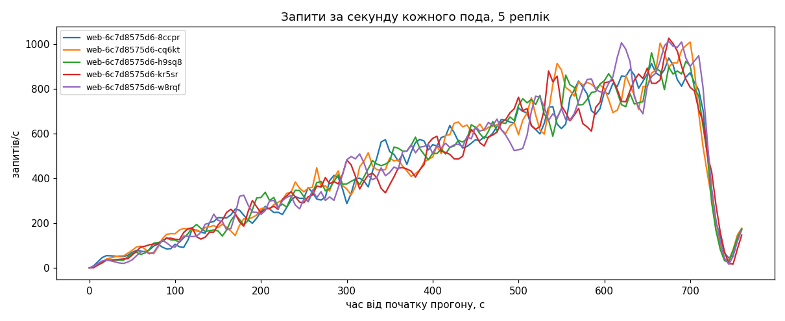
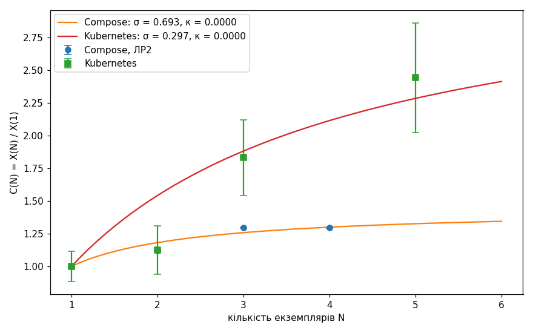
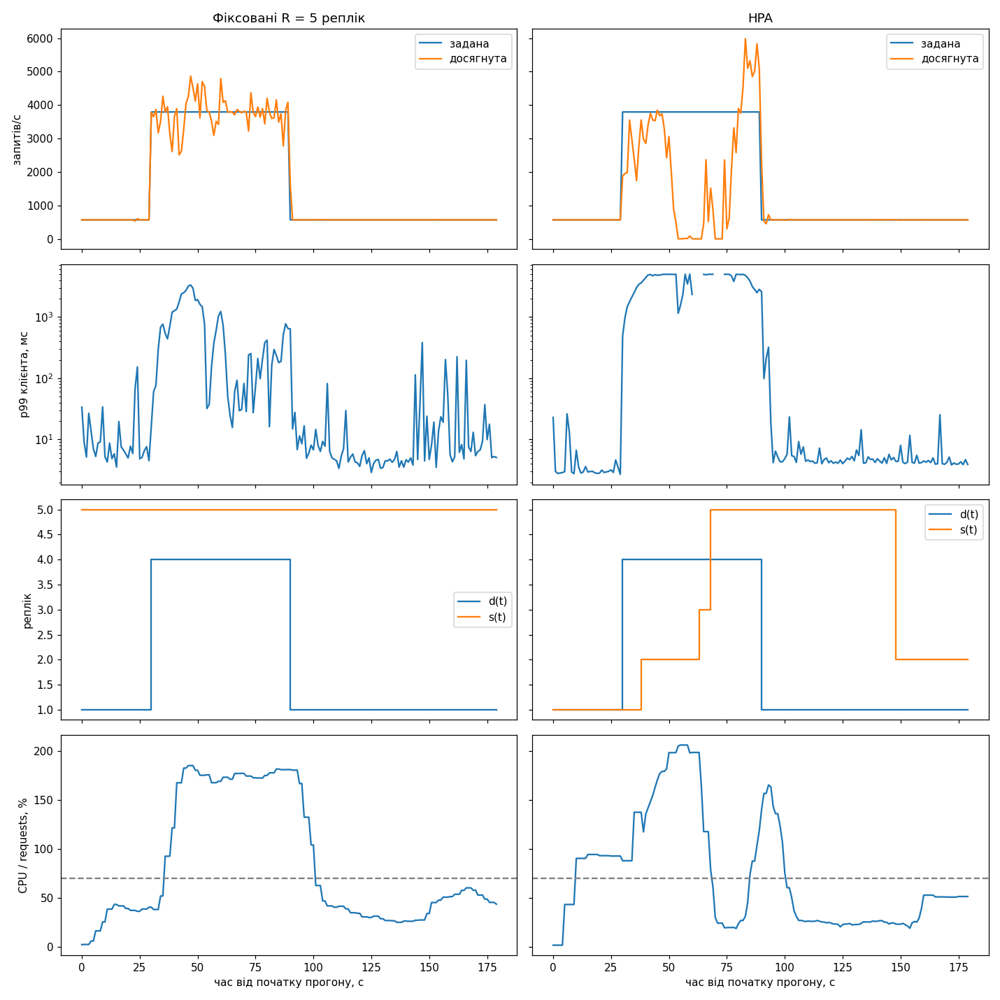

<div align="center">

Міністерство освіти і науки України<br>
Національний технічний університет України «Київський політехнічний інститут імені Ігоря Сікорського»

Факультет біомедичної інженерії<br>
Кафедра біомедичної кібернетики

# Звіт

**про виконання лабораторної роботи №3<br>
з дисципліни «Високопродуктивні розподілені обчислювальні системи»**

Тема роботи: «Сервіс у Kubernetes з автомасштабуванням і без нього»<br>
Варіант № 8

</div>

**Виконав:** студент гр. ЗК-61мп Євтушенко Єгор<br>
**Прийняв:** Матвійчук О. В.

<div align="center">

Київ<br>
КПІ ім. Ігоря Сікорського<br>
2026

</div>

---

## Мета роботи

Перенести сервіс із лабораторної роботи 2 разом із базою PostgreSQL і моніторингом у локальний кластер Kubernetes. Виміряти пропускну здатність ступінчастим навантаженням на фіксованій кількості реплік, визначити коефіцієнт дисбалансу навантаження і параметри універсального закону масштабованості в кластері. Порівняти за метриками еластичності роботу сервісу під змінним навантаженням у двох режимах: з фіксованою кількістю реплік і з HorizontalPodAutoscaler.

## Варіант

Номер варіанта збігається з номером у лабораторній роботі 1. Розмір пулу береться з варіанта лабораторної роботи 2 (10). R = 3 + (8 mod 3) = 5.

| № | R | Кластер | requests / limits CPU | Цільове використання CPU | Рівень стрибка | Додаткова вимога |
|---|---|---|---|---|---|---|
| 8 | 5 | k3d | 250m / 500m | 70 % | 2 · X(1) | Д1 |

| Вимога | Що зробити | Чим підтвердити |
|---|---|---|
| Д1 | розподілити поди web рівномірно по двох робочих вузлах через topologySpreadConstraints | розподіл подів між вузлами для кожного N серії і кількість запитів за секунду на кожен вузол |

## Середовище

Кластер, генератор навантаження і Prometheus працюють на одному ноутбуці: Apple M3 Pro (5 продуктивних і 6 енергоефективних ядер), 18 ГБ памʼяті, macOS 27.0.1. Docker Desktop 29.9.3 виділяє віртуальній машині 11 CPU і 8 319 303 680 байт памʼяті. k3d 5.9.0 з k3s v1.36.4+k3s1, kubectl 1.36.1, Helm 4.3.2 (`results/versions.txt`). Генератор працює на Python 3.13 на тій самій машині і конкурує з вузлами кластера за ядра процесора. Образ сервісу той самий, що в лабораторній роботі 2 (`app/main.py` і `Dockerfile` не змінювались), лише з тегом `donations-api:3.0`.

## Крок 1. Конфігурація кластера

Кластер k3d з одного вузла server і двох вузлів agent. На вузлі server заборонено розміщення робочих подів taint-ом, вбудований Traefik вимкнено, бо Ingress варіанту не потрібен. NodePort 30080 сервісу web перенаправлено на `localhost:8080`, NodePort 30090 Prometheus на `localhost:9090`:

```bash
k3d cluster create lab3 --servers 1 --agents 2 \
  --k3s-arg "--node-taint=node-role.kubernetes.io/control-plane=true:NoSchedule@server:0" \
  --k3s-arg "--disable=traefik@server:0" \
  -p "8080:30080@server:0" -p "9090:30090@server:0" --wait
```

`results/nodes.txt`:

```
NAME                STATUS   ROLES           AGE     VERSION        INTERNAL-IP   OS-IMAGE           KERNEL-VERSION            CONTAINER-RUNTIME
k3d-lab3-agent-0    Ready    <none>          2m53s   v1.36.4+k3s1   172.18.0.4    K3s v1.36.4+k3s1   7.0.14-linuxkit (arm64)   containerd://2.3.4-k3s1.36
k3d-lab3-agent-1    Ready    <none>          2m53s   v1.36.4+k3s1   172.18.0.5    K3s v1.36.4+k3s1   7.0.14-linuxkit (arm64)   containerd://2.3.4-k3s1.36
k3d-lab3-server-0   Ready    control-plane   2m57s   v1.36.4+k3s1   172.18.0.3    K3s v1.36.4+k3s1   7.0.14-linuxkit (arm64)   containerd://2.3.4-k3s1.36
```

## Крок 2. Команди розгортання і видалення

`scripts/deploy.sh` (додаток А) створює кластер, ставить мітку `role=infra` на вузол server командою `kubectl label node k3d-lab3-server-0 role=infra`, збирає образ `donations-api:3.0`, завантажує його в кластер командою `k3d image import`, створює Secret з `.env`, застосовує маніфести бази, міграції і web, після чого ставить моніторинг Helm-чартами. Повне видалення кластера: `scripts/destroy.sh`, тобто `k3d cluster delete lab3`. Повний прогін роботи з нуля виконує `scripts/run_all.sh`: видалення, розгортання, перевірки кроків 3–5 і вся серія вимірювань; вивід розгортання збережено в `results/deploy.log`.

## Крок 3. PostgreSQL

`k8s/postgres.yaml` (додаток Б):

- headless Service `db` (`clusterIP: None`) і StatefulSet `db` з одним подом `db-0` і `volumeClaimTemplates` на 1 Gi;
- под бази розміщується на вузлі server: `nodeSelector: role: infra` і toleration до taint `node-role.kubernetes.io/control-plane`;
- `postgres:16` запускається з `-c max_connections=100`;
- імʼя бази, користувач і пароль беруться з Secret `db-secret`, який `deploy.sh` створює з `.env` командою `kubectl create secret generic db-secret --from-env-file=.env`; файл `.env` є в `.gitignore`, у репозиторії лежить лише `.env.example` без пароля.

Схема бази застосовується Job `migrate` (`k8s/migrate.yaml`): ConfigMap `db-schema` містить `init.sql` з лабораторної роботи 1, контейнер `postgres:16` чекає на `pg_isready` і виконує `psql -f /sql/init.sql`. `deploy.sh` чекає на `condition=complete` цього Job і лише потім розгортає web.

Перевірка збереження даних (`scripts/check_db_persistence.sh`, `results/check_db_persistence.txt`): у базі 100 записів, занесених генератором, под бази видаляється, StatefulSet створює новий под з тим самим томом:

```
$ curl http://localhost:8080/donations?limit=1
{"items":[{"id":1,"donor_code":"D-0001","blood_group":"A","rh_factor":"+","volume_ml":300,"donation_date":"2026-02-16","is_suitable":true}],"total":100,"limit":1,"offset":0}
$ kubectl delete pod db-0
pod "db-0" deleted from default namespace
$ kubectl get pod db-0
NAME   READY   STATUS    RESTARTS   AGE
db-0   1/1     Running   0          4s
$ curl http://localhost:8080/donations?limit=1
{"items":[{"id":1,"donor_code":"D-0001","blood_group":"A","rh_factor":"+","volume_ml":300,"donation_date":"2026-02-16","is_suitable":true}],"total":100,"limit":1,"offset":0}
```

Після перестворення пода `total` лишився 100, перший запис той самий.

## Крок 4. Сервіс web

`k8s/web.yaml` (додаток Б):

- Deployment `web` без поля `replicas`, тому кількість реплік змінюють лише `kubectl scale` і HPA;
- Service `web` типу NodePort з `nodePort: 30080`;
- ConfigMap `web-config` з `PGHOST: db`, `PGPORT: "5432"` і `DB_POOL_SIZE: "10"`;
- `PGDATABASE`, `PGUSER` і `PGPASSWORD` через `secretKeyRef` на `db-secret`, `POD_NAME` через Downward API (`fieldRef.fieldPath: metadata.name`);
- `requests.cpu: 250m`, `limits.cpu: 500m`, `limits.memory: 512Mi`;
- `readinessProbe` на `/healthz` з `timeoutSeconds: 3`, `periodSeconds: 5`, `failureThreshold: 3`, `livenessProbe` на `/livez`;
- `lifecycle.preStop.sleep.seconds: 5` і `terminationGracePeriodSeconds: 15`;
- `topologySpreadConstraints` вимоги Д1 (крок 13).

Пароль не міститься в образі (Dockerfile копіює лише `app/` і залежності), у ConfigMap і в репозиторії.

Повний цикл через `localhost:8080` (`scripts/check_crud.sh`, `results/check_crud.txt`), заголовок `x-pod` показує под, що обробив запит:

```
$ curl -X POST http://localhost:8080/donations -H Content-Type: application/json -d {"donor_code":"D-9001","blood_group":"B","rh_factor":"+","volume_ml":450,"donation_date":"2026-11-20","is_suitable":true}
HTTP/1.1 201 Created
x-pod: web-6c7d8575d6-kr5sr
{"id":101,"donor_code":"D-9001","blood_group":"B","rh_factor":"+","volume_ml":450,"donation_date":"2026-11-20","is_suitable":true}

$ curl http://localhost:8080/donations/101
HTTP/1.1 200 OK
x-pod: web-6c7d8575d6-kr5sr
{"id":101,"donor_code":"D-9001","blood_group":"B","rh_factor":"+","volume_ml":450,"donation_date":"2026-11-20","is_suitable":true}

$ curl -X PUT http://localhost:8080/donations/101 -H Content-Type: application/json -d {"donor_code":"D-9001","blood_group":"B","rh_factor":"-","volume_ml":400,"donation_date":"2026-11-20","is_suitable":false}
HTTP/1.1 200 OK
x-pod: web-6c7d8575d6-kr5sr
{"id":101,"donor_code":"D-9001","blood_group":"B","rh_factor":"-","volume_ml":400,"donation_date":"2026-11-20","is_suitable":false}

$ curl -X DELETE http://localhost:8080/donations/101
HTTP/1.1 204 No Content
x-pod: web-6c7d8575d6-kr5sr

$ curl http://localhost:8080/donations/101
HTTP/1.1 404 Not Found
x-pod: web-6c7d8575d6-kr5sr
{"error":"donation not found"}
```

На момент перевірки працювала одна репліка, тому всі запити обробив под `web-6c7d8575d6-kr5sr`.

## Крок 5. Моніторинг

Моніторинг ставиться в `deploy.sh` двома Helm-чартами, усі його поди розміщено на вузлі server (`nodeSelector: role: infra` і toleration):

- `kube-prometheus-stack` 93.10.1 (`k8s/monitoring/kube-prometheus-stack.yaml`): Prometheus з `scrapeInterval: 5s` і NodePort 30090, збір cAdvisor через kubelet, kube-state-metrics; Grafana, Alertmanager і node-exporter вимкнено. Поди web Prometheus знаходить через `kubernetes_sd_configs` з `role: pod` (задача `web` у `additionalScrapeConfigs`), мітки `pod` і `node` беруться з метаданих пода;
- `prometheus-postgres-exporter` 8.3.0 (`k8s/monitoring/postgres-exporter.yaml`) з паролем з того самого Secret і ServiceMonitor з інтервалом 5 с.

metrics-server у k3d входить до складу кластера. Перевірка (`scripts/check_prometheus.sh`, `results/check_prometheus.txt`, знято після серії, коли HPA лишив дві репліки):

```
$ query: sum by (pod) (rate(http_requests_total[1m]))
  {'pod': 'web-6c7d8575d6-kr5sr'} 0.5091001654575538
  {'pod': 'web-6c7d8575d6-z8lg4'} 0.509090909090909
$ query: container_cpu_cfs_periods_total{container="web"}
  {'__name__': 'container_cpu_cfs_periods_total', 'container': 'web', 'job': 'kubelet', 'node': 'k3d-lab3-agent-1', 'pod': 'web-6c7d8575d6-kr5sr'} 26542
  {'__name__': 'container_cpu_cfs_periods_total', 'container': 'web', 'job': 'kubelet', 'node': 'k3d-lab3-agent-1', 'pod': 'web-6c7d8575d6-z8lg4'} 1444
$ query: container_cpu_cfs_throttled_periods_total{container="web"}
  {'__name__': 'container_cpu_cfs_throttled_periods_total', 'container': 'web', 'job': 'kubelet', 'node': 'k3d-lab3-agent-1', 'pod': 'web-6c7d8575d6-kr5sr'} 6928
  {'__name__': 'container_cpu_cfs_throttled_periods_total', 'container': 'web', 'job': 'kubelet', 'node': 'k3d-lab3-agent-1', 'pod': 'web-6c7d8575d6-z8lg4'} 83
$ query: kube_deployment_status_replicas_ready{deployment="web"}
  {'__name__': 'kube_deployment_status_replicas_ready', 'container': 'kube-state-metrics', 'deployment': 'web', 'job': 'kube-state-metrics', 'pod': 'monitoring-kube-state-metrics-55dfb59c5c-46gzm'} 2
$ query: pg_up
  {'__name__': 'pg_up', 'container': 'prometheus-postgres-exporter', 'job': 'pg-exporter-prometheus-postgres-exporter', 'pod': 'pg-exporter-prometheus-postgres-exporter-87ff759b8-d5bwm'} 1
$ kubectl top pods
NAME                                                       CPU(cores)   MEMORY(bytes)
db-0                                                       13m          58Mi
monitoring-kube-prometheus-operator-5fd9c8fc89-s9vsd       8m           31Mi
monitoring-kube-state-metrics-55dfb59c5c-46gzm             1m           27Mi
pg-exporter-prometheus-postgres-exporter-87ff759b8-d5bwm   6m           10Mi
prometheus-monitoring-kube-prometheus-prometheus-0         38m          379Mi
web-6c7d8575d6-kr5sr                                       4m           65Mi
web-6c7d8575d6-z8lg4                                       4m           43Mi
```

Ряди запитів є для кожного пода web, лічильники CFS для контейнера web і `kube_deployment_status_replicas_ready` є, `kubectl top pods` повертає дані.

## Крок 6. Модель зʼєднань генератора

Генератор з лабораторної роботи 2 (додаток В) доповнено моделлю зʼєднань: 8 процесів тримають разом 8 · R = 40 постійних keep-alive зʼєднань (по 5 на процес), кожне зʼєднання закривається після 100 запитів і замість нього відкривається нове. Ця модель діє в усіх прогонах. Сходинка ступінчастого профілю триває 30 с, середні значення сходинки рахуються за останні 20 с. Профіль: 10 с прогріву на 200 запитів/с, далі сходинки 200, 400, 600, … запитів/с; прогін зупиняється після двох сходинок поспіль, на яких досягнуто менше 0,9 заданої інтенсивності. Затримка рахується від запланованого моменту надсилання, таймаут запиту 5 с; запит без відповіді за 5 с рахується як відповідь не 2xx. Запити рівномірно розподілені між `GET /donations/{id}` для 100 занесених записів.

Кількість одночасних запитів генератора обмежена 40 зʼєднаннями: коли всі зʼєднання зайняті, запит чекає на вільне, і цей час входить у затримку клієнта. Тому p99 клієнта на сходинках насичення досягає секунд, хоча сервер обробляє запит за десятки мілісекунд.

## Крок 7. Серія без автомасштабування

Для N = 1, 2, 3 і 5 виконано по одному ступінчастому прогону (`scripts/run_series.sh`): `kubectl scale deployment/web --replicas=N`, очікування N готових подів і ще 15 с, далі прогін. X(N) береться як найбільша досягнута інтенсивність серед сходинок, розкид як стандартне відхилення посекундних значень за останні 20 с цієї сходинки. p99 сервера обчислено з гістограми `http_request_duration_seconds` за останні 20 с сходинки (`sum by (le) (increase(...[20s]))` з лінійною інтерполяцією всередині бакета). Частку дроселювання CPU обчислено за лічильниками cAdvisor `container_cpu_cfs_throttled_periods_total / container_cpu_cfs_periods_total` для контейнера web. cAdvisor оновлює ці лічильники приблизно раз на 15 с, тому у 20-секундне вікно часто потрапляє одне значення; приріст рахується за всю 30-секундну сходинку.

Жодна точка не є недосягнутою: на останній сходинці кожного прогону досягнута інтенсивність нижча за 0,9 заданої (`last_step_achieved_ratio` у `results/step_nN_steps.json`).

| N | X(N), запитів/с | Розкид, запитів/с | Сходинка, задано | p99 клієнта, мс | p99 сервера, мс | Дроселювання, середнє за подами | Дроселювання, найбільше |
|---|---|---|---|---|---|---|---|
| 1 | 1896,4 | 216,9 | 2000 | 4038,5 | 97,7 | 1,00 | 1,00 |
| 2 | 2132,6 | 347,4 | 2200 | 755,4 | 92,4 | 0,70 | 0,77 |
| 3 | 3474,3 | 550,1 | 3400 | 1492,3 | 86,7 | 0,82 | 0,94 |
| 5 | 4632,7 | 794,3 | 4400 | 3529,2 | 72,5 | 0,81 | 0,90 |

p99 сервера в усіх рядах лежить у бакеті 50–100 мс набору Г2, тому його точність обмежена шириною цього бакета. На сходинці X(N) кожен под дроселюється в 62–100 % періодів CFS: под з лімітом 500m вичерпує квоту 50 мс процесорного часу за період 100 мс.

## Крок 8. Коефіцієнт дисбалансу

I = X_max / X_avg на сходинці, де досягнуто X(N); запити за секунду кожного пода взято з `rate(http_requests_total[20s])`:

| N | X_max, запитів/с | X_avg, запитів/с | I | Под з X_max: p99 сервера, мс / дроселювання | Под з найменшим X: запитів/с, p99 сервера, мс / дроселювання |
|---|---|---|---|---|---|
| 2 | 1255,6 | 1089,5 | 1,152 | 94,2 / 0,77 | 923,3; 83,9 / 0,62 |
| 3 | 1275,7 | 1214,8 | 1,050 | 94,4 / 0,78 | 1095,9; 86,1 / 0,74 |
| 5 | 991,8 | 915,0 | 1,084 | 48,4 / 0,88 | 795,7; 42,7 / 0,90 |

Дисбаланс невеликий, найбільший на двох репліках. Під генератора лише 40 зʼєднань, а kube-proxy обирає под під час встановлення зʼєднання, тому кількість зʼєднань на подах у кожен момент нерівна. Перевідкриття зʼєднання після 100 запитів поступово вирівнює розподіл.

Кількість запитів за секунду кожного пода за R = 5 реплік (`results/charts/pods_rps_n5.png`):



## Крок 9. Універсальний закон масштабованості

C(N) = X(N) / X(1): C(2) = 1,125; C(3) = 1,832; C(5) = 2,443. Підбір за лінеаризованою формою N / C(N) − 1 = σ(N − 1) + κN(N − 1) методом найменших квадратів без вільного члена (формули з лабораторної роботи 2) дав σ = 0,673 і κ = −0,084. Оцінка κ відʼємна, тому за правилом з лабораторної роботи 2 κ = 0, а σ перераховано за однією змінною: σ = Σuy / Σu² = 6,2407 / 21 = 0,297. За κ = 0 максимуму немає, N* не існує, а пропускна здатність прямує до X(1) / σ ≈ 6380 запитів/с.

| Стенд | σ | κ | N* |
|---|---|---|---|
| Docker Compose, ЛР2 | 0,693 | 0 | немає |
| Kubernetes, k3d | 0,297 | 0 | немає |



У кластері X(1) удвічі менший, ніж у Compose (1896 проти 3400 запитів/с), бо под обмежений 0,5 CPU замість 1 CPU, і саме через низький X(1) відносна пропускна здатність у кластері росте швидше. Обидва стенди ділять той самий процесор ноутбука з генератором, тому закон дає σ > 0 і максимуму немає.

## Крок 10. Прогін з профілем на фіксованих R репліках

До генератора додано режим `segments --profile "тривалість:інтенсивність,..."`. Рівень стрибка дорівнює меншому з 2 · X(1) = 3792,8 і 0,9 · X(5) = 4169,4, тобто 3793 запити/с; 0,3 · X(1) = 569 запитів/с. Профіль `30:569,60:3793,90:569` (`results/elastic_profile.txt`). Прогін на фіксованих 5 репліках (`results/fixed_steps.json`):

| Відрізок | Задано, запитів/с | p50 клієнта, мс | p99 клієнта, мс | 2xx | не 2xx | Помилки зʼєднання |
|---|---|---|---|---|---|---|
| 0–30 с | 569 | 2,63 | 16,55 | 17 069 | 0 | 0 |
| 30–90 с | 3793 | 20,79 | 2315,08 | 226 540 | 0 | 0 |
| 90–180 с | 569 | 2,51 | 329,12 | 52 249 | 0 | 0 |

## Крок 11. Прогін з HPA

`k8s/hpa.yaml`: `autoscaling/v2`, ціль `Deployment/web`, використання CPU 70 %, `minReplicas: 1`, `maxReplicas: 5`, `behavior.scaleDown.stabilizationWindowSeconds: 30`. Перед прогоном Deployment масштабовано до однієї репліки, а скрипт чекав, поки `kubectl get hpa` показує одну репліку 60 с поспіль (`results/hpa_before.txt`):

```
NAME   REFERENCE        TARGETS       MINPODS   MAXPODS   REPLICAS   AGE
web    Deployment/web   cpu: 1%/70%   1         5         1          2m3s
```

Після прогону (`results/hpa_after.txt`):

```
NAME   REFERENCE        TARGETS        MINPODS   MAXPODS   REPLICAS   AGE
web    Deployment/web   cpu: 52%/70%   1         5         2          5m5s
```

Прогін з тим самим профілем (`results/hpa_steps.json`):

| Відрізок | Задано, запитів/с | p50 клієнта, мс | p99 клієнта, мс | 2xx | не 2xx | Помилки зʼєднання |
|---|---|---|---|---|---|---|
| 0–30 с | 569 | 2,27 | 3,36 | 17 069 | 0 | 0 |
| 30–90 с | 3793 | 3221,6 | 4980,77 | 132 811 | 91 285 | 1783 |
| 90–180 с | 569 | 2,9 | 1765,46 | 52 904 | 0 | 7 |

Бажану кількість реплік взято з ряду `kube_horizontalpodautoscaler_status_desired_replicas`. Вона змінилась з 1 на 2 вже на 28-й секунді прогону, ще до стрибка: 569 запитів/с одна репліка обробляє приблизно з 90 % CPU від requests, а це більше за ціль 70 %. Тому першою зміною після початку стрибка є перехід з 2 на 5.

| Подія | Час |
|---|---|
| від початку стрибка до першої зміни бажаної кількості реплік (2 → 5) | 28 с |
| від початку стрибка до готовності найбільшої за прогін кількості реплік (5) | 38 с |
| від початку стрибка до моменту, після якого p99 клієнта 10 с поспіль нижчий за 1,2 · 2315,08 = 2778,1 мс | не досягнуто |
| від кінця стрибка до першого зменшення кількості готових реплік (5 → 2) | 58 с |

Відповіді не 2xx у цьому прогоні є таймаутами генератора (5 с без відповіді): сервіс не повертав кодів помилок. Поки одна-дві репліки дроселювались на ліміті 500m, усі 40 зʼєднань генератора чекали на відповідь, і з 55-ї по 75-ту секунду досягнута інтенсивність падала майже до нуля. Поди, додані HPA, отримували запити лише через нові зʼєднання, тобто після закриття старих.

## Крок 12. Метрики еластичності

d(t) = min{N ≤ 5 : X(N) ≥ z(t)} за X(N) з кроку 7; X(4) = 4010,3 запити/с узято з кривої закону з σ = 0,297, κ = 0. На рівні 569 запитів/с d(t) = 1, на рівні стрибка 3793 запити/с d(t) = 4 (X(3) = 3474,3 < 3793 ≤ X(4)). s(t) = `kube_deployment_status_replicas_ready`. Поріг порушення 2 · p99₀ = 2 · 16,55 = 33,1 мс, де p99₀ є p99 першого відрізка прогону кроку 10. T = 180 с.

| Метрика | Фіксовані 5 реплік | HPA |
|---|---|---|
| θ_U | 0,000 | 0,211 |
| θ_O | 1,000 | 0,622 |
| a_U | 0,000 | 0,439 |
| a_O | 3,000 | 1,589 |
| W, репліко-секунд | 900 | 567 |
| Секунд порушення порогу | 65 | 56 |
| Відповідей не 2xx | 0 | 91 285 |
| Помилок зʼєднання | 0 | 1790 |

Діаграми обох прогонів з однаковими шкалами (`results/charts/elastic.png`): задана і досягнута інтенсивність, p99 клієнта, d(t) і s(t), використання CPU відносно `requests.cpu`. Використання CPU обчислено як середнє за подами `rate(process_cpu_seconds_total[15s]) / 0,25`: сервіс працює одним процесом, і цей лічильник надходить кожні 5 с, тоді як лічильник cAdvisor оновлюється раз на 15 с.



Фіксовані 5 реплік весь час мають надлишок (θ_O = 1, у середньому 3 зайві репліки) і витрачають 900 репліко-секунд, але не дають жодної відповіді не 2xx. HPA витрачає на 37 % менше репліко-секунд (567), проте 21 % часу реплік бракує, і на стрибку втрачено 91 285 запитів за таймаутом. Порушень порогу p99 майже однаково, бо і на 5 репліках під час стрибка процесор ноутбука повністю зайнятий.

## Крок 13. Додаткова вимога Д1

До Deployment web додано:

```yaml
topologySpreadConstraints:
  - maxSkew: 1
    topologyKey: kubernetes.io/hostname
    whenUnsatisfiable: DoNotSchedule
    nodeTaintsPolicy: Honor
    labelSelector:
      matchLabels:
        app: web
```

`nodeTaintsPolicy: Honor` потрібен, щоб вузол server, на який поди web не допускаються через taint, не рахувався доменом з нулем подів. Інакше вже за N = 3 різниця між вузлом agent з двома подами і вузлом server без подів дорівнює 2 > maxSkew, і третій под лишається в стані Pending. З полем `Honor` враховуються лише два вузли agent.

Розподіл подів між вузлами для кожного N (`results/pods_nN.txt`) і запити за секунду на кожен вузол на сходинці X(N) (сума `rate(http_requests_total[20s])` подів вузла):

| N | Подів на agent-0 | Подів на agent-1 | Запитів/с на agent-0 | Запитів/с на agent-1 |
|---|---|---|---|---|
| 1 | 0 | 1 | 0 | 1871,4 |
| 2 | 1 | 1 | 923,3 | 1255,6 |
| 3 | 2 | 1 | 2548,5 | 1095,9 |
| 5 | 3 | 2 | 2835,6 | 1739,3 |

Різниця кількості подів між вузлами ніколи не перевищує 1. Запити розподіляються за подами, а не за вузлами, тому вузол з більшою кількістю подів отримує пропорційно більше запитів.

## Висновки

У цій лабораторній роботі ми перенесли сервіс донацій крові разом з PostgreSQL і моніторингом у кластер k3d з одним вузлом server і двома agent. База працює як StatefulSet на вузлі server і зберігає дані після видалення пода, схему створює Job міграції, пароль передається лише через Secret. Сервіс розгортається як Deployment без поля replicas з requests/limits 250m/500m, перевірками готовності й життя і паузою preStop, а Prometheus збирає метрики подів web, cAdvisor, kube-state-metrics і postgres-exporter.

Одна репліка витримала 1896 запитів/с, дві 2133, три 3474, пʼять 4633. За законом масштабованості вийшло σ = 0,30 і κ = 0, тобто максимуму немає. Під навантаженням кожен под дроселюється в 62–100 % періодів CFS, а всі поди і генератор ділять процесор ноутбука. Коефіцієнт дисбалансу від 1,05 до 1,15, бо 40 зʼєднань генератора розходяться між подами нерівно.

На стрибку до 3793 запитів/с фіксовані 5 реплік витратили 900 репліко-секунд без жодної втраченої відповіді, а HPA 567 репліко-секунд, але через нестачу реплік на початку стрибка 91 285 запитів завершились таймаутом. HPA перейшов з 2 на 5 реплік через 28 с після початку стрибка, 5 реплік стали готові через 38 с, а p99 так і не повернувся до рівня фіксованого прогону до кінця стрибка. За вимогою Д1 поди завжди розподілені між двома робочими вузлами з різницею не більше одного пода.

## ДОДАТОК А. Скрипти

### `scripts/deploy.sh`

```bash
#!/usr/bin/env bash
set -euo pipefail
cd "$(dirname "$0")/.."
CLUSTER=lab3

k3d cluster create "$CLUSTER" --servers 1 --agents 2 \
  --k3s-arg "--node-taint=node-role.kubernetes.io/control-plane=true:NoSchedule@server:0" \
  --k3s-arg "--disable=traefik@server:0" \
  -p "8080:30080@server:0" -p "9090:30090@server:0" --wait
kubectl label node "k3d-$CLUSTER-server-0" role=infra --overwrite

docker build -t donations-api:3.0 .
k3d image import donations-api:3.0 -c "$CLUSTER"

kubectl create secret generic db-secret --from-env-file=.env --dry-run=client -o yaml | kubectl apply -f -
kubectl apply -f k8s/postgres.yaml
kubectl rollout status statefulset/db --timeout=180s
kubectl apply -f k8s/migrate.yaml
kubectl wait --for=condition=complete job/migrate --timeout=180s
kubectl apply -f k8s/web.yaml
kubectl rollout status deployment/web --timeout=180s

helm upgrade --install monitoring prometheus-community/kube-prometheus-stack --version 93.10.1 \
  -f k8s/monitoring/kube-prometheus-stack.yaml --wait --timeout 10m
helm upgrade --install pg-exporter prometheus-community/prometheus-postgres-exporter --version 8.3.0 \
  -f k8s/monitoring/postgres-exporter.yaml --wait --timeout 5m
```

### `scripts/destroy.sh`

```bash
#!/usr/bin/env bash
set -euo pipefail
k3d cluster delete lab3
```

### `scripts/run_all.sh`

```bash
#!/usr/bin/env bash
set -euo pipefail
cd "$(dirname "$0")/.."
scripts/destroy.sh >/dev/null 2>&1 || true
scripts/deploy.sh > results/deploy.log 2>&1
kubectl get nodes -o wide > results/nodes.txt
kubectl get pods -o wide > results/pods_after_deploy.txt
python3 loadgen/loadgen.py seed --ids results/ids.json
scripts/check_crud.sh > results/check_crud.txt 2>&1
scripts/check_db_persistence.sh > results/check_db_persistence.txt 2>&1
scripts/check_prometheus.sh > results/check_prometheus.txt 2>&1
kubectl top pods > results/kubectl_top.txt
scripts/run_series.sh > results/series.log 2>&1
```

### `scripts/run_series.sh`

```bash
#!/usr/bin/env bash
set -euo pipefail
cd "$(dirname "$0")/.."
LG="python3 loadgen/loadgen.py"
R=5

wait_ready() {
  kubectl rollout status deployment/web --timeout=300s >/dev/null
  until [ "$(kubectl get deployment web -o jsonpath='{.status.readyReplicas}')" = "$1" ]; do sleep 2; done
  sleep 15
}

for n in 1 2 3 $R; do
  kubectl scale deployment/web --replicas=$n
  wait_ready $n
  kubectl get pods -l app=web -o wide --no-headers | awk '{print $1, $7}' > results/pods_n$n.txt
  $LG step --instances $n --out results/step_n$n
done

python3 - <<'EOF' > results/elastic_profile.txt
import json
x1 = json.load(open("results/step_n1_steps.json"))["X"]
xr = json.load(open("results/step_n5_steps.json"))["X"]
spike = min(2 * x1, 0.9 * xr)
print(f"30:{0.3 * x1:.0f},60:{spike:.0f},90:{0.3 * x1:.0f}")
EOF
PROFILE=$(cat results/elastic_profile.txt)

kubectl scale deployment/web --replicas=$R
wait_ready $R
$LG segments --instances $R --profile "$PROFILE" --out results/fixed

kubectl apply -f k8s/hpa.yaml
ones=0
while [ $ones -lt 60 ]; do
  cur=$(kubectl get hpa web -o jsonpath='{.status.currentReplicas}')
  ready=$(kubectl get deployment web -o jsonpath='{.status.readyReplicas}')
  if [ "$cur" = "1" ] && [ "$ready" = "1" ]; then ones=$((ones + 5)); else ones=0; fi
  sleep 5
done
kubectl get hpa web > results/hpa_before.txt
$LG segments --instances 1 --profile "$PROFILE" --out results/hpa
kubectl get hpa web > results/hpa_after.txt
kubectl delete -f k8s/hpa.yaml
```

### `scripts/check_crud.sh`

```bash
#!/usr/bin/env bash
set -uo pipefail
B=http://localhost:8080
J='Content-Type: application/json'

step() {
  echo
  echo "\$ $*"
  "$@" -s -D - | grep -iE '^(HTTP/|x-pod:)|^\{' | tr -d '\r'
  echo
}

step curl -X POST $B/donations -H "$J" -d '{"donor_code":"D-9001","blood_group":"B","rh_factor":"+","volume_ml":450,"donation_date":"2026-11-20","is_suitable":true}'
ID=$(curl -s "$B/donations?limit=1&offset=100" | python3 -c "import json,sys; print(json.load(sys.stdin)['items'][0]['id'])")
step curl "$B/donations?blood_group=B&limit=2&offset=0"
step curl $B/donations/$ID
step curl -X PUT $B/donations/$ID -H "$J" -d '{"donor_code":"D-9001","blood_group":"B","rh_factor":"-","volume_ml":400,"donation_date":"2026-11-20","is_suitable":false}'
step curl $B/donations/$ID
step curl -X DELETE $B/donations/$ID
step curl -X DELETE $B/donations/$ID
step curl $B/donations/$ID
```

### `scripts/check_db_persistence.sh`

```bash
#!/usr/bin/env bash
set -euo pipefail
B=http://localhost:8080
echo "\$ curl $B/donations?limit=1"
curl -s "$B/donations?limit=1"; echo
old=$(kubectl get pod db-0 -o jsonpath='{.metadata.uid}')
echo "\$ kubectl delete pod db-0"
kubectl delete pod db-0
until [ "$(kubectl get pod db-0 -o jsonpath='{.metadata.uid}' 2>/dev/null)" != "$old" ] && \
      [ "$(kubectl get pod db-0 -o jsonpath='{.status.conditions[?(@.type=="Ready")].status}' 2>/dev/null)" = "True" ]; do
  sleep 1
done
kubectl rollout status deployment/web --timeout=120s >/dev/null
until [ "$(curl -s -o /dev/null -w '%{http_code}' $B/healthz)" = 200 ]; do sleep 1; done
echo "\$ kubectl get pod db-0"
kubectl get pod db-0
echo "\$ curl $B/donations?limit=1"
curl -s "$B/donations?limit=1"; echo
```

### `scripts/check_prometheus.sh`

```bash
#!/usr/bin/env bash
set -euo pipefail
q() {
  echo "\$ query: $1"
  curl -s http://localhost:9090/api/v1/query --data-urlencode "query=$1" | python3 -c '
import json, sys
for r in json.load(sys.stdin)["data"]["result"]:
    print(" ", {k: v for k, v in r["metric"].items() if k in ("__name__", "pod", "node", "container", "deployment", "job")}, r["value"][1])'
}
q 'sum by (pod) (rate(http_requests_total[1m]))'
q 'container_cpu_cfs_periods_total{container="web"}'
q 'container_cpu_cfs_throttled_periods_total{container="web"}'
q 'kube_deployment_status_replicas_ready{deployment="web"}'
q 'pg_up'
echo "\$ kubectl top pods"
kubectl top pods
```

## ДОДАТОК Б. Маніфести

### `k8s/postgres.yaml`

```yaml
apiVersion: v1
kind: Service
metadata:
  name: db
spec:
  clusterIP: None
  selector:
    app: db
  ports:
    - name: postgres
      port: 5432
---
apiVersion: apps/v1
kind: StatefulSet
metadata:
  name: db
spec:
  serviceName: db
  replicas: 1
  selector:
    matchLabels:
      app: db
  template:
    metadata:
      labels:
        app: db
    spec:
      nodeSelector:
        role: infra
      tolerations:
        - key: node-role.kubernetes.io/control-plane
          operator: Exists
          effect: NoSchedule
      containers:
        - name: postgres
          image: postgres:16
          args: ["-c", "max_connections=100"]
          env:
            - name: POSTGRES_DB
              valueFrom:
                secretKeyRef: {name: db-secret, key: POSTGRES_DB}
            - name: POSTGRES_USER
              valueFrom:
                secretKeyRef: {name: db-secret, key: POSTGRES_USER}
            - name: POSTGRES_PASSWORD
              valueFrom:
                secretKeyRef: {name: db-secret, key: POSTGRES_PASSWORD}
            - name: PGDATA
              value: /var/lib/postgresql/data/pgdata
          ports:
            - containerPort: 5432
          readinessProbe:
            exec:
              command: ["sh", "-c", "pg_isready -h 127.0.0.1 -U \"$POSTGRES_USER\" -d \"$POSTGRES_DB\""]
            periodSeconds: 5
          volumeMounts:
            - name: data
              mountPath: /var/lib/postgresql/data
  volumeClaimTemplates:
    - metadata:
        name: data
      spec:
        accessModes: ["ReadWriteOnce"]
        resources:
          requests:
            storage: 1Gi
```

### `k8s/migrate.yaml`

```yaml
apiVersion: v1
kind: ConfigMap
metadata:
  name: db-schema
data:
  init.sql: |
    CREATE TABLE IF NOT EXISTS donations (
        id            BIGINT GENERATED ALWAYS AS IDENTITY PRIMARY KEY,
        donor_code    VARCHAR(32) NOT NULL,
        blood_group   VARCHAR(2)  NOT NULL CHECK (blood_group IN ('O', 'A', 'B', 'AB')),
        rh_factor     CHAR(1)     NOT NULL CHECK (rh_factor IN ('+', '-')),
        volume_ml     SMALLINT    NOT NULL CHECK (volume_ml BETWEEN 200 AND 500),
        donation_date DATE        NOT NULL,
        is_suitable   BOOLEAN     NOT NULL
    );

    CREATE INDEX IF NOT EXISTS donations_blood_group_id_idx ON donations (blood_group, id);
---
apiVersion: batch/v1
kind: Job
metadata:
  name: migrate
spec:
  backoffLimit: 10
  template:
    spec:
      restartPolicy: OnFailure
      containers:
        - name: migrate
          image: postgres:16
          command: ["sh", "-c", "until pg_isready -h db; do sleep 1; done; psql -h db -v ON_ERROR_STOP=1 -f /sql/init.sql"]
          env:
            - name: PGDATABASE
              valueFrom:
                secretKeyRef: {name: db-secret, key: POSTGRES_DB}
            - name: PGUSER
              valueFrom:
                secretKeyRef: {name: db-secret, key: POSTGRES_USER}
            - name: PGPASSWORD
              valueFrom:
                secretKeyRef: {name: db-secret, key: POSTGRES_PASSWORD}
          volumeMounts:
            - name: sql
              mountPath: /sql
      volumes:
        - name: sql
          configMap:
            name: db-schema
```

### `k8s/web.yaml`

```yaml
apiVersion: v1
kind: ConfigMap
metadata:
  name: web-config
data:
  PGHOST: db
  PGPORT: "5432"
  DB_POOL_SIZE: "10"
---
apiVersion: apps/v1
kind: Deployment
metadata:
  name: web
spec:
  selector:
    matchLabels:
      app: web
  template:
    metadata:
      labels:
        app: web
    spec:
      terminationGracePeriodSeconds: 15
      topologySpreadConstraints:
        - maxSkew: 1
          topologyKey: kubernetes.io/hostname
          whenUnsatisfiable: DoNotSchedule
          nodeTaintsPolicy: Honor
          labelSelector:
            matchLabels:
              app: web
      containers:
        - name: web
          image: donations-api:3.0
          imagePullPolicy: Never
          ports:
            - containerPort: 8000
          envFrom:
            - configMapRef:
                name: web-config
          env:
            - name: PGDATABASE
              valueFrom:
                secretKeyRef: {name: db-secret, key: POSTGRES_DB}
            - name: PGUSER
              valueFrom:
                secretKeyRef: {name: db-secret, key: POSTGRES_USER}
            - name: PGPASSWORD
              valueFrom:
                secretKeyRef: {name: db-secret, key: POSTGRES_PASSWORD}
            - name: POD_NAME
              valueFrom:
                fieldRef:
                  fieldPath: metadata.name
          resources:
            requests:
              cpu: 250m
            limits:
              cpu: 500m
              memory: 512Mi
          readinessProbe:
            httpGet:
              path: /healthz
              port: 8000
            timeoutSeconds: 3
            periodSeconds: 5
            failureThreshold: 3
          livenessProbe:
            httpGet:
              path: /livez
              port: 8000
          lifecycle:
            preStop:
              sleep:
                seconds: 5
---
apiVersion: v1
kind: Service
metadata:
  name: web
spec:
  type: NodePort
  selector:
    app: web
  ports:
    - port: 8000
      targetPort: 8000
      nodePort: 30080
```

### `k8s/hpa.yaml`

```yaml
apiVersion: autoscaling/v2
kind: HorizontalPodAutoscaler
metadata:
  name: web
spec:
  scaleTargetRef:
    apiVersion: apps/v1
    kind: Deployment
    name: web
  minReplicas: 1
  maxReplicas: 5
  metrics:
    - type: Resource
      resource:
        name: cpu
        target:
          type: Utilization
          averageUtilization: 70
  behavior:
    scaleDown:
      stabilizationWindowSeconds: 30
```

### `k8s/monitoring/kube-prometheus-stack.yaml`

```yaml
grafana:
  enabled: false
alertmanager:
  enabled: false
nodeExporter:
  enabled: false
kubeEtcd:
  enabled: false
kubeControllerManager:
  enabled: false
kubeScheduler:
  enabled: false
kubeProxy:
  enabled: false
defaultRules:
  create: false

prometheusOperator:
  nodeSelector:
    role: infra
  tolerations:
    - key: node-role.kubernetes.io/control-plane
      operator: Exists
      effect: NoSchedule
  admissionWebhooks:
    patch:
      nodeSelector:
        role: infra
      tolerations:
        - key: node-role.kubernetes.io/control-plane
          operator: Exists
          effect: NoSchedule

kube-state-metrics:
  nodeSelector:
    role: infra
  tolerations:
    - key: node-role.kubernetes.io/control-plane
      operator: Exists
      effect: NoSchedule

prometheus:
  service:
    type: NodePort
    nodePort: 30090
  prometheusSpec:
    scrapeInterval: 5s
    evaluationInterval: 5s
    retention: 3d
    serviceMonitorSelectorNilUsesHelmValues: false
    podMonitorSelectorNilUsesHelmValues: false
    nodeSelector:
      role: infra
    tolerations:
      - key: node-role.kubernetes.io/control-plane
        operator: Exists
        effect: NoSchedule
    additionalScrapeConfigs:
      - job_name: web
        kubernetes_sd_configs:
          - role: pod
            namespaces:
              names: [default]
        relabel_configs:
          - source_labels: [__meta_kubernetes_pod_label_app]
            regex: web
            action: keep
          - source_labels: [__meta_kubernetes_pod_container_port_number]
            regex: "8000"
            action: keep
          - source_labels: [__meta_kubernetes_pod_name]
            target_label: pod
          - source_labels: [__meta_kubernetes_pod_node_name]
            target_label: node
```

### `k8s/monitoring/postgres-exporter.yaml`

```yaml
nodeSelector:
  role: infra
tolerations:
  - key: node-role.kubernetes.io/control-plane
    operator: Exists
    effect: NoSchedule
config:
  datasource:
    host: db
    port: "5432"
    database: donations
    sslmode: disable
    userSecret:
      name: db-secret
      key: POSTGRES_USER
    passwordSecret:
      name: db-secret
      key: POSTGRES_PASSWORD
serviceMonitor:
  enabled: true
  interval: 5s
```

## ДОДАТОК В. Генератор

### `loadgen/loadgen.py`

```python
import argparse
import asyncio
import csv
import http.client
import json
import math
import multiprocessing as mp
import os
import queue
import random
import statistics
import time
from urllib.parse import urlsplit

TIMEOUT = 5.0
FLUSH_INTERVAL = 0.5
STEP_TAIL = 20
REQUESTS_PER_CONNECTION = 100


def segments_of(profile):
    if profile["mode"] == "segments":
        begin = 0.0
        for duration, rate in profile["segments"]:
            yield begin, begin + duration, rate
            begin += duration
        return
    yield 0.0, profile["warmup"], profile["warmup_rate"]
    for k in range(1000):
        begin = profile["warmup"] + k * profile["step"]
        yield begin, begin + profile["step"], profile["start"] + k * profile["increment"]


def rate_at(profile, t):
    for begin, end, rate in segments_of(profile):
        if begin <= t < end:
            return rate
    return None


def schedule(profile, idx, procs):
    for begin, end, rate in segments_of(profile):
        n = round((end - begin) * rate)
        for j in range(idx, n, procs):
            yield begin + j / rate


def new_bucket():
    return {"sent": 0, "ok": 0, "non2xx": 0, "conn_err": 0, "lat": []}


async def exchange(conn, host, path):
    reader, writer = conn[0], conn[1]
    writer.write(f"GET {path} HTTP/1.1\r\nHost: {host}\r\n\r\n".encode())
    await writer.drain()
    head = await reader.readuntil(b"\r\n\r\n")
    lines = head.decode("latin-1").split("\r\n")
    status = int(lines[0].split(" ", 2)[1])
    length = 0
    for line in lines[1:]:
        name, _, value = line.partition(":")
        if name.strip().lower() == "content-length":
            length = int(value)
    if length:
        await reader.readexactly(length)
    return status


async def worker_main(idx, procs, url, paths, profile, connections, t0, stop, out):
    parts = urlsplit(url)
    host, port = parts.hostname, parts.port or 80
    seconds = {}
    free = asyncio.Queue()
    for _ in range(connections):
        free.put_nowait(None)
    rnd = random.Random(idx)
    tasks = set()

    def bucket(t):
        s = int(t - t0)
        b = seconds.get(s)
        if b is None:
            b = seconds[s] = new_bucket()
        return b

    async def request(path, held):
        slot = await free.get()
        held.append(slot)
        if slot is None or slot[2] >= REQUESTS_PER_CONNECTION:
            if slot is not None:
                slot[1].close()
            held[0] = None
            reader, writer = await asyncio.open_connection(host, port)
            slot = held[0] = (reader, writer, 0)
        bucket(time.time())["sent"] += 1
        try:
            status = await exchange(slot, host, path)
        except BaseException:
            slot[1].close()
            held[0] = None
            raise
        held[0] = (slot[0], slot[1], slot[2] + 1)
        return status

    async def one(sched):
        held = []
        try:
            status = await asyncio.wait_for(request(rnd.choice(paths), held), TIMEOUT)
        except asyncio.TimeoutError:
            bucket(time.time())["non2xx"] += 1
            return
        except (OSError, asyncio.IncompleteReadError, ValueError, IndexError):
            bucket(time.time())["conn_err"] += 1
            return
        finally:
            if held:
                free.put_nowait(held[0])
        end = time.time()
        b = bucket(end)
        b["ok" if 200 <= status < 300 else "non2xx"] += 1
        b["lat"].append(end - (t0 + sched))

    async def flusher():
        while True:
            await asyncio.sleep(FLUSH_INTERVAL)
            now = int(time.time() - t0)
            done = {s: b for s, b in seconds.items() if s < now}
            for s in done:
                del seconds[s]
            if done:
                out.put((idx, done))

    flush_task = asyncio.create_task(flusher())
    for sched in schedule(profile, idx, procs):
        if stop.is_set():
            break
        delay = t0 + sched - time.time()
        if delay > 0:
            await asyncio.sleep(delay)
        if stop.is_set():
            break
        t = asyncio.create_task(one(sched))
        tasks.add(t)
        t.add_done_callback(tasks.discard)
    if tasks:
        await asyncio.wait(tasks)
    flush_task.cancel()
    out.put((idx, dict(seconds)))
    out.put((idx, None))


def worker(*args):
    asyncio.run(worker_main(*args))


def percentile(values, q):
    if not values:
        return None
    values = sorted(values)
    return values[max(0, min(len(values) - 1, math.ceil(q / 100 * len(values)) - 1))]


def merge(total, part):
    for s, b in part.items():
        t = total.setdefault(s, new_bucket())
        for k in ("sent", "ok", "non2xx", "conn_err"):
            t[k] += b[k]
        t["lat"].extend(b["lat"])


def summarize_step(seconds, begin, end, target, step, t0):
    rows = [seconds.get(s, new_bucket()) for s in range(int(end - STEP_TAIL), int(end))]
    achieved = [r["ok"] for r in rows]
    lat = [x for r in rows for x in r["lat"]]
    total = sum(r["ok"] + r["non2xx"] + r["conn_err"] for r in rows)
    ms = lambda v: round(v * 1000, 2) if v is not None else None
    return {
        "step": step,
        "target_rps": target,
        "start_unix": round(t0 + begin, 3),
        "end_unix": round(t0 + end, 3),
        "tail_start_unix": round(t0 + end - STEP_TAIL, 3),
        "achieved_rps": round(statistics.mean(achieved), 2),
        "achieved_std": round(statistics.pstdev(achieved), 2),
        "sent_rps": round(statistics.mean(r["sent"] for r in rows), 2),
        "p50_ms": ms(percentile(lat, 50)),
        "p95_ms": ms(percentile(lat, 95)),
        "p99_ms": ms(percentile(lat, 99)),
        "non2xx_share": round(sum(r["non2xx"] for r in rows) / total, 5) if total else None,
        "conn_errors": sum(r["conn_err"] for r in rows),
    }


def run(args):
    if args.path:
        paths = [args.path]
    else:
        with open(args.ids) as f:
            paths = [f"/donations/{i}" for i in json.load(f)]
    if args.mode == "segments":
        segs = [tuple(float(x) for x in part.split(":")) for part in args.profile.split(",")]
        profile = {"mode": "segments", "segments": segs}
    else:
        profile = {"mode": "step", "warmup": args.warmup, "warmup_rate": args.warmup_rate, "start": args.start,
                   "increment": args.increment, "step": args.step}
    procs = args.processes
    per_proc = [args.connections // procs + (1 if i < args.connections % procs else 0) for i in range(procs)]
    ctx = mp.get_context("spawn")
    stop = ctx.Event()
    out = ctx.Queue()
    t0 = time.time() + 2.0
    workers = [ctx.Process(target=worker, args=(i, procs, args.url, paths, profile, per_proc[i], t0, stop, out))
               for i in range(procs)]
    for w in workers:
        w.start()
    seconds = {}
    steps = []
    alive = procs
    below = 0
    k = 0
    end_at = sum(d for d, _ in profile["segments"]) if profile["mode"] == "segments" else None
    while alive:
        try:
            _, part = out.get(timeout=0.2)
        except queue.Empty:
            part = {}
        else:
            if part is None:
                alive -= 1
                continue
            merge(seconds, part)
        if profile["mode"] != "step" or stop.is_set():
            continue
        begin = profile["warmup"] + k * profile["step"]
        end = begin + profile["step"]
        if time.time() - t0 < end + FLUSH_INTERVAL * 3 + 0.5:
            continue
        s = summarize_step(seconds, begin, end, profile["start"] + k * profile["increment"], k + 1, t0)
        steps.append(s)
        print(json.dumps(s), flush=True)
        below = below + 1 if s["achieved_rps"] < 0.9 * s["target_rps"] else 0
        k += 1
        if below >= 2:
            stop.set()
    for w in workers:
        w.join()
    write_results(args, seconds, steps, profile, t0, end_at)


def write_results(args, seconds, steps, profile, t0, end_at):
    os.makedirs(os.path.dirname(args.out) or ".", exist_ok=True)
    ms = lambda v: round(v * 1000, 2) if v is not None else ""
    with open(args.out + "_seconds.csv", "w", newline="") as f:
        w = csv.writer(f)
        w.writerow(["unix", "second", "target_rps", "sent", "achieved", "ok_2xx", "non_2xx", "conn_errors", "p50_ms", "p95_ms", "p99_ms"])
        for s in sorted(seconds):
            if s < 0 or (end_at is not None and s >= end_at):
                continue
            b = seconds[s]
            w.writerow([round(t0 + s, 3), s, rate_at(profile, s), b["sent"], b["ok"], b["ok"], b["non2xx"], b["conn_err"],
                        ms(percentile(b["lat"], 50)), ms(percentile(b["lat"], 95)), ms(percentile(b["lat"], 99))])
    summary = {"url": args.url, "processes": args.processes, "connections": args.connections,
               "instances": args.instances, "t0_unix": round(t0, 3), "profile": profile, "steps": steps}
    if profile["mode"] == "segments":
        segs = []
        for begin, end, rate in segments_of(profile):
            rows = [seconds.get(s, new_bucket()) for s in range(int(begin), int(end))]
            lat = [x for r in rows for x in r["lat"]]
            segs.append({"begin_s": begin, "end_s": end, "target_rps": rate,
                         "p50_ms": ms(percentile(lat, 50)), "p99_ms": ms(percentile(lat, 99)),
                         "ok_2xx": sum(r["ok"] for r in rows), "non_2xx": sum(r["non2xx"] for r in rows),
                         "conn_errors": sum(r["conn_err"] for r in rows)})
        summary["segments"] = segs
    if steps:
        best = max(steps, key=lambda s: s["achieved_rps"])
        summary.update({"X": best["achieved_rps"], "X_std": best["achieved_std"], "X_step": best["step"],
                        "X_target_rps": best["target_rps"],
                        "last_step_achieved_ratio": round(steps[-1]["achieved_rps"] / steps[-1]["target_rps"], 4)})
    with open(args.out + "_steps.json", "w") as f:
        json.dump(summary, f, indent=2)


def seed(args):
    parts = urlsplit(args.url)
    rnd = random.Random(1)
    ids = []
    for n in range(args.count):
        body = json.dumps({
            "donor_code": f"D-{n + 1:04d}",
            "blood_group": rnd.choice(["O", "A", "B", "AB"]),
            "rh_factor": rnd.choice(["+", "-"]),
            "volume_ml": rnd.randrange(200, 501, 50),
            "donation_date": f"2026-{rnd.randint(1, 9):02d}-{rnd.randint(1, 28):02d}",
            "is_suitable": rnd.random() > 0.1,
        })
        conn = http.client.HTTPConnection(parts.hostname, parts.port or 80, timeout=10)
        conn.request("POST", "/donations", body, {"Content-Type": "application/json"})
        resp = conn.getresponse()
        data = json.loads(resp.read())
        conn.close()
        if resp.status != 201:
            raise SystemExit(f"seed failed: {resp.status} {data}")
        ids.append(data["id"])
    with open(args.ids, "w") as f:
        json.dump(ids, f)
    print(f"seeded {len(ids)} records")


def main():
    p = argparse.ArgumentParser()
    sub = p.add_subparsers(dest="mode", required=True)
    s = sub.add_parser("seed")
    s.add_argument("--url", default="http://localhost:8080")
    s.add_argument("--count", type=int, default=100)
    s.add_argument("--ids", default="results/ids.json")
    for name in ("step", "segments"):
        r = sub.add_parser(name)
        r.add_argument("--url", default="http://localhost:8080")
        r.add_argument("--ids", default="results/ids.json")
        r.add_argument("--path")
        r.add_argument("--processes", type=int, default=8)
        r.add_argument("--connections", type=int, default=40)
        r.add_argument("--instances", type=int, default=1)
        r.add_argument("--out", required=True)
        if name == "step":
            r.add_argument("--warmup", type=float, default=10)
            r.add_argument("--warmup-rate", type=float, default=200)
            r.add_argument("--start", type=float, default=200)
            r.add_argument("--increment", type=float, default=200)
            r.add_argument("--step", type=float, default=30)
        else:
            r.add_argument("--profile", required=True)
    args = p.parse_args()
    seed(args) if args.mode == "seed" else run(args)


if __name__ == "__main__":
    main()
```

## ДОДАТОК Г. Аналіз результатів

### `loadgen/analyze.py`

```python
import csv
import json
import math
import os
import urllib.parse
import urllib.request

import matplotlib

matplotlib.use("Agg")
import matplotlib.pyplot as plt

PROM = "http://localhost:9090"
R = "results"
CHARTS = os.path.join(R, "charts")
NS = (1, 2, 3, 5)
RMAX = 5
REQ_CPU = 0.25
READ = 'job="web",path="/donations/{donation_id}"'
BUCKET = 'http_request_duration_seconds_bucket{job="web"}'
LAB2 = "../Lab2/results/analysis.json"


def prom(endpoint, **params):
    with urllib.request.urlopen(f"{PROM}/api/v1/{endpoint}?" + urllib.parse.urlencode(params)) as resp:
        return json.load(resp)["data"]["result"]


def instant(expr, t):
    return prom("query", query=expr, time=t)


def series(expr, start, end, step=1):
    return prom("query_range", query=expr, start=start, end=end, step=step)


def quantile(buckets, q):
    finite = sorted((float(le), c) for le, c in buckets.items() if le != "+Inf")
    n = buckets.get("+Inf", 0.0)
    if n <= 0:
        return None
    r = q * n
    prev_b, prev_c = 0.0, 0.0
    for b, c in finite:
        if c >= r and c > prev_c:
            return {"value_ms": (prev_b + (b - prev_b) * (r - prev_c) / (c - prev_c)) * 1000,
                    "bucket_ms": (prev_b * 1000, b * 1000), "beyond": False}
        prev_b, prev_c = b, c
    return {"value_ms": prev_b * 1000, "bucket_ms": (prev_b * 1000, math.inf), "beyond": True}


def server_p99(t, by=None, window=20):
    group = f"le, {by}" if by else "le"
    rows = instant(f"sum by ({group}) (increase({BUCKET}[{window}s]))", t)
    out = {}
    for r in rows:
        key = r["metric"].get(by) if by else "all"
        out.setdefault(key, {})[r["metric"]["le"]] = float(r["value"][1])
    res = {k: quantile(v, 0.99) for k, v in out.items()}
    return res if by else res.get("all")


def by_label(expr, t, label):
    return {r["metric"][label]: float(r["value"][1]) for r in instant(expr, t)}


def throttling(t, window=30):
    return by_label(f'increase(container_cpu_cfs_throttled_periods_total{{container="web"}}[{window}s]) / '
                    f'increase(container_cpu_cfs_periods_total{{container="web"}}[{window}s])', t, "pod")


def load(name):
    with open(os.path.join(R, f"{name}_steps.json")) as f:
        summary = json.load(f)
    with open(os.path.join(R, f"{name}_seconds.csv")) as f:
        seconds = list(csv.DictReader(f))
    return summary, seconds


def fit_usl(points):
    u = [n - 1 for n, _ in points]
    v = [n * (n - 1) for n, _ in points]
    y = [n / c - 1 for n, c in points]
    suu, svv = sum(a * a for a in u), sum(a * a for a in v)
    suv = sum(a * b for a, b in zip(u, v))
    suy, svy = sum(a * b for a, b in zip(u, y)), sum(a * b for a, b in zip(v, y))
    det = suu * svv - suv ** 2
    raw_sigma = (svv * suy - suv * svy) / det
    raw_kappa = (suu * svy - suv * suy) / det
    sigma, kappa = raw_sigma, raw_kappa
    if sigma < 0:
        sigma, kappa = 0.0, svy / svv
    elif kappa < 0:
        sigma, kappa = suy / suu, 0.0
    n_star = math.sqrt((1 - sigma) / kappa) if kappa > 0 and sigma < 1 else None
    return {"sigma": sigma, "kappa": kappa, "raw_sigma": raw_sigma, "raw_kappa": raw_kappa, "N_star": n_star,
            "y": dict(zip([n for n, _ in points], y)), "sums": {"suu": suu, "svv": svv, "suv": suv, "suy": suy, "svy": svy}}


def usl(n, lam, sigma, kappa):
    return lam * n / (1 + sigma * (n - 1) + kappa * n * (n - 1))


def ready_series(start, end):
    rows = series('kube_deployment_status_replicas_ready{deployment="web"}', start, end)
    return {int(float(t)): float(v) for t, v in rows[0]["values"]} if rows else {}


def desired_series(start, end):
    rows = series('kube_horizontalpodautoscaler_status_desired_replicas{horizontalpodautoscaler="web"}', start, end)
    return {int(float(t)): float(v) for t, v in rows[0]["values"]} if rows else {}


def cpu_series(start, end):
    rows = series(f'avg(rate(process_cpu_seconds_total{{job="web"}}[15s])) / {REQ_CPU}', start, end)
    return {int(float(t)): float(v) for t, v in rows[0]["values"]} if rows else {}


def elastic(name, X, p99_0, spike_p99_fixed):
    summary, seconds = load(name)
    t0 = summary["t0_unix"]
    segs = summary["segments"]
    T = int(segs[-1]["end_s"])
    rows = {int(r["second"]): r for r in seconds}
    start, end = int(t0), int(t0) + T
    ready = ready_series(start - 10, end + 5)
    desired = desired_series(start - 10, end + 5)
    cpu = cpu_series(start, end)

    def at(m, ts):
        keys = [k for k in m if k <= ts]
        return m[max(keys)] if keys else None

    out = []
    for s in range(T):
        z = summary["profile"]["segments"][0][1] if s < segs[0]["end_s"] else (
            summary["profile"]["segments"][1][1] if s < segs[1]["end_s"] else summary["profile"]["segments"][2][1])
        d = next((n for n in range(1, RMAX + 1) if X[n] >= z), RMAX)
        r = rows.get(s, {})
        out.append({"s": s, "z": z, "d": d, "s_ready": at(ready, start + s), "desired": at(desired, start + s),
                    "achieved": float(r.get("achieved") or 0), "p99": float(r["p99_ms"]) if r.get("p99_ms") else None,
                    "cpu_rel": at(cpu, start + s)})
    su = [x["s_ready"] for x in out]
    metrics = {
        "T": T,
        "theta_U": sum(1 for x in out if x["s_ready"] < x["d"]) / T,
        "theta_O": sum(1 for x in out if x["s_ready"] > x["d"]) / T,
        "a_U": sum(max(x["d"] - x["s_ready"], 0) for x in out) / T,
        "a_O": sum(max(x["s_ready"] - x["d"], 0) for x in out) / T,
        "W": sum(su),
        "violations": sum(1 for x in out if x["p99"] is not None and x["p99"] > 2 * p99_0),
        "non_2xx": sum(sg["non_2xx"] for sg in segs),
        "conn_errors": sum(sg["conn_errors"] for sg in segs),
    }
    spike_start, spike_end = int(segs[1]["begin_s"]), int(segs[1]["end_s"])
    if desired:
        base = out[spike_start - 1]["desired"]
        first = next((x["s"] for x in out[spike_start:] if x["desired"] is not None and x["desired"] != base), None)
        metrics["t_first_desired_change"] = None if first is None else first - spike_start
        max_ready = max(x["s_ready"] for x in out)
        reach = next((x["s"] for x in out[spike_start:] if x["s_ready"] == max_ready), None)
        metrics["max_ready"] = max_ready
        metrics["t_max_ready"] = None if reach is None or reach >= spike_end else reach - spike_start
        limit = 1.2 * spike_p99_fixed
        run_len, stable = 0, None
        for x in out[spike_start:spike_end]:
            run_len = run_len + 1 if x["p99"] is not None and x["p99"] < limit else 0
            if run_len == 10:
                stable = x["s"] - 9 - spike_start
                break
        metrics["t_p99_stable"] = stable
        before = out[spike_end - 1]["s_ready"]
        dec = next((x["s"] for x in out[spike_end:] if x["s_ready"] < before), None)
        metrics["t_first_decrease"] = None if dec is None else dec - spike_end
    return out, metrics, segs


def chart_elastic(fixed, hpa):
    fig, axes = plt.subplots(4, 2, figsize=(13, 13), sharex=True, sharey="row")
    for col, (title, data) in enumerate((("Фіксовані R = 5 реплік", fixed), ("HPA", hpa))):
        xs = [x["s"] for x in data]
        axes[0][col].plot(xs, [x["z"] for x in data], label="задана")
        axes[0][col].plot(xs, [x["achieved"] for x in data], label="досягнута")
        axes[0][col].set_title(title)
        axes[1][col].plot(xs, [x["p99"] if x["p99"] is not None else math.nan for x in data])
        axes[1][col].set_yscale("log")
        axes[2][col].step(xs, [x["d"] for x in data], where="post", label="d(t)")
        axes[2][col].step(xs, [x["s_ready"] for x in data], where="post", label="s(t)")
        axes[3][col].plot(xs, [x["cpu_rel"] * 100 if x["cpu_rel"] is not None else math.nan for x in data])
        axes[3][col].axhline(70, linestyle="--", color="gray")
        axes[3][col].set_xlabel("час від початку прогону, с")
        axes[0][col].legend()
        axes[2][col].legend()
    axes[0][0].set_ylabel("запитів/с")
    axes[1][0].set_ylabel("p99 клієнта, мс")
    axes[2][0].set_ylabel("реплік")
    axes[3][0].set_ylabel("CPU / requests, %")
    fig.tight_layout()
    fig.savefig(os.path.join(CHARTS, "elastic.png"), dpi=110)
    plt.close(fig)


def main():
    os.makedirs(CHARTS, exist_ok=True)
    out = {"runs": {}}
    for n in NS:
        summary, _ = load(f"step_n{n}")
        best = next(s for s in summary["steps"] if s["step"] == summary["X_step"])
        t = best["end_unix"]
        thr = throttling(t)
        pod_rps = by_label(f"sum by (pod) (rate(http_requests_total{{{READ}}}[20s]))", t, "pod")
        node_rps = by_label(f"sum by (node) (rate(http_requests_total{{{READ}}}[20s]))", t, "node")
        run = {"X": summary["X"], "X_std": summary["X_std"], "X_step": summary["X_step"], "X_target": summary["X_target_rps"],
               "not_reached": summary["last_step_achieved_ratio"] >= 0.9, "best": best,
               "server_p99": server_p99(t), "throttling": thr,
               "throttling_avg": sum(thr.values()) / len(thr) if thr else None,
               "throttling_max": max(thr.values()) if thr else None,
               "pod_rps": pod_rps, "node_rps": node_rps,
               "pods": open(os.path.join(R, f"pods_n{n}.txt")).read().split("\n")}
        if n > 1 and pod_rps:
            avg = sum(pod_rps.values()) / len(pod_rps)
            hi, lo = max(pod_rps, key=pod_rps.get), min(pod_rps, key=pod_rps.get)
            pod_p99 = server_p99(t, by="pod")
            run["imbalance"] = {"I": pod_rps[hi] / avg, "X_max": pod_rps[hi], "X_avg": avg,
                                "max_pod": {"pod": hi, "rps": pod_rps[hi], "p99": pod_p99.get(hi), "throttling": thr.get(hi)},
                                "min_pod": {"pod": lo, "rps": pod_rps[lo], "p99": pod_p99.get(lo), "throttling": thr.get(lo)}}
        if n == RMAX:
            start, end = summary["t0_unix"], summary["steps"][-1]["end_unix"]
            fig, ax = plt.subplots(figsize=(11, 4.5))
            for r in series(f"sum by (pod) (rate(http_requests_total{{{READ}}}[20s]))", start, end, step=5):
                ax.plot([float(tt) - start for tt, _ in r["values"]], [float(v) for _, v in r["values"]], label=r["metric"]["pod"])
            ax.set_xlabel("час від початку прогону, с")
            ax.set_ylabel("запитів/с")
            ax.set_title(f"Запити за секунду кожного пода, {RMAX} реплік")
            ax.legend(fontsize=8)
            fig.tight_layout()
            fig.savefig(os.path.join(CHARTS, "pods_rps_n5.png"), dpi=110)
            plt.close(fig)
        out["runs"][n] = run
    X1 = out["runs"][1]["X"]
    points = [(n, out["runs"][n]["X"] / X1) for n in NS if n > 1 and not out["runs"][n]["not_reached"]]
    fit = fit_usl(points)
    out["usl"] = fit
    X = {n: out["runs"][n]["X"] if n in out["runs"] else usl(n, X1, fit["sigma"], fit["kappa"]) for n in range(1, RMAX + 1)}
    out["X_for_d"] = X
    lab2 = json.load(open(LAB2))
    fig, ax = plt.subplots(figsize=(8, 5))
    ns = [n / 10 for n in range(10, 61)]
    l2x1 = lab2["runs"]["1"]["X"]
    ax.errorbar([1, 2, 3, 4], [lab2["runs"][str(n)]["X"] / l2x1 for n in (1, 2, 3, 4)],
                yerr=[lab2["runs"][str(n)]["X_std"] / l2x1 for n in (1, 2, 3, 4)], fmt="o", capsize=4, label="Compose, ЛР2")
    ax.plot(ns, [usl(n, 1, lab2["usl"]["sigma"], lab2["usl"]["kappa"]) for n in ns], label=f"Compose: σ = {lab2['usl']['sigma']:.3f}, κ = {lab2['usl']['kappa']:.4f}")
    ax.errorbar(list(NS), [out["runs"][n]["X"] / X1 for n in NS], yerr=[out["runs"][n]["X_std"] / X1 for n in NS],
                fmt="s", capsize=4, label="Kubernetes")
    ax.plot(ns, [usl(n, 1, fit["sigma"], fit["kappa"]) for n in ns], label=f"Kubernetes: σ = {fit['sigma']:.3f}, κ = {fit['kappa']:.4f}")
    ax.set_xlabel("кількість екземплярів N")
    ax.set_ylabel("C(N) = X(N) / X(1)")
    ax.legend()
    fig.tight_layout()
    fig.savefig(os.path.join(CHARTS, "usl.png"), dpi=110)
    plt.close(fig)
    fixed_summary, _ = load("fixed")
    p99_0 = fixed_summary["segments"][0]["p99_ms"]
    spike_p99 = fixed_summary["segments"][1]["p99_ms"]
    fixed, fm, fsegs = elastic("fixed", X, p99_0, spike_p99)
    hpa, hm, hsegs = elastic("hpa", X, p99_0, spike_p99)
    out.update({"p99_0": p99_0, "spike_p99_fixed": spike_p99, "fixed": fm, "hpa": hm,
                "fixed_segments": fsegs, "hpa_segments": hsegs})
    chart_elastic(fixed, hpa)
    with open(os.path.join(R, "analysis.json"), "w") as f:
        json.dump(out, f, indent=2, ensure_ascii=False, default=str)
    for n in NS:
        r = out["runs"][n]
        print(n, r["X"], r["X_std"], r["X_target"], r["not_reached"], r["best"]["p99_ms"], r["server_p99"],
              r["throttling_avg"], r["throttling_max"], r.get("imbalance", {}).get("I"), r["node_rps"])
    print(json.dumps(fit, default=str))
    print("fixed", json.dumps(fm))
    print("hpa", json.dumps(hm))


if __name__ == "__main__":
    main()
```
