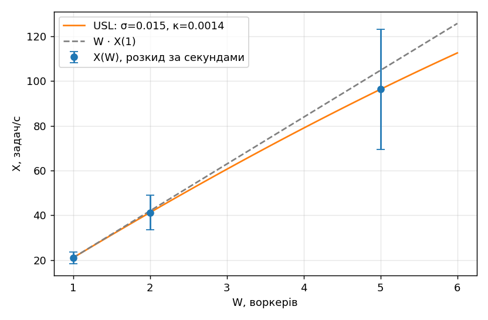
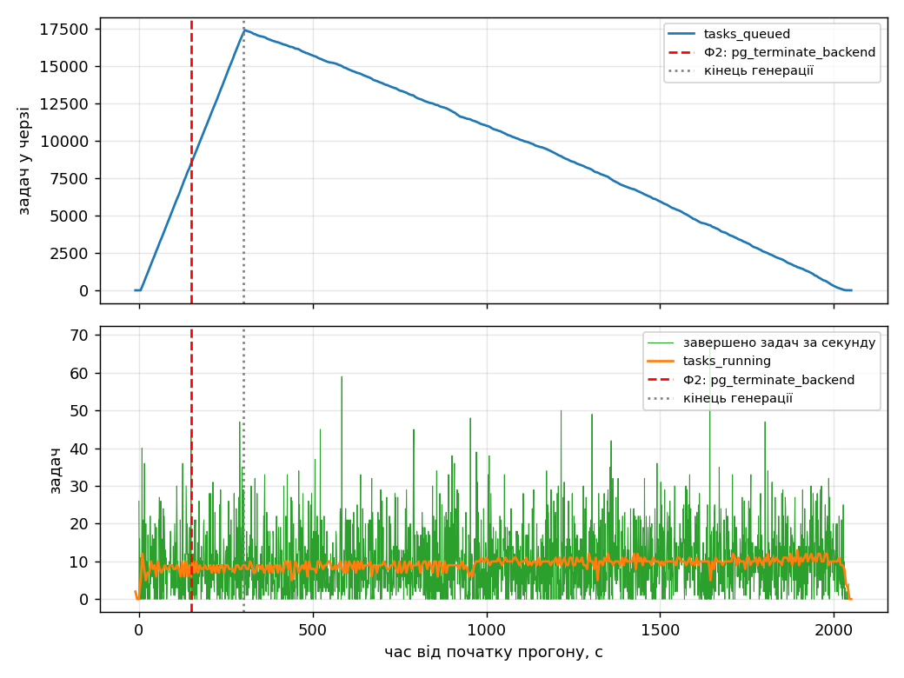

<div align="center">

Міністерство освіти і науки України<br>
Національний технічний університет України «Київський політехнічний інститут імені Ігоря Сікорського»

Факультет біомедичної інженерії<br>
Кафедра біомедичної кібернетики

# Звіт

**про виконання лабораторної роботи №4<br>
з дисципліни «Високопродуктивні розподілені обчислювальні системи»**

Тема роботи: «Синхронізація пула воркерів»<br>
Варіант № 8

</div>

**Виконав:** студент гр. ЗК-61мп Євтушенко Єгор<br>
**Прийняв:** Матвійчук О. В.

<div align="center">

Київ<br>
КПІ ім. Ігоря Сікорського<br>
2026

</div>

---

## Мета роботи

Доповнити сервіс із лабораторної роботи 3 чергою задач обробки в PostgreSQL і пулом воркерів, які беруть задачі з черги, виконують обробку синтетичного зрізу і записують результат. Показати вимірюванням, що наївне захоплення задачі дає дублювання, усунути дублювання блокуванням рядка, захистити задачу від зникнення воркера через lease, heartbeat і fencing token, зробити запис результату ідемпотентним. Виміряти пропускну здатність пулу на 1, 2 і R воркерах, перевірити закон Літтла для черги і коректну зупинку воркерів. Перевірити поведінку пулу у сценарії відмови за варіантом.

## Варіант

Номер варіанта збігається з номером у лабораторній роботі 1: сутність «Донація крові», ресурс `/donations`. R = 5 з лабораторної роботи 3, S = 256.

| № | q_lo / q_hi | T_poll, мс | L, с | Сценарій відмови | Додаткова вимога |
|---|---|---|---|---|---|
| 8 | 0,05 / 0,95 | 50 | 5 | Ф2 | Д5 |

| Сценарій | Дія | Що записати |
|---|---|---|
| Ф2 | завершити сесію бази одного воркера командою SELECT pg_terminate_backend(pid) під час кроку обробки | рядки журналу воркера про перепідключення; доля задачі, що оброблялась; кількість результатів для неї |

| Вимога | Що зробити | Чим підтвердити |
|---|---|---|
| Д5 | LISTEN/NOTIFY замість опитування: тригер на вставку в tasks надсилає повідомлення, воркер чекає на нього | p50 і p99 різниці started_at − created_at за λ = 5 задач за секунду з опитуванням 100 мс і з LISTEN; кількість запитів до бази за секунду за порожньої черги в обох режимах |

## Середовище

Стенд з лабораторної роботи 3: k3d 5.9.0 з k3s v1.36.4+k3s1, один вузол server з міткою `role=infra` і taint-ом, два вузли agent, PostgreSQL 16 (StatefulSet), kube-prometheus-stack 93.10.1 і prometheus-postgres-exporter 8.3.0, Prometheus з інтервалом збору 5 с. Усе працює на одному ноутбуці Apple M3 Pro (5 продуктивних і 6 енергоефективних ядер), 18 ГБ памʼяті, macOS 27.0.1, Docker Desktop 29.9.3 з 11 CPU і 7,75 ГіБ для віртуальної машини. Генератор задач і скрипт прогонів працюють на Python 3.13 на тій самій машині. Сервіс web працює однією реплікою (Deployment без поля `replicas`), воркер написано на Python 3.12 (asyncpg 0.32.0, prometheus-client 0.26.0).

Повний прогін з нуля виконує `scripts/run_all.sh`: видалення і створення кластера (`scripts/deploy.sh`), занесення 100 записів генератором і кроки 1–10 скриптом `scripts/lab.py` (додаток А). Журнал прогону `results/lab.log`, результати кожного кроку в `results/stepN/`.

## Крок 1. Таблиці задач і ендпоінти

Таблиці додаються міграцією, тобто Job `migrate` з лабораторної роботи 3: ConfigMap `db-schema` тепер містить `init.sql` і `tasks.sql` (`db/tasks.sql`, додаток Б), а Job виконує обидва файли. Поля `tasks`: `id`, `record_id` із зовнішнім ключем на `donations (id)`, `status` (`queued`, `running`, `done`, `failed`), `seed`, `attempts`, `max_attempts` зі значенням 3, `token` зі значенням 0, `lease_until`, `worker_id`, `created_at`, `started_at`, `finished_at`; індекс `(status, created_at)`. Поля `task_results`: `task_id` як первинний ключ із зовнішнім ключем на `tasks (id)`, `token`, `worker_id`, `result` типу `jsonb`, `created_at`.

Ендпоінти сервісу web (`app/main.py`, додаток Б):

- `POST /donations/{id}/tasks` створює задачу з `seed`, який генерує сервіс (`random.randrange(1, 2**31)`), і повертає 202 з тілом задачі; якщо запису немає, вставка порушує зовнішній ключ і сервіс повертає 404;
- `GET /tasks/{id}` повертає задачу разом із результатом, якщо він є, або 404;
- `GET /tasks` повертає перелік з фільтром `status`, пагінацією `limit` і `offset` і загальною кількістю `total`.

Сервіс кожні 5 секунд одним запитом рахує задачі в статусах `queued` і `running` і записує їх у вимірювачі `tasks_queued` і `tasks_running`. У тому самому циклі він повертає в чергу задачі зі спливлим lease (крок 5).

Перевірка (`results/step1_endpoints.txt`, на момент перших запитів воркерів 0):

```
$ curl -X POST /donations/1/tasks
{"id":1,"record_id":1,"status":"queued","seed":17968624,"attempts":0,"max_attempts":3,"token":0,"lease_until":null,"worker_id":null,"created_at":"2026-11-25T10:59:49.138041+00:00","started_at":null,"finished_at":null}
HTTP 202

$ curl -X POST /donations/999999/tasks
{"error":"donation not found"}
HTTP 404

$ curl -X GET /tasks/999999
{"error":"task not found"}
HTTP 404

$ curl -X GET /tasks?status=queued&limit=2&offset=0
{"items":[{"id":1,"record_id":1,"status":"queued","seed":17968624, ...}],"total":1,"limit":2,"offset":0}
HTTP 200

$ curl /metrics | grep ^tasks_
tasks_queued 1.0
tasks_running 0.0

$ curl -X GET /tasks/1
{"id":1,"record_id":1,"status":"done","seed":17968624,"attempts":1,"max_attempts":3,"token":1,"lease_until":"2026-11-25T11:00:02.355461+00:00","worker_id":"worker-bfdbd55d5-xvbk8","created_at":"2026-11-25T10:59:49.138041+00:00","started_at":"2026-11-25T10:59:57.355461+00:00","finished_at":"2026-11-25T10:59:57.422216+00:00","result":{"std":1182.6638266689629,"mean":2052.6347747961554,"p_hi":3896,"p_lo":209,"removed":6545}}
HTTP 200
```

Останній запит виконано після запуску одного воркера: задача перейшла в `done` і має результат. Повний вивід `\d tasks` і `\d task_results` наведено в тому самому файлі.

## Крок 2. Воркер

Воркер (`worker/worker.py`, додаток В) працює окремим процесом з власним образом `donations-worker:4.0` (`worker/Dockerfile`). Налаштування беруться зі змінних середовища: адреса бази (`PGHOST`, `PGPORT`, а `PGDATABASE`, `PGUSER`, `PGPASSWORD` з Secret), адреса сервісу `WEB_URL`, тривалість lease `LEASE_S`, інтервал опитування `T_POLL_MS`, імовірність падіння `FAIL_RATE`, `WORKER_ID`. У Kubernetes `WORKER_ID` заповнюється через Downward API з імені пода. Також змінні `CLAIM`, `SAFE` і `WAIT` вибирають спосіб захоплення, захист кроку 5 і очікування кроку 10, щоб усі кроки роботи виконувались тим самим образом.

Задача виконується в три кроки:

1. отримання запису `GET /donations/{record_id}` від сервісу web;
2. обробка зрізу: генератор `x(i+1) = (1103515245 · x(i) + 12345) mod 2^31`, `p(i) = x(i+1) >> 19`, гістограма з 4096 рівнів, межі `p_lo` і `p_hi` за квантилями 0,05 і 0,95 (найменший рівень, на якому накопичена частка досягає квантиля), перетворення `p' = ⌊4095 · (p − p_lo) / (p_hi − p_lo)⌉` всередині вікна і 0 поза ним, результат `p_lo`, `p_hi`, кількість вилучених пікселів, середнє і стандартне відхилення `p'` за пікселями всередині вікна; цей крок написано циклами Python без NumPy і виконується в окремому потоці (`asyncio.to_thread`), щоб heartbeat не чекав на обробку;
3. запис результату в базу.

Воркер виконує одну задачу за раз і надає на порту 9100 `/metrics` з лічильником `worker_tasks_total{result}` (`done`, `failed`, `lost`), лічильником `worker_claims_total{result}` (`task`, `empty`), гістограмою `worker_task_duration_seconds{step}` (`claim`, `fetch`, `process`, `store`) і вимірювачем `worker_tasks_in_flight`.

Deployment `worker` (`k8s/worker.yaml`) без поля `replicas`, `requests.cpu: 250m`, `limits.cpu: 500m`, `limits.memory: 512Mi`, `terminationGracePeriodSeconds: 30`. До Prometheus додано задачу збору `worker` з пошуком подів `app=worker` на порту 9100. Генератор (`loadgen/loadgen.py`, режим `tasks`) надсилає `POST /donations/{id}/tasks` із заданою інтенсивністю за відкритою моделлю для випадкових записів зі ста занесених і записує ідентифікатори створених задач у CSV.

20 задач на одному воркері (`results/step2/summary.json`, середні за гістограмою воркера):

| Величина | Значення, мс |
|---|---|
| fetch | 13,41 |
| process | 36,35 |
| store | 1,80 |
| t_io = fetch + store | 15,20 |
| t_cpu = process | 36,35 |

## Крок 3. Наївне захоплення

Наївне захоплення (`CLAIM=naive`, `SAFE=0`): `SELECT ... WHERE status = 'queued' ORDER BY created_at LIMIT 1`, потім окремий `UPDATE tasks SET status = 'running' ... WHERE id = $2` без транзакції і без блокувань; результат записується `INSERT` без `ON CONFLICT`. Первинний ключ `task_results` на цьому кроці замінено звичайним індексом:

```sql
ALTER TABLE task_results DROP CONSTRAINT IF EXISTS task_results_pkey;
CREATE INDEX IF NOT EXISTS task_results_task_id_idx ON task_results (task_id);
```

5 воркерів, 300 задач з інтенсивністю 100 за секунду, очікування порожньої черги. Кількість дублів за таблицею результатів рахується як кількість `task_id`, для яких у `task_results` більше одного рядка, за журналами як кількість задач, для яких у журналах воркерів більше одного рядка `done task=` (`results/step3/summary.json`, журнали в `results/step3/*/logs/`):

| T_poll | n | n_dup за таблицею | D за таблицею | n_dup за журналами | D за журналами | Рядків у task_results |
|---|---|---|---|---|---|---|
| 50 мс | 300 | 29 | 0,097 | 29 | 0,097 | 330 |
| 1 мс | 300 | 31 | 0,103 | 31 | 0,103 | 337 |

Приклад з журналів серії з T_poll = 50 мс: задачу 42 виконали три воркери.

```
2026-11-25T11:00:16.433+00:00 worker-95c84cbb5-gtsqv done task=42 token=0 attempts=0
2026-11-25T11:00:16.433+00:00 worker-95c84cbb5-xpxwq done task=42 token=0 attempts=0
2026-11-25T11:00:16.444+00:00 worker-95c84cbb5-mslqs done task=42 token=0 attempts=0
```

За 1 мс воркери частіше опитують чергу одночасно, тому дублів трохи більше.

## Крок 4. Блокування рядка

Захоплення однією командою (`CLAIM=skip_locked`), первинний ключ `task_results` повернуто:

```sql
UPDATE tasks SET status = 'running', worker_id = $1, token = token + 1,
       lease_until = NULL, attempts = attempts + 1, started_at = now()
WHERE id = (SELECT id FROM tasks WHERE status = 'queued'
            ORDER BY created_at LIMIT 1 FOR UPDATE SKIP LOCKED)
RETURNING id, record_id, seed, token, attempts
```

На цьому кроці lease ще немає, тому `lease_until = NULL`. Далі `SKIP LOCKED` прибрано (`CLAIM=for_update`). Обидві серії з T_poll = 1 мс, 5 воркерів, 300 задач з інтенсивністю 100 за секунду. p99 часу захоплення обчислено з різниці гістограм `worker_task_duration_seconds{step="claim"}` усіх воркерів, знятих до прогону і в момент спорожнення черги; кількість рядків `pg_stat_activity` з `wait_event_type = 'Lock'` знімалась кожну секунду (`results/step4/summary.json`):

| Захоплення | D | p99 захоплення, мс | Порожніх захоплень | Найбільше рядків Lock |
|---|---|---|---|---|
| FOR UPDATE SKIP LOCKED | 0 | 3,50 | 5500 | 0 |
| FOR UPDATE | 0 | 1,67 | 6843 | 0 |

Дублів немає в обох випадках: у `task_results` рівно 300 рядків. Без `SKIP LOCKED` порожніх захоплень на 24 % більше, бо воркер, що чекав на заблокований рядок, після завершення чужої транзакції бачить його вже в статусі `running` і повертає порожній результат. Сама команда захоплення виконується менше ніж за мілісекунду, тому очікування блокування теж коротше за мілісекунду і жоден із щосекундних знімків `pg_stat_activity` його не застав, а p99 захоплення не зріс. Для подальших кроків повернуто `SKIP LOCKED` і T_poll = 50 мс.

## Крок 5. Lease, heartbeat і fencing token

З `SAFE=1` воркер працює так:

- захоплення командою кроку 4 з `lease_until = now() + 5 s` (L = 5 с);
- heartbeat кожні L / 3 ≈ 1,67 с окремим зʼєднанням: `UPDATE tasks SET lease_until = now() + $1 WHERE id = $2 AND token = $3`; якщо оновлено 0 рядків, воркер пише в журнал `heartbeat updated 0 rows` і вважає задачу втраченою;
- завершення і запис результату в одній транзакції: `UPDATE tasks SET status = 'done', finished_at = now() WHERE id = $1 AND token = $2`, і якщо оновлено один рядок, `INSERT INTO task_results ... ON CONFLICT (task_id) DO NOTHING`; якщо оновлено 0 рядків, транзакція скасовується, а в журнал пишеться `store updated 0 rows`;
- задачі зі спливлим lease повертає в чергу сервіс web кожні 5 секунд; задача, у якої `attempts` досягло `max_attempts`, отримує статус `failed`:

```sql
UPDATE tasks SET status = CASE WHEN attempts >= max_attempts THEN 'failed' ELSE 'queued' END,
       worker_id = NULL, finished_at = CASE WHEN attempts >= max_attempts THEN now() END
WHERE status = 'running' AND lease_until < now()
```

У контейнері воркера процесом з PID 1 є `tini`, а Python працює його дочірнім процесом. Ядро не доставляє SIGSTOP процесу з PID 1 у його просторі імен, тому команда зупинки адресується процесу Python: `kubectl exec <под> -- pkill -STOP -f worker.py` і `pkill -CONT -f worker.py`.

Перевірка на 2 воркерах під час обробки 100 задач (генератор створює їх з інтенсивністю 30 за секунду). Скрипт зупиняє перший воркер і через 0,3 с перевіряє, що за ним лишилась задача в статусі `running`, тобто воркер зупинено посеред обробки. Воркер стоїть 2 · L = 10 с, далі `pkill -CONT` (`results/step5/summary.json`, журнали `results/step5/logs/`):

| Показник | Значення |
|---|---|
| зупинений воркер | worker-857474fc5d-ngd9s |
| задача в обробці на момент зупинки | 7 |
| attempts / token до | 1 / 1 |
| attempts / token після | 2 / 2 |
| воркер, який її завершив | worker-857474fc5d-vn9ch |
| рядків у task_results для задачі 7 | 1 (token 2, worker-857474fc5d-vn9ch) |
| задач done / задач з більше ніж одним результатом | 100 / 0 |

Журнали обох воркерів щодо задачі 7:

```
2026-11-25T12:22:19.123+00:00 worker-857474fc5d-vn9ch done task=7 token=2 attempts=2
2026-11-25T12:22:20.391+00:00 worker-857474fc5d-ngd9s store updated 0 rows task=7 token=1
```

Задачу захоплено о 12:22:10.207 з lease до 12:22:15.207. Зупинений воркер не продовжив lease, сервіс web повернув задачу в чергу, а другий воркер захопив її з токеном 2 і завершив о 12:22:19.12. Після відновлення перший воркер дообробив свою копію і спробував записати результат з токеном 1: команда оновила 0 рядків, і другого результату не зʼявилось.

## Крок 6. Пропускна здатність пулу

Для W = 1, 2 і 5: воркери зупинено (`kubectl scale deployment/worker --replicas=0`), генератор створює 400 задач, далі `kubectl scale deployment/worker --replicas=W` і очікування порожньої черги. X(W) дорівнює кількості задач, завершених за секунду. Вікно має закінчуватися спорожненням черги і тривати не більше 30 секунд. Черга з 400 задач спорожнялась швидше ніж за 30 секунд, тому вікно починається з моменту, коли кожен з W воркерів захопив першу задачу, і закінчується останнім `finished_at`. Розкид дорівнює стандартному відхиленню посекундної кількості завершених задач без неповних першої й останньої секунд. Транзакції бази за секунду і CPU пода бази обчислено з приростів `xact_commit + xact_rollback` з `pg_stat_database` і `usage_usec` з `/sys/fs/cgroup/cpu.stat` контейнера бази, які одна сесія `psql` знімала кожні 0,2 с; власні транзакції цих знімків віднято (`results/step6/summary.json`).

| W | Вікно, с | Задач у вікні | X(W), задач/с | Розкид | p99 захоплення, мс | Транзакцій бази за секунду | CPU пода бази, ядер |
|---|---|---|---|---|---|---|---|
| 1 | 19,08 | 400 | 20,97 | 2,60 | 20,90 | 93,3 | 0,077 |
| 2 | 9,56 | 394 | 41,20 | 7,69 | 8,90 | 166,7 | 0,078 |
| 5 | 4,15 | 400 | 96,35 | 26,92 | 42,43 | 367,1 | 0,106 |

Порівняння X(1) з 1 / (t_io + t_cpu + T_poll / 2) за t_io і t_cpu з кроку 2: 1 / (0,0152 + 0,0364 + 0,025) = 13,1 задачі/с проти виміряних 20,97. За непорожньої черги воркер не чекає T_poll між задачами, а t_fetch у кроці 2 виміряно на перших 20 запитах до web; у цьому прогоні fetch займає 2 мс, і 1 / (0,002 + 0,040 + 0,004) = 21,7 задачі/с збігається з виміряним.

C(W) = X(W) / X(1): C(2) = 1,965, C(5) = 4,595. За формулами лабораторної роботи 2 з W замість N: σ = 0,0151, κ = 0,00139, W* = √((1 − σ) / κ) = 26,6 (`results/step6/usl.json`). Пул масштабується майже лінійно: кожен воркер має власний ліміт 0,5 CPU, а база завантажена лише на 0,1 ядра.



## Крок 7. Закон Літтла

На 5 воркерах генератор створює задачі з інтенсивністю 0,7 · X(5) = 67,44 за секунду протягом 180 секунд. За останні 120 секунд: λ дорівнює кількості задач, створених у вікні, поділеній на 120; L_q дорівнює середньому значенню `tasks_queued` з Prometheus (`avg_over_time(sum(tasks_queued)[120s:5s])`); W_q дорівнює середній різниці `started_at − created_at` задач, створених у вікні (`results/step7/summary.json`):

| λ, задач/с | W_q, с | λ · W_q | L_q виміряне | Розбіжність |
|---|---|---|---|---|
| 67,44 | 0,00752 | 0,507 | 0,500 | −1,4 % |

Повтор з інтенсивністю 1,3 · X(5) = 125,25 за секунду протягом 120 секунд: інтенсивність більша за пропускну здатність пулу, і черга росте весь прогін.

| Створено задач | Довжина черги на кінець генерації | W_q перших 100 задач, с | W_q останніх 100 задач, с |
|---|---|---|---|
| 15 030 | 1499 | 0,107 | 13,523 |

## Крок 8. Коректна зупинка

За SIGTERM воркер перестає захоплювати задачі, чекає на завершення поточної задачі, закриває зʼєднання з базою і виходить з кодом 0. Якщо задача не завершується за 25 секунд (менше за `terminationGracePeriodSeconds: 30`), воркер повертає її в чергу командою `UPDATE tasks SET status = 'queued' WHERE id = $1 AND token = $2` і виходить. Процес воркера запускається через `tini` (`ENTRYPOINT ["tini", "--"]`), який передає SIGTERM процесу Python і повертає його код завершення.

Під прогоном з інтенсивністю 0,7 · X(5) = 67,44 за секунду протягом 90 секунд на 30-й секунді виконано `kubectl rollout restart deployment/worker`. Коди завершення контейнерів старих подів записано з `kubectl get pods -w` (`results/step8/pod_watch.txt`, `results/step8/summary.json`):

| Показник | Значення |
|---|---|
| коди завершення 5 старих контейнерів | 0, 0, 0, 0, 0 (`Completed`) |
| задач, повернутих у чергу воркерами під час зупинки | 0 |
| задач у статусі failed | 0 |
| задач з більше ніж одним результатом | 0 |
| задач з attempts > 1 | 0 |
| усього задач / done | 6070 / 6070 |

Задача обробляється близько 45 мс, тому кожен воркер устигав завершити поточну задачу задовго до спливання 25 секунд, і повертати задачі в чергу не довелося.

## Крок 9. Падіння воркерів і сценарій Ф2

Після кроку обробки і до запису результату воркер з імовірністю `FAIL_RATE` пише в журнал `crash task=...` і викликає `os._exit(1)`. У Deployment worker задано `FAIL_RATE: "0.15"`, 5 воркерів, генератор створює задачі з інтенсивністю 0,7 · X(5) = 67,44 за секунду протягом 300 секунд.

Пробний прогін з типовими налаштуваннями kubelet показав, що з f = 0,15 воркер падає в середньому після 1 / f ≈ 7 задач, тобто менш ніж за секунду роботи. Пауза kubelet між перезапусками контейнера після кожного падіння подвоюється від 10 секунд до 5 хвилин (CrashLoopBackOff), тому всі 5 воркерів за кілька хвилин опинились у цьому стані і майже не обробляли задач. За таких умов черга за прогін не спорожнюється, і порівняти розподіл за attempts з f і f³ неможливо. Тому в кластері ЛР4 kubelet на вузлах agent обмежує паузу перед перезапуском однією секундою (`k8s/kubelet-crashloop.yaml`, у k3s 1.36 параметр `crashLoopBackOff.maxContainerRestartPeriod` доступний за увімкненою за замовчуванням можливістю `KubeletCrashLoopBackOffMax`):

```yaml
apiVersion: kubelet.config.k8s.io/v1beta1
kind: KubeletConfiguration
crashLoopBackOff:
  maxContainerRestartPeriod: 1s
```

`deploy.sh` монтує цей файл у `/var/lib/rancher/k3s/agent/etc/kubelet.conf.d/` вузлів agent. Контейнери після падінь, як і раніше, перезапускає Kubernetes.

Посередині прогону, на 150,5-й секунді, виконано сценарій Ф2: серед задач у статусі `running` вибрано найсвіжішу, а сесію бази її воркера (`application_name` дорівнює `<WORKER_ID>/main`) завершено командою `pg_terminate_backend`. Стан сесії в `pg_stat_activity` на той момент був `idle`, тобто воркер виконував обробку і з базою не працював.

```sql
WITH t AS (SELECT id, worker_id FROM tasks WHERE status = 'running' ORDER BY started_at DESC LIMIT 1)
SELECT t.id, t.worker_id, a.pid, pg_terminate_backend(a.pid)
FROM t JOIN pg_stat_activity a ON a.application_name = t.worker_id || '/main'
```

Генерація тривала 300 с, після неї чергу розбирали ще 1743 с (`results/step9/summary.json`, журнали `results/step9/logs/`).

Перезапуски контейнерів (`kubectl get pods -l app=worker` після прогону):

```
NAME                      READY   STATUS    RESTARTS        AGE
worker-6cbd57f678-5b9dl   1/1     Running   727 (14s ago)   34m
worker-6cbd57f678-987q6   1/1     Running   725 (19s ago)   34m
worker-6cbd57f678-g7cct   1/1     Running   719 (9s ago)    34m
worker-6cbd57f678-jgkz8   1/1     Running   723 (14s ago)   34m
worker-6cbd57f678-xf9vt   1/1     Running   722 (9s ago)    34m
```

Разом 3616 перезапусків.

Розподіл задач за attempts:

| attempts | done | failed |
|---|---|---|
| 1 | 17 132 | 0 |
| 2 | 2 655 | 0 |
| 3 | 374 | 71 |
| усього | 20 161 | 71 |

| Показник | Виміряно | Очікувано |
|---|---|---|
| частка задач з attempts > 1 | 3100 / 20 232 = 0,153 | f = 0,15 |
| частка failed | 71 / 20 232 = 0,00351 | f³ = 0,00338 |
| задач з більше ніж одним результатом | 0 | 0 |
| X у цьому прогоні, задач/с | 9,27 | X(5) без падінь = 96,35 |

X у прогоні дорівнює кількості задач, завершених з 30-ї секунди до кінця генерації, поділеній на 270 с. Пропускна здатність упала вдесятеро: на одну задачу припадає близько 45 мс обробки, а на одне падіння близько 3 с, за які контейнер перезапускається, стартує Python, підключається до бази і до сервісу web. Задача, на якій воркер упав, лишається в статусі `running` до спливання lease, тобто ще 5–10 секунд.

Ф2: сесію завершено під час обробки задачі 1396 воркером `worker-6cbd57f678-987q6`. Рядки його журналу:

```
2026-11-25T11:46:51.485+00:00 worker-6cbd57f678-987q6 main connection lost: InterfaceError: connection is closed
2026-11-25T11:46:51.490+00:00 worker-6cbd57f678-987q6 main connection reconnected
2026-11-25T11:46:51.493+00:00 worker-6cbd57f678-987q6 done task=1396 token=1 attempts=1
```

Воркер виявив закрите зʼєднання на кроці запису результату, перепідключився за 5 мс і повторив запис. Heartbeat іде окремим зʼєднанням, тому lease не сплив і токен лишився дійсним. Задача 1396 завершилась з першої спроби (`status = done`, `attempts = 1`, `token = 1`), у `task_results` для неї один рядок.

Діаграма `tasks_queued`, `tasks_running` і кількості завершених задач за секунду (`results/step9/timeline.png`):



## Крок 10. Додаткова вимога Д5

Тригер на вставку в `tasks` (`db/notify.sql`) надсилає повідомлення в канал `tasks_new`. Скрипт прогону застосовує його до бази на початку кроку:

```sql
CREATE OR REPLACE FUNCTION tasks_notify() RETURNS trigger AS $$
BEGIN
    PERFORM pg_notify('tasks_new', NEW.id::text);
    RETURN NEW;
END;
$$ LANGUAGE plpgsql;

CREATE TRIGGER tasks_notify AFTER INSERT ON tasks FOR EACH ROW EXECUTE FUNCTION tasks_notify();
```

З `WAIT=listen` воркер тримає окреме зʼєднання з `LISTEN tasks_new` (`add_listener` asyncpg). Перед кожною спробою захоплення він скидає подію, а після порожнього захоплення чекає на повідомлення замість паузи T_poll. Подія скидається до захоплення, тому повідомлення, що прийшло між захопленням і очікуванням, не губиться.

Порівняння на 5 воркерах (`results/step10/summary.json`): спочатку 30 секунд за порожньої черги, потім 60 секунд генератор створює задачі з λ = 5 за секунду. Запити воркерів до бази за секунду дорівнюють приросту `worker_claims_total` усіх воркерів, поділеному на тривалість. Транзакції бази за секунду дорівнюють приросту `xact_commit + xact_rollback` бази, у них входять також запити сервісу web раз на 5 с, postgres-exporter і перевірки готовності.

| Режим | Задач | p50 started_at − created_at, мс | p99, мс | Запитів воркерів до бази за секунду за порожньої черги | Транзакцій бази за секунду за порожньої черги |
|---|---|---|---|---|---|
| опитування 100 мс | 300 | 32,30 | 85,86 | 48,82 | 56,14 |
| LISTEN | 300 | 1,78 | 5,18 | 0 | 7,82 |

За опитування 5 воркерів за порожньої черги роблять 48,8 запиту за секунду, що близько до W / T_poll = 5 / 0,1 = 50. З LISTEN воркери до бази не звертаються, і в базі лишаються лише 7,8 транзакції за секунду сторонніх запитів. Затримка від створення до захоплення з LISTEN менша в 18 разів за медіаною і в 17 разів за p99: воркер дізнається про задачу одразу після вставки. За опитування медіана 32 мс менша за T_poll / 2 = 50 мс, бо 5 воркерів опитують чергу незалежно, і задачу забирає той, чия черга опитування настає першою.

## Висновки

У цій лабораторній роботі ми доповнили сервіс донацій крові чергою задач у PostgreSQL і пулом воркерів, які обробляють синтетичний зріз 256 × 256. Наївне захоплення через окремі SELECT і UPDATE дало дублі: близько 10 % задач обробили кілька воркерів (D = 0,097 за T_poll = 50 мс і 0,103 за 1 мс), а одну задачу навіть три воркери. Захоплення однією командою з FOR UPDATE SKIP LOCKED прибрало дублі повністю. Без SKIP LOCKED дублів теж немає, але порожніх захоплень на 24 % більше.

Lease на 5 с, heartbeat і fencing token захищають задачу від зниклого воркера. Коли ми зупинили воркер на 10 с, його задачу повернули в чергу і завершив інший воркер з токеном 2. Зупинений воркер після відновлення отримав «0 rows» і результату не записав, тож для задачі є рівно один результат. Пул масштабується майже лінійно: 21, 41 і 96 задач/с на 1, 2 і 5 воркерах, σ = 0,015, κ = 0,0014, W* ≈ 27. Закон Літтла виконався з розбіжністю 1,4 %, а за інтенсивності 1,3 · X(5) черга росла весь час. Після SIGTERM усі воркери завершились з кодом 0, без втрачених задач і дублів.

З FAIL_RATE = 0,15 частка задач з повторними спробами вийшла 0,153, частка failed 0,0035, як і очікувалось за f і f³. Дублів результатів знову не було, але пропускна здатність упала з 96 до 9 задач/с через перезапуски контейнерів. За сценарієм Ф2 воркер, у якого завершили сесію бази, перепідключився за 5 мс і записав результат з першої спроби. LISTEN/NOTIFY за вимогою Д5 зменшив затримку захоплення з 32 до 1,8 мс за медіаною і прибрав запити воркерів до бази за порожньої черги (49 запитів за секунду за опитування).

## ДОДАТОК А. Скрипти

### `scripts/deploy.sh`

```bash
#!/usr/bin/env bash
set -euo pipefail
cd "$(dirname "$0")/.."
CLUSTER=lab4

k3d cluster create "$CLUSTER" --servers 1 --agents 2 \
  --k3s-arg "--node-taint=node-role.kubernetes.io/control-plane=true:NoSchedule@server:0" \
  --k3s-arg "--disable=traefik@server:0" \
  --volume "$PWD/k8s/kubelet-crashloop.yaml:/var/lib/rancher/k3s/agent/etc/kubelet.conf.d/50-crashloop.conf@agent:*" \
  -p "8080:30080@server:0" -p "9090:30090@server:0" --wait
kubectl label node "k3d-$CLUSTER-server-0" role=infra --overwrite

docker build -t donations-api:4.0 .
docker build -t donations-worker:4.0 worker
k3d image import donations-api:4.0 donations-worker:4.0 -c "$CLUSTER"

kubectl create secret generic db-secret --from-env-file=.env --dry-run=client -o yaml | kubectl apply -f -
kubectl apply -f k8s/postgres.yaml
kubectl rollout status statefulset/db --timeout=180s
kubectl apply -f k8s/migrate.yaml
kubectl wait --for=condition=complete job/migrate --timeout=180s
kubectl apply -f k8s/web.yaml
kubectl rollout status deployment/web --timeout=180s
kubectl apply -f k8s/worker.yaml
kubectl scale deployment/worker --replicas=0

helm upgrade --install monitoring prometheus-community/kube-prometheus-stack --version 93.10.1 \
  -f k8s/monitoring/kube-prometheus-stack.yaml --wait --timeout 10m
helm upgrade --install pg-exporter prometheus-community/prometheus-postgres-exporter --version 8.3.0 \
  -f k8s/monitoring/postgres-exporter.yaml --wait --timeout 5m
```

### `scripts/destroy.sh`

```bash
#!/usr/bin/env bash
set -euo pipefail
k3d cluster delete lab4
```

### `scripts/run_all.sh`

```bash
#!/usr/bin/env bash
set -euo pipefail
cd "$(dirname "$0")/.."
mkdir -p results
scripts/destroy.sh >/dev/null 2>&1 || true
scripts/deploy.sh > results/deploy.log 2>&1
kubectl get nodes -o wide > results/nodes.txt
python3 loadgen/loadgen.py seed --ids results/ids.json
python3 scripts/lab.py 1 2 3 4 5 6 7 8 9 10 2>&1 | tee results/lab.log
```

### `scripts/lab.py`

```python
import argparse
import json
import math
import os
import re
import statistics
import subprocess
import sys
import threading
import time
import urllib.parse
import urllib.request
from concurrent.futures import ThreadPoolExecutor
from datetime import datetime, timezone

ROOT = os.path.dirname(os.path.dirname(os.path.abspath(__file__)))
RESULTS = os.path.join(ROOT, "results")
PROM = "http://localhost:9090"
R = 5
T_POLL_MS = 50
LEASE_S = 5
FINAL = {"CLAIM": "skip_locked", "SAFE": "1", "WAIT": "poll", "T_POLL_MS": str(T_POLL_MS), "FAIL_RATE": "0"}


def sh(*cmd, input=None, check=True):
    p = subprocess.run(cmd, input=input, capture_output=True, text=True)
    if check and p.returncode != 0:
        raise RuntimeError(f"{' '.join(cmd)}: {p.stderr}")
    return p.stdout


def sql(query):
    return sh("kubectl", "exec", "-i", "db-0", "--", "sh", "-c",
              'psql -U "$POSTGRES_USER" -d "$POSTGRES_DB" -At -v ON_ERROR_STOP=1', input=query).strip()


def sql_json(query):
    out = sql(f"SELECT coalesce(json_agg(t), '[]') FROM ({query}) t")
    return json.loads(out)


def sql_one(query):
    rows = sql_json(query)
    return rows[0] if rows else None


def prom(query, at=None):
    params = {"query": query}
    if at:
        params["time"] = at
    with urllib.request.urlopen(f"{PROM}/api/v1/query?{urllib.parse.urlencode(params)}") as r:
        return json.load(r)["data"]["result"]


def prom_range(query, start, end, step=5):
    params = urllib.parse.urlencode({"query": query, "start": start, "end": end, "step": step})
    with urllib.request.urlopen(f"{PROM}/api/v1/query_range?{params}") as r:
        return json.load(r)["data"]["result"]


def save(name, data):
    path = os.path.join(RESULTS, name)
    os.makedirs(os.path.dirname(path), exist_ok=True)
    with open(path, "w") as f:
        json.dump(data, f, indent=2, ensure_ascii=False, default=str)
    print(f"[{name}] {json.dumps(data, ensure_ascii=False, default=str)[:1500]}", flush=True)


def note(msg):
    print(f"{datetime.now().strftime('%H:%M:%S')} {msg}", flush=True)


def worker_pods():
    out = sh("kubectl", "get", "pods", "-l", "app=worker", "-o", "json")
    return json.loads(out)["items"]


def set_workers(replicas, **env):
    if env:
        sh("kubectl", "set", "env", "deployment/worker", *[f"{k}={v}" for k, v in env.items()])
    sh("kubectl", "scale", "deployment/worker", f"--replicas={replicas}")
    sh("kubectl", "rollout", "status", "deployment/worker", "--timeout=300s")
    while True:
        pods = worker_pods()
        ready = [p for p in pods if p["metadata"].get("deletionTimestamp") is None and all(
            c.get("ready") for c in p["status"].get("containerStatuses", []) or [{}])]
        if len(pods) == replicas and len(ready) == replicas:
            break
        time.sleep(1)
    time.sleep(2)
    return [p["metadata"]["name"] for p in pods]


def reset():
    sql("TRUNCATE task_results, tasks RESTART IDENTITY")


def wait_empty(timeout=900):
    start = time.time()
    while time.time() - start < timeout:
        left = int(sql("SELECT count(*) FROM tasks WHERE status IN ('queued', 'running')"))
        if left == 0:
            return True
        time.sleep(1)
    return False


def generate(out, rate, count=None, duration=None, seed=0):
    os.makedirs(os.path.dirname(os.path.join(RESULTS, out)), exist_ok=True)
    cmd = [sys.executable, os.path.join(ROOT, "loadgen", "loadgen.py"), "tasks", "--rate", str(rate),
           "--ids", os.path.join(RESULTS, "ids.json"), "--out", os.path.join(RESULTS, out), "--seed", str(seed)]
    cmd += ["--count", str(count)] if count else ["--duration", str(duration)]
    return subprocess.Popen(cmd)


class Logs:
    def __init__(self, folder):
        self.folder = os.path.join(RESULTS, folder, "logs")
        os.makedirs(self.folder, exist_ok=True)
        self.since = datetime.now(timezone.utc).strftime("%Y-%m-%dT%H:%M:%SZ")
        self.seen = set()
        self.current = {}
        self.stop = threading.Event()
        self.thread = threading.Thread(target=self.loop, daemon=True)
        self.thread.start()

    def loop(self):
        while not self.stop.is_set():
            try:
                pods = worker_pods()
            except RuntimeError:
                pods = []
            for p in pods:
                name = p["metadata"]["name"]
                for c in p["status"].get("containerStatuses", []) or []:
                    key = (name, c.get("restartCount", 0))
                    if key in self.seen or "running" not in c.get("state", {}):
                        continue
                    old = self.current.get(name)
                    if old is not None and old.poll() is None:
                        old.terminate()
                        old.wait()
                    self.seen.add(key)
                    f = open(os.path.join(self.folder, f"{name}.r{key[1]}.log"), "w")
                    self.current[name] = subprocess.Popen(
                        ["kubectl", "logs", "-f", f"--since-time={self.since}", name],
                        stdout=f, stderr=subprocess.DEVNULL)
                    f.close()
            time.sleep(1)

    def close(self):
        time.sleep(2)
        self.stop.set()
        self.thread.join()
        for p in self.current.values():
            if p.poll() is None:
                p.terminate()
            p.wait()

    def lines(self, pattern=""):
        out = []
        for name in sorted(os.listdir(self.folder)):
            with open(os.path.join(self.folder, name)) as f:
                out += [line.rstrip("\n") for line in f if pattern in line]
        return out


def scrape(pod):
    code = "import urllib.request;print(urllib.request.urlopen('http://localhost:9100/metrics').read().decode())"
    text = sh("kubectl", "exec", pod, "--", "python", "-c", code)
    data = {}
    for line in text.splitlines():
        if line.startswith("#") or not line.strip():
            continue
        name, value = line.rsplit(" ", 1)
        data[name] = float(value)
    return data


def scrape_all(pods):
    with ThreadPoolExecutor(len(pods)) as ex:
        parts = list(ex.map(scrape, pods))
    total = {}
    for part in parts:
        for k, v in part.items():
            total[k] = total.get(k, 0.0) + v
    return total


def diff(after, before):
    return {k: v - before.get(k, 0.0) for k, v in after.items()}


def metric(data, name, **labels):
    want = ",".join(f'{k}="{v}"' for k, v in labels.items())
    return sum(v for k, v in data.items() if k.startswith(name) and (not want or all(
        f'{k2}="{v2}"' in k for k2, v2 in labels.items())))


def histogram_quantile(data, step, q):
    buckets = []
    for k, v in data.items():
        if not k.startswith("worker_task_duration_seconds_bucket{"):
            continue
        labels = dict(re.findall(r'(\w+)="([^"]*)"', k))
        if labels.get("step") == step:
            buckets.append((float(labels["le"]), v))
    buckets.sort()
    total = buckets[-1][1]
    if total == 0:
        return None
    rank = q * total
    prev_le, prev_c = 0.0, 0.0
    for le, c in buckets:
        if c >= rank:
            if math.isinf(le):
                return prev_le
            return prev_le + (le - prev_le) * (rank - prev_c) / (c - prev_c)
        prev_le, prev_c = le, c


def step_mean(data, step):
    count = data.get(f'worker_task_duration_seconds_count{{step="{step}"}}', 0)
    return data.get(f'worker_task_duration_seconds_sum{{step="{step}"}}', 0) / count if count else None


def lock_sampler(stop, out):
    while not stop.is_set():
        out.append(int(sql("SELECT count(*) FROM pg_stat_activity WHERE wait_event_type = 'Lock'")))
        stop.wait(1)


def db_counters():
    row = sql_one("SELECT xact_commit + xact_rollback AS xacts FROM pg_stat_database WHERE datname = current_database()")
    usage = sh("kubectl", "exec", "db-0", "--", "sh", "-c", "grep usage_usec /sys/fs/cgroup/cpu.stat")
    return {"t": time.time(), "xacts": row["xacts"], "cpu_usec": int(usage.split()[1])}


def db_sampler(stop, out):
    p = subprocess.Popen(["kubectl", "exec", "-i", "db-0", "--", "sh", "-c",
                          'psql -U "$POSTGRES_USER" -d "$POSTGRES_DB" -At -F " " -v ON_ERROR_STOP=1'],
                         stdin=subprocess.PIPE, stdout=subprocess.PIPE, text=True, bufsize=1)
    query = ("SELECT extract(epoch FROM clock_timestamp()), xact_commit + xact_rollback, "
             "substring(pg_read_file('/sys/fs/cgroup/cpu.stat') FROM 'usage_usec ([0-9]+)') "
             "FROM pg_stat_database WHERE datname = current_database();\n")
    while not stop.is_set():
        p.stdin.write(query)
        t, xacts, usec = p.stdout.readline().split()
        out.append({"t": float(t), "xacts": int(xacts), "cpu_usec": int(usec)})
        stop.wait(0.2)
    p.stdin.close()
    p.wait()


def duplicates(logs):
    table = sql_one("SELECT count(*) AS dup FROM (SELECT task_id FROM task_results GROUP BY task_id HAVING count(*) > 1) d")["dup"]
    done = {}
    for line in logs.lines(" done task="):
        tid = re.search(r"task=(\d+)", line).group(1)
        done[tid] = done.get(tid, 0) + 1
    by_logs = sum(1 for v in done.values() if v > 1)
    n = int(sql("SELECT count(*) FROM tasks"))
    return {"n": n, "n_dup_table": table, "D_table": table / n, "n_dup_logs": by_logs, "D_logs": by_logs / n,
            "results_rows": int(sql("SELECT count(*) FROM task_results"))}


def step1(args):
    reset()
    set_workers(0)
    ids = json.load(open(os.path.join(RESULTS, "ids.json")))
    out = []

    def curl(method, path):
        p = subprocess.run(["curl", "-s", "-X", method, "-w", "\\nHTTP %{http_code}", f"http://localhost:8080{path}"],
                           capture_output=True, text=True)
        out.append(f"$ curl -X {method} {path}\n{p.stdout}\n")
        return p.stdout

    body = curl("POST", f"/donations/{ids[0]}/tasks")
    task_id = json.loads(body.rsplit("\n", 1)[0])["id"]
    curl("POST", "/donations/999999/tasks")
    curl("GET", f"/tasks/{task_id}")
    curl("GET", "/tasks/999999")
    curl("GET", "/tasks?status=queued&limit=2&offset=0")
    time.sleep(6)
    metrics = sh("curl", "-s", "http://localhost:8080/metrics")
    out.append("$ curl /metrics | grep ^tasks_\n" + "\n".join(l for l in metrics.splitlines() if l.startswith("tasks_")) + "\n")
    set_workers(1, **FINAL)
    wait_empty()
    curl("GET", f"/tasks/{task_id}")
    out.append("$ \\d tasks\n" + sh("kubectl", "exec", "db-0", "--", "sh", "-c", 'psql -U "$POSTGRES_USER" -d "$POSTGRES_DB" -c "\\d tasks" -c "\\d task_results"'))
    with open(os.path.join(RESULTS, "step1_endpoints.txt"), "w") as f:
        f.write("\n".join(out))
    print("\n".join(out))


def step2(args):
    reset()
    pods = set_workers(1, **FINAL)
    logs = Logs("step2")
    before = scrape_all(pods)
    generate("step2/tasks.csv", 100, count=20).wait()
    wait_empty()
    logs.close()
    d = diff(scrape_all(pods), before)
    fetch, process, store, claim = (step_mean(d, s) for s in ("fetch", "process", "store", "claim"))
    save("step2/summary.json", {
        "tasks_done": metric(d, "worker_tasks_total", result="done"),
        "t_fetch_s": fetch, "t_process_s": process, "t_store_s": store, "t_claim_s": claim,
        "t_io_s": fetch + store, "t_cpu_s": process,
        "metric_names": sorted({k.split("{")[0] for k in d if k.startswith("worker_")}),
    })


def series(folder, rate, count, lock_sample=False):
    reset()
    pods = [p["metadata"]["name"] for p in worker_pods()]
    logs = Logs(folder)
    before = scrape_all(pods)
    stop, locks = threading.Event(), []
    sampler = threading.Thread(target=lock_sampler, args=(stop, locks)) if lock_sample else None
    if sampler:
        sampler.start()
    t0 = time.time()
    generate(f"{folder}/tasks.csv", rate, count=count).wait()
    wait_empty()
    elapsed = time.time() - t0
    after = scrape_all(pods)
    stop.set()
    if sampler:
        sampler.join()
    logs.close()
    d = diff(after, before)
    result = duplicates(logs)
    result.update({
        "elapsed_s": elapsed,
        "claims_task": metric(d, "worker_claims_total", result="task"),
        "claims_empty": metric(d, "worker_claims_total", result="empty"),
        "claim_p99_ms": histogram_quantile(d, "claim", 0.99) * 1000,
        "claim_mean_ms": step_mean(d, "claim") * 1000,
    })
    if lock_sample:
        result["lock_waits_max"] = max(locks)
        result["lock_waits_samples"] = locks
    return result


def step3(args):
    sql("ALTER TABLE task_results DROP CONSTRAINT IF EXISTS task_results_pkey; "
        "CREATE INDEX IF NOT EXISTS task_results_task_id_idx ON task_results (task_id)")
    out = {}
    for poll in (50, 1):
        set_workers(R, CLAIM="naive", SAFE="0", WAIT="poll", T_POLL_MS=str(poll), FAIL_RATE="0")
        out[f"poll_{poll}ms"] = series(f"step3/poll_{poll}ms", 100, 300)
    save("step3/summary.json", out)


def step4(args):
    reset()
    sql("DROP INDEX IF EXISTS task_results_task_id_idx; "
        "ALTER TABLE task_results ADD CONSTRAINT task_results_pkey PRIMARY KEY (task_id)")
    out = {}
    for claim in ("skip_locked", "for_update"):
        set_workers(R, CLAIM=claim, SAFE="0", WAIT="poll", T_POLL_MS="1", FAIL_RATE="0")
        out[claim] = series(f"step4/{claim}", 100, 300, lock_sample=True)
    save("step4/summary.json", out)
    set_workers(R, **FINAL)


def task_row(tid):
    return sql_one(f"SELECT id, status, attempts, token, worker_id, lease_until, started_at, finished_at FROM tasks WHERE id = {tid}")


def step5(args):
    for attempt in range(5):
        try:
            return lease_check()
        except LookupError:
            note(f"step 5 attempt {attempt + 1}: no task caught in processing, repeating")


def lease_check():
    reset()
    pods = set_workers(2, **FINAL)
    logs = Logs("step5")
    gen = generate("step5/tasks.csv", 30, count=100)
    time.sleep(0.5)
    victim, task, before = None, None, None
    while gen.poll() is None:
        pod = pods[0]
        sh("kubectl", "exec", pod, "--", "pkill", "-STOP", "-f", "worker.py")
        t_stop = time.time()
        time.sleep(0.3)
        row = sql_one(f"SELECT id FROM tasks WHERE status = 'running' AND worker_id = '{pod}'")
        if row:
            victim, task, before = pod, row["id"], task_row(row["id"])
            break
        sh("kubectl", "exec", pod, "--", "pkill", "-CONT", "-f", "worker.py")
    if victim is None:
        gen.wait()
        wait_empty()
        logs.close()
        raise LookupError
    note(f"stopped {victim} with task {task}")
    while time.time() < t_stop + 2 * LEASE_S:
        time.sleep(0.2)
    sh("kubectl", "exec", victim, "--", "pkill", "-CONT", "-f", "worker.py")
    t_cont = time.time()
    gen.wait()
    wait_empty()
    time.sleep(3)
    logs.close()
    after = task_row(task)
    results = sql_json(f"SELECT task_id, token, worker_id, created_at FROM task_results WHERE task_id = {task}")
    save("step5/summary.json", {
        "stopped_worker": victim, "task_id": task, "stop_unix": t_stop, "cont_unix": t_cont,
        "before": before, "after": after, "completed_by": [r["worker_id"] for r in results],
        "results_rows": len(results), "results": results,
        "victim_zero_rows_lines": [l for l in logs.lines("0 rows") if victim in l],
        "victim_task_lines": [l for l in logs.lines(f"task={task} ")],
        "all_done": int(sql("SELECT count(*) FROM tasks WHERE status = 'done'")),
        "tasks_with_many_results": sql_one("SELECT count(*) AS n FROM (SELECT task_id FROM task_results GROUP BY task_id HAVING count(*) > 1) d")["n"],
    })


def per_second(times):
    if not times:
        return []
    start = int(min(times))
    counts = [0] * (int(max(times)) - start + 1)
    for t in times:
        counts[int(t) - start] += 1
    return counts


def step6(args):
    out = {}
    for w in (1, 2, R):
        reset()
        set_workers(0, **FINAL)
        generate(f"step6/w{w}_tasks.csv", 200, count=400).wait()
        stop, samples = threading.Event(), []
        sampler = threading.Thread(target=db_sampler, args=(stop, samples))
        sampler.start()
        pods = set_workers(w)
        m_before = scrape_all(pods)
        wait_empty()
        stop.set()
        sampler.join()
        d = diff(scrape_all(pods), m_before)
        rows = sql_json("SELECT worker_id AS w, extract(epoch FROM started_at) AS s, extract(epoch FROM finished_at) AS f FROM tasks")
        finished = [r["f"] for r in rows]
        first_start, last = min(r["s"] for r in rows), max(finished)
        all_started = max(min(r["s"] for r in rows if r["w"] == wid) for wid in {r["w"] for r in rows})
        window_start = max(all_started, last - 30)
        in_window = [f for f in finished if f >= window_start]
        per_sec = per_second(in_window)
        duration = last - window_start
        inside = [x for x in samples if window_start <= x["t"] <= last]
        before, after = inside[0], inside[-1]
        db_time = after["t"] - before["t"]
        out[f"W={w}"] = {
            "W": w, "tasks": len(rows), "processing_s": last - first_start, "all_workers_started_after_s": all_started - first_start,
            "window_s": duration, "tasks_in_window": len(in_window),
            "X": len(in_window) / duration, "X_std_per_second": statistics.pstdev(per_sec[1:-1] if len(per_sec) > 3 else per_sec),
            "per_second": per_sec,
            "claim_p99_ms": histogram_quantile(d, "claim", 0.99) * 1000,
            "db_tps": (after["xacts"] - before["xacts"] - (len(inside) - 1)) / db_time,
            "db_cpu_cores": (after["cpu_usec"] - before["cpu_usec"]) / 1e6 / db_time,
            "db_sample_span_s": db_time,
            "t_fetch_s": step_mean(d, "fetch"), "t_process_s": step_mean(d, "process"), "t_store_s": step_mean(d, "store"),
        }
        note(f"W={w} X={out[f'W={w}']['X']:.2f}")
    save("step6/summary.json", out)


def created_window(start, end):
    return sql_json(
        "SELECT extract(epoch FROM created_at) AS c, extract(epoch FROM started_at) AS s FROM tasks "
        f"WHERE created_at >= to_timestamp({start}) AND created_at < to_timestamp({end}) ORDER BY created_at")


def x_r():
    return json.load(open(os.path.join(RESULTS, "step6", "summary.json")))[f"W={R}"]["X"]


def step7(args):
    xr = x_r()
    reset()
    set_workers(R, **FINAL)
    rate = round(0.7 * xr, 2)
    t0 = time.time()
    generate("step7/steady_tasks.csv", rate, duration=180).wait()
    t_end = t0 + 0.2 + 180
    while time.time() < t_end + 12:
        time.sleep(1)
    w_start = t_end - 120
    rows = created_window(w_start, t_end)
    lam = len(rows) / 120
    wq = statistics.mean(r["s"] - r["c"] for r in rows)
    lq = prom("avg_over_time(sum(tasks_queued)[120s:5s])", at=t_end)
    lq = float(lq[0]["value"][1])
    steady = {"rate_target": rate, "lambda": lam, "W_q_s": wq, "lambda_W_q": lam * wq, "L_q_measured": lq,
              "diff_pct": (lq - lam * wq) / (lam * wq) * 100 if lam * wq else None,
              "window_unix": [w_start, t_end]}
    wait_empty()
    reset()
    rate = round(1.3 * xr, 2)
    t0 = time.time()
    generate("step7/overload_tasks.csv", rate, duration=120).wait()
    queue_end = int(sql("SELECT count(*) FROM tasks WHERE status = 'queued'"))
    wait_empty()
    rows = sql_json("SELECT extract(epoch FROM created_at) AS c, extract(epoch FROM started_at) AS s FROM tasks ORDER BY created_at")
    first = [r["s"] - r["c"] for r in rows[:100]]
    last = [r["s"] - r["c"] for r in rows[-100:]]
    save("step7/summary.json", {"steady": steady, "overload": {
        "rate_target": rate, "created": len(rows), "queue_at_end": queue_end,
        "W_q_first_100_s": statistics.mean(first), "W_q_last_100_s": statistics.mean(last)}})


class PodWatch:
    def __init__(self, path):
        self.f = open(path, "w")
        template = ('{.metadata.name}{" "}{.status.containerStatuses[0].state.terminated.exitCode}{" "}'
                    '{.status.containerStatuses[0].state.terminated.reason}{" "}'
                    '{.status.containerStatuses[0].lastState.terminated.exitCode}{"\\n"}')
        self.p = subprocess.Popen(["kubectl", "get", "pods", "-l", "app=worker", "-w", "-o", f"jsonpath={template}"],
                                  stdout=self.f, stderr=subprocess.DEVNULL)

    def close(self):
        self.p.terminate()
        self.f.close()


def summary_counts():
    return sql_one(
        "SELECT (SELECT count(*) FROM tasks) AS total, "
        "(SELECT count(*) FROM tasks WHERE status = 'done') AS done, "
        "(SELECT count(*) FROM tasks WHERE status = 'failed') AS failed, "
        "(SELECT count(*) FROM tasks WHERE attempts > 1) AS attempts_gt_1, "
        "(SELECT count(*) FROM (SELECT task_id FROM task_results GROUP BY task_id HAVING count(*) > 1) d) AS many_results")


def step8(args):
    xr = x_r()
    reset()
    set_workers(R, **FINAL)
    logs = Logs("step8")
    watch = PodWatch(os.path.join(RESULTS, "step8", "pod_watch.txt"))
    gen = generate("step8/tasks.csv", round(0.7 * xr, 2), duration=90)
    time.sleep(30)
    t_restart = time.time()
    sh("kubectl", "rollout", "restart", "deployment/worker")
    sh("kubectl", "rollout", "status", "deployment/worker", "--timeout=300s")
    gen.wait()
    wait_empty()
    time.sleep(3)
    watch.close()
    logs.close()
    codes = {}
    for line in open(os.path.join(RESULTS, "step8", "pod_watch.txt")):
        parts = line.split()
        if len(parts) >= 2 and parts[1].isdigit():
            codes[parts[0]] = {"exit_code": int(parts[1]), "reason": parts[2] if len(parts) > 2 else None}
    counts = summary_counts()
    counts.update({"restart_unix": t_restart, "exit_codes": codes,
                   "requeued_by_workers": len(logs.lines("requeued on shutdown")),
                   "sigterm_lines": logs.lines("SIGTERM"), "exit_lines": logs.lines("exit 0")})
    save("step8/summary.json", counts)


def step9(args):
    xr = x_r()
    reset()
    set_workers(R, **dict(FINAL, FAIL_RATE="0.15"))
    restarts_before = {p["metadata"]["name"]: p["status"]["containerStatuses"][0]["restartCount"] for p in worker_pods()}
    logs = Logs("step9")
    t0 = time.time()
    gen = generate("step9/tasks.csv", round(0.7 * xr, 2), duration=300)
    while time.time() < t0 + 150:
        time.sleep(0.5)
    scenario = None
    for _ in range(300):
        scenario = sql_one(
            "WITH t AS (SELECT id, worker_id FROM tasks WHERE status = 'running' ORDER BY started_at DESC LIMIT 1) "
            "SELECT t.id AS task_id, t.worker_id, a.pid, a.application_name, a.state, "
            "pg_terminate_backend(a.pid) AS terminated, extract(epoch FROM clock_timestamp()) AS at "
            "FROM t JOIN pg_stat_activity a ON a.application_name = t.worker_id || '/main'")
        if scenario:
            break
        time.sleep(0.1)
    note(f"terminated {scenario}")
    gen.wait()
    t_gen_end = time.time()
    wait_empty(timeout=3600)
    t_end = time.time()
    time.sleep(3)
    pods_text = sh("kubectl", "get", "pods", "-l", "app=worker", "-o", "wide")
    logs.close()
    tid, wid = scenario["task_id"], scenario["worker_id"]
    dist = sql_json("SELECT attempts, status, count(*) AS n FROM tasks GROUP BY attempts, status ORDER BY attempts, status")
    counts = summary_counts()
    rows = sql_json("SELECT extract(epoch FROM finished_at) AS f FROM tasks WHERE status = 'done'")
    done_in_gen = [r["f"] for r in rows if t0 + 30 <= r["f"] < t_gen_end]
    restarts = {p["metadata"]["name"]: p["status"]["containerStatuses"][0]["restartCount"] for p in worker_pods()}
    save("step9/summary.json", {
        "rate": round(0.7 * xr, 2), "X_R_no_failures": xr, "t0": t0, "t_gen_end": t_gen_end, "t_drained": t_end,
        "X_run": len(done_in_gen) / (t_gen_end - t0 - 30),
        "restarts": restarts, "restarts_before": restarts_before, "restarts_total": sum(restarts.values()),
        "kubectl_get_pods": pods_text, "attempts_distribution": dist, "counts": counts,
        "share_attempts_gt_1": counts["attempts_gt_1"] / counts["total"], "share_failed": counts["failed"] / counts["total"],
        "f": 0.15, "f3": 0.15 ** 3,
        "scenario": scenario, "scenario_task": task_row(tid),
        "scenario_task_results": sql_json(f"SELECT task_id, token, worker_id, created_at FROM task_results WHERE task_id = {tid}"),
        "scenario_worker_lines": [l for l in logs.lines(wid) if "connection" in l or f"task={tid} " in l],
        "crash_lines": len(logs.lines(" crash task=")),
    })
    series_q = {name: prom_range(f"sum({name})", t0 - 10, t_end + 10)
                for name in ("tasks_queued", "tasks_running")}
    finished = sql_json("SELECT extract(epoch FROM finished_at) AS f FROM tasks WHERE status = 'done'")
    save("step9/timeline.json", {"prom": series_q, "finished": sorted(r["f"] for r in finished),
                                 "scenario_at": scenario["at"], "t0": t0, "t_gen_end": t_gen_end})


def idle_rate(pods, seconds=30):
    before_db, before_w = db_counters(), scrape_all(pods)
    time.sleep(seconds)
    after_db, after_w = db_counters(), scrape_all(pods)
    d = diff(after_w, before_w)
    span = after_db["t"] - before_db["t"]
    return {"worker_claims_per_s": (metric(d, "worker_claims_total", result="empty") + metric(d, "worker_claims_total", result="task")) / span,
            "db_xacts_per_s": (after_db["xacts"] - before_db["xacts"]) / span}


def step10(args):
    sql(open(os.path.join(ROOT, "db", "notify.sql")).read())
    out = {"trigger": sql("SELECT tgname FROM pg_trigger WHERE tgrelid = 'tasks'::regclass AND NOT tgisinternal")}
    for mode, env in (("poll_100ms", {"WAIT": "poll", "T_POLL_MS": "100"}), ("listen", {"WAIT": "listen", "T_POLL_MS": "100"})):
        reset()
        pods = set_workers(R, **dict(FINAL, **env))
        logs = Logs(f"step10/{mode}")
        time.sleep(5)
        idle = idle_rate(pods, 30)
        generate(f"step10/{mode}_tasks.csv", 5, duration=60).wait()
        wait_empty()
        logs.close()
        delays = sorted(sql_json("SELECT extract(epoch FROM started_at - created_at) AS d FROM tasks"), key=lambda r: r["d"])
        values = [r["d"] for r in delays]
        pick = lambda q: values[max(0, math.ceil(q * len(values)) - 1)]
        out[mode] = {"tasks": len(values), "p50_ms": pick(0.5) * 1000, "p99_ms": pick(0.99) * 1000,
                     "mean_ms": statistics.mean(values) * 1000, "idle": idle}
    save("step10/summary.json", out)
    set_workers(R, **FINAL)


def main():
    p = argparse.ArgumentParser()
    p.add_argument("steps", nargs="+")
    args = p.parse_args()
    for s in args.steps:
        note(f"step {s} start")
        globals()[f"step{s}"](args)
        note(f"step {s} done")


if __name__ == "__main__":
    main()
```

### `scripts/plots.py`

```python
import json
import math
import os

import matplotlib

matplotlib.use("Agg")
import matplotlib.pyplot as plt

RESULTS = os.path.join(os.path.dirname(os.path.dirname(os.path.abspath(__file__))), "results")


def load(name):
    with open(os.path.join(RESULTS, name)) as f:
        return json.load(f)


def usl():
    data = load("step6/summary.json")
    ws = [v["W"] for v in data.values()]
    xs = [v["X"] for v in data.values()]
    stds = [v["X_std_per_second"] for v in data.values()]
    x1 = xs[0]
    pts = [(w, x / x1) for w, x in zip(ws, xs) if w > 1]
    u1 = [w - 1 for w, _ in pts]
    u2 = [w * (w - 1) for w, _ in pts]
    y = [w / c - 1 for w, c in pts]
    a11 = sum(a * a for a in u1)
    a12 = sum(a * b for a, b in zip(u1, u2))
    a22 = sum(b * b for b in u2)
    b1 = sum(a * c for a, c in zip(u1, y))
    b2 = sum(b * c for b, c in zip(u2, y))
    det = a11 * a22 - a12 * a12
    sigma_raw = (b1 * a22 - b2 * a12) / det
    kappa_raw = (a11 * b2 - a12 * b1) / det
    sigma, kappa = sigma_raw, kappa_raw
    if kappa < 0:
        kappa = 0.0
        sigma = b1 / a11
    if sigma < 0:
        sigma = 0.0
        kappa = b2 / a22 if kappa_raw >= 0 else 0.0
    w_star = math.sqrt((1 - sigma) / kappa) if kappa > 0 else None
    fit = {"X_1": x1, "C": {w: x / x1 for w, x in zip(ws, xs)}, "sigma_raw": sigma_raw, "kappa_raw": kappa_raw,
           "sigma": sigma, "kappa": kappa, "W_star": w_star,
           "limit_if_kappa_0": (1 / sigma) if sigma > 0 and kappa == 0 else None}
    with open(os.path.join(RESULTS, "step6", "usl.json"), "w") as f:
        json.dump(fit, f, indent=2)
    print(json.dumps(fit))
    grid = [1 + i * 0.05 for i in range(int((max(ws) + 1 - 1) / 0.05) + 1)]
    curve = [x1 * w / (1 + sigma * (w - 1) + kappa * w * (w - 1)) for w in grid]
    plt.figure(figsize=(6.4, 4.2))
    plt.errorbar(ws, xs, yerr=stds, fmt="o", capsize=4, label="X(W), розкид за секундами")
    plt.plot(grid, curve, label=f"USL: σ={sigma:.3f}, κ={kappa:.4f}")
    plt.plot([1, max(ws) + 1], [x1, x1 * (max(ws) + 1)], "--", color="grey", label="W · X(1)")
    plt.xlabel("W, воркерів")
    plt.ylabel("X, задач/с")
    plt.legend()
    plt.grid(alpha=0.3)
    plt.tight_layout()
    plt.savefig(os.path.join(RESULTS, "step6", "x_w.png"), dpi=130)


def timeline():
    data = load("step9/timeline.json")
    t0 = data["t0"]
    fig, (top, bottom) = plt.subplots(2, 1, figsize=(8, 6), sharex=True)
    series = {name: s[0]["values"] for name, s in data["prom"].items() if s}
    if "tasks_queued" in series:
        top.plot([float(t) - t0 for t, _ in series["tasks_queued"]], [float(v) for _, v in series["tasks_queued"]],
                 label="tasks_queued")
    finished = data["finished"]
    if finished:
        start = int(min(finished))
        counts = [0] * (int(max(finished)) - start + 1)
        for t in finished:
            counts[int(t) - start] += 1
        bottom.plot([start + i - t0 for i in range(len(counts))], counts, linewidth=0.6, color="tab:green",
                    label="завершено задач за секунду")
    if "tasks_running" in series:
        bottom.plot([float(t) - t0 for t, _ in series["tasks_running"]], [float(v) for _, v in series["tasks_running"]],
                    color="tab:orange", label="tasks_running")
    for ax in (top, bottom):
        ax.axvline(data["scenario_at"] - t0, color="red", linestyle="--", label="Ф2: pg_terminate_backend")
        ax.axvline(data["t_gen_end"] - t0, color="grey", linestyle=":", label="кінець генерації")
        ax.grid(alpha=0.3)
        ax.legend(fontsize=8, loc="upper right")
    top.set_ylabel("задач у черзі")
    bottom.set_ylabel("задач")
    bottom.set_xlabel("час від початку прогону, с")
    fig.tight_layout()
    fig.savefig(os.path.join(RESULTS, "step9", "timeline.png"), dpi=130)


if __name__ == "__main__":
    usl()
    timeline()
```

## ДОДАТОК Б. Сервіс, схема і маніфести

### `app/main.py`

```python
import asyncio
import json
import os
import random
import socket
import time
from contextlib import asynccontextmanager
from datetime import date
from typing import Literal

import asyncpg
from fastapi import FastAPI, Path, Query, Response
from fastapi.exceptions import RequestValidationError
from fastapi.responses import JSONResponse
from prometheus_client import CONTENT_TYPE_LATEST, REGISTRY, Counter, Gauge, Histogram, generate_latest
from prometheus_client.core import CounterMetricFamily
from pydantic import BaseModel, ConfigDict, Field

DEFAULT_LIMIT = 20
MAX_LIMIT = 100
COLUMNS = "id, donor_code, blood_group, rh_factor, volume_ml, donation_date, is_suitable"
POD_NAME = os.environ.get("POD_NAME") or socket.gethostname()
DB_POOL_SIZE = int(os.environ.get("DB_POOL_SIZE", "10"))
BUCKETS = (0.002, 0.005, 0.01, 0.02, 0.05, 0.1, 0.2, 0.5, 1.0, 2.0)
CGROUP_CPU_STAT = ("/sys/fs/cgroup/cpu.stat", "/sys/fs/cgroup/cpu,cpuacct/cpu.stat")

REQUESTS = Counter("http_requests", "HTTP requests", ["method", "path", "code"])
DURATION = Histogram("http_request_duration_seconds", "Request processing time", buckets=BUCKETS)
IN_PROGRESS = Gauge("http_requests_in_progress", "Requests being processed")
TASKS_QUEUED = Gauge("tasks_queued", "Tasks in status queued")
TASKS_RUNNING = Gauge("tasks_running", "Tasks in status running")
TASK_COLUMNS = ("id, record_id, status, seed, attempts, max_attempts, token, lease_until, worker_id, "
                "created_at, started_at, finished_at")
REFRESH_INTERVAL = 5
TaskStatus = Literal["queued", "running", "done", "failed"]

BloodGroup = Literal["O", "A", "B", "AB"]


class CgroupCpuCollector:
    def collect(self):
        for path in CGROUP_CPU_STAT:
            try:
                with open(path) as f:
                    stats = dict(line.split() for line in f if line.strip())
            except OSError:
                continue
            yield CounterMetricFamily("cgroup_cpu_nr_periods", "CFS periods", value=int(stats["nr_periods"]))
            yield CounterMetricFamily("cgroup_cpu_nr_throttled", "Throttled CFS periods", value=int(stats["nr_throttled"]))
            return


REGISTRY.register(CgroupCpuCollector())


class DonationIn(BaseModel):
    model_config = ConfigDict(extra="forbid")

    donor_code: str = Field(min_length=1, max_length=32, pattern=r"^[^\x00-\x1f\x7f]+$")
    blood_group: BloodGroup
    rh_factor: Literal["+", "-"]
    volume_ml: int = Field(ge=200, le=500)
    donation_date: date
    is_suitable: bool


state = {"pool": None}


async def connect():
    while state["pool"] is None:
        try:
            state["pool"] = await asyncpg.create_pool(min_size=min(2, DB_POOL_SIZE), max_size=DB_POOL_SIZE)
        except (OSError, asyncpg.PostgresError):
            await asyncio.sleep(1)


async def refresh():
    while True:
        await asyncio.sleep(REFRESH_INTERVAL)
        pool = state["pool"]
        if pool is None:
            continue
        try:
            await pool.execute(
                "UPDATE tasks SET status = CASE WHEN attempts >= max_attempts THEN 'failed' ELSE 'queued' END, "
                "worker_id = NULL, finished_at = CASE WHEN attempts >= max_attempts THEN now() END "
                "WHERE status = 'running' AND lease_until < now()"
            )
            row = await pool.fetchrow(
                "SELECT count(*) FILTER (WHERE status = 'queued') AS queued, "
                "count(*) FILTER (WHERE status = 'running') AS running FROM tasks"
            )
        except (OSError, asyncpg.PostgresError, asyncpg.InterfaceError):
            continue
        TASKS_QUEUED.set(row["queued"])
        TASKS_RUNNING.set(row["running"])


@asynccontextmanager
async def lifespan(app):
    tasks = [asyncio.create_task(connect()), asyncio.create_task(refresh())]
    yield
    for task in tasks:
        task.cancel()
    if state["pool"] is not None:
        await state["pool"].close()


class MetricsMiddleware:
    def __init__(self, app):
        self.app = app
        self.pod_header = (b"x-pod", POD_NAME.encode())

    async def __call__(self, scope, receive, send):
        if scope["type"] != "http":
            return await self.app(scope, receive, send)
        status = [500]

        async def send_with_pod(message):
            if message["type"] == "http.response.start":
                status[0] = message["status"]
                message["headers"] = [*message.get("headers", []), self.pod_header]
            await send(message)

        track = scope["path"] != "/metrics"
        if track:
            IN_PROGRESS.inc()
        start = time.perf_counter()
        try:
            await self.app(scope, receive, send_with_pod)
        finally:
            if track:
                DURATION.observe(time.perf_counter() - start)
                IN_PROGRESS.dec()
            route = scope.get("route")
            REQUESTS.labels(scope["method"], route.path if route else "unmatched", str(status[0])).inc()


app = FastAPI(lifespan=lifespan)
app.add_middleware(MetricsMiddleware)


@app.exception_handler(RequestValidationError)
async def validation_error(request, exc):
    errors = [
        {
            "field": ".".join(str(p) for p in e["loc"][1:]) if e["type"] != "json_invalid" and len(e["loc"]) > 1 else None,
            "message": e["msg"],
        }
        for e in exc.errors()
    ]
    return JSONResponse(status_code=400, content={"errors": errors})


def unavailable():
    return JSONResponse(status_code=503, content={"error": "database unavailable"})


def not_found():
    return JSONResponse(status_code=404, content={"error": "donation not found"})


def to_dict(row):
    d = dict(row)
    d["donation_date"] = d["donation_date"].isoformat()
    return d


RecordId = Path(ge=1, le=2**63 - 1)


@app.post("/donations", status_code=201)
async def create_donation(body: DonationIn):
    pool = state["pool"]
    if pool is None:
        return unavailable()
    row = await pool.fetchrow(
        "INSERT INTO donations (donor_code, blood_group, rh_factor, volume_ml, donation_date, is_suitable) "
        f"VALUES ($1, $2, $3, $4, $5, $6) RETURNING {COLUMNS}",
        *body.model_dump().values(),
    )
    return to_dict(row)


@app.get("/donations")
async def list_donations(
    limit: int = Query(DEFAULT_LIMIT, ge=1, le=MAX_LIMIT),
    offset: int = Query(0, ge=0, le=2**31 - 1),
    blood_group: BloodGroup | None = None,
):
    pool = state["pool"]
    if pool is None:
        return unavailable()
    where, args = ("WHERE blood_group = $1", [blood_group]) if blood_group else ("", [])
    n = len(args)
    async with pool.acquire() as conn:
        total = await conn.fetchval(f"SELECT count(*) FROM donations {where}", *args)
        rows = await conn.fetch(
            f"SELECT {COLUMNS} FROM donations {where} ORDER BY id LIMIT ${n + 1} OFFSET ${n + 2}",
            *args, limit, offset,
        )
    return {"items": [to_dict(r) for r in rows], "total": total, "limit": limit, "offset": offset}


@app.get("/donations/{donation_id}")
async def get_donation(donation_id: int = RecordId):
    pool = state["pool"]
    if pool is None:
        return unavailable()
    row = await pool.fetchrow(f"SELECT {COLUMNS} FROM donations WHERE id = $1", donation_id)
    return to_dict(row) if row else not_found()


@app.put("/donations/{donation_id}")
async def replace_donation(body: DonationIn, donation_id: int = RecordId):
    pool = state["pool"]
    if pool is None:
        return unavailable()
    row = await pool.fetchrow(
        "UPDATE donations SET donor_code = $2, blood_group = $3, rh_factor = $4, volume_ml = $5, "
        f"donation_date = $6, is_suitable = $7 WHERE id = $1 RETURNING {COLUMNS}",
        donation_id, *body.model_dump().values(),
    )
    return to_dict(row) if row else not_found()


@app.delete("/donations/{donation_id}", status_code=204)
async def delete_donation(donation_id: int = RecordId):
    pool = state["pool"]
    if pool is None:
        return unavailable()
    status = await pool.execute("DELETE FROM donations WHERE id = $1", donation_id)
    return Response(status_code=204) if status == "DELETE 1" else not_found()


def task_dict(row, result=None):
    d = dict(row)
    for k in ("lease_until", "created_at", "started_at", "finished_at"):
        d[k] = d[k].isoformat() if d[k] else None
    if result is not None:
        d["result"] = json.loads(result)
    return d


@app.post("/donations/{donation_id}/tasks", status_code=202)
async def create_task(donation_id: int = RecordId):
    pool = state["pool"]
    if pool is None:
        return unavailable()
    try:
        row = await pool.fetchrow(
            f"INSERT INTO tasks (record_id, seed) VALUES ($1, $2) RETURNING {TASK_COLUMNS}",
            donation_id, random.randrange(1, 2**31),
        )
    except asyncpg.ForeignKeyViolationError:
        return not_found()
    return task_dict(row)


@app.get("/tasks/{task_id}")
async def get_task(task_id: int = Path(ge=1, le=2**63 - 1)):
    pool = state["pool"]
    if pool is None:
        return unavailable()
    async with pool.acquire() as conn:
        row = await conn.fetchrow(f"SELECT {TASK_COLUMNS} FROM tasks WHERE id = $1", task_id)
        if row is None:
            return JSONResponse(status_code=404, content={"error": "task not found"})
        result = await conn.fetchval(
            "SELECT result FROM task_results WHERE task_id = $1 ORDER BY created_at LIMIT 1", task_id
        )
    return task_dict(row, result)


@app.get("/tasks")
async def list_tasks(
    limit: int = Query(DEFAULT_LIMIT, ge=1, le=MAX_LIMIT),
    offset: int = Query(0, ge=0, le=2**31 - 1),
    status: TaskStatus | None = None,
):
    pool = state["pool"]
    if pool is None:
        return unavailable()
    where, args = ("WHERE status = $1", [status]) if status else ("", [])
    n = len(args)
    async with pool.acquire() as conn:
        total = await conn.fetchval(f"SELECT count(*) FROM tasks {where}", *args)
        rows = await conn.fetch(
            f"SELECT {TASK_COLUMNS} FROM tasks {where} ORDER BY id LIMIT ${n + 1} OFFSET ${n + 2}",
            *args, limit, offset,
        )
    return {"items": [task_dict(r) for r in rows], "total": total, "limit": limit, "offset": offset}


@app.get("/healthz")
async def healthz():
    pool = state["pool"]
    if pool is None:
        return unavailable()
    try:
        await asyncio.wait_for(pool.fetchval("SELECT 1"), timeout=2)
    except (OSError, asyncio.TimeoutError, asyncpg.PostgresError, asyncpg.InterfaceError):
        return unavailable()
    return {"status": "ok"}


@app.get("/livez")
async def livez():
    return {"status": "ok"}


@app.get("/metrics")
async def metrics():
    return Response(generate_latest(REGISTRY), media_type=CONTENT_TYPE_LATEST)
```

### `db/tasks.sql`

```sql
CREATE TABLE IF NOT EXISTS tasks (
    id           BIGINT GENERATED ALWAYS AS IDENTITY PRIMARY KEY,
    record_id    BIGINT      NOT NULL REFERENCES donations (id),
    status       VARCHAR(8)  NOT NULL DEFAULT 'queued' CHECK (status IN ('queued', 'running', 'done', 'failed')),
    seed         BIGINT      NOT NULL,
    attempts     INTEGER     NOT NULL DEFAULT 0,
    max_attempts INTEGER     NOT NULL DEFAULT 3,
    token        BIGINT      NOT NULL DEFAULT 0,
    lease_until  TIMESTAMPTZ,
    worker_id    TEXT,
    created_at   TIMESTAMPTZ NOT NULL DEFAULT clock_timestamp(),
    started_at   TIMESTAMPTZ,
    finished_at  TIMESTAMPTZ
);

CREATE INDEX IF NOT EXISTS tasks_status_created_at_idx ON tasks (status, created_at);

CREATE TABLE IF NOT EXISTS task_results (
    task_id    BIGINT      PRIMARY KEY REFERENCES tasks (id),
    token      BIGINT      NOT NULL,
    worker_id  TEXT        NOT NULL,
    result     JSONB       NOT NULL,
    created_at TIMESTAMPTZ NOT NULL DEFAULT clock_timestamp()
);
```

### `db/notify.sql`

```sql
CREATE OR REPLACE FUNCTION tasks_notify() RETURNS trigger AS $$
BEGIN
    PERFORM pg_notify('tasks_new', NEW.id::text);
    RETURN NEW;
END;
$$ LANGUAGE plpgsql;

DROP TRIGGER IF EXISTS tasks_notify ON tasks;
CREATE TRIGGER tasks_notify AFTER INSERT ON tasks FOR EACH ROW EXECUTE FUNCTION tasks_notify();
```

### `k8s/migrate.yaml`

```yaml
apiVersion: v1
kind: ConfigMap
metadata:
  name: db-schema
data:
  init.sql: |
    CREATE TABLE IF NOT EXISTS donations (
        id            BIGINT GENERATED ALWAYS AS IDENTITY PRIMARY KEY,
        donor_code    VARCHAR(32) NOT NULL,
        blood_group   VARCHAR(2)  NOT NULL CHECK (blood_group IN ('O', 'A', 'B', 'AB')),
        rh_factor     CHAR(1)     NOT NULL CHECK (rh_factor IN ('+', '-')),
        volume_ml     SMALLINT    NOT NULL CHECK (volume_ml BETWEEN 200 AND 500),
        donation_date DATE        NOT NULL,
        is_suitable   BOOLEAN     NOT NULL
    );

    CREATE INDEX IF NOT EXISTS donations_blood_group_id_idx ON donations (blood_group, id);
  tasks.sql: |
    CREATE TABLE IF NOT EXISTS tasks (
        id           BIGINT GENERATED ALWAYS AS IDENTITY PRIMARY KEY,
        record_id    BIGINT      NOT NULL REFERENCES donations (id),
        status       VARCHAR(8)  NOT NULL DEFAULT 'queued' CHECK (status IN ('queued', 'running', 'done', 'failed')),
        seed         BIGINT      NOT NULL,
        attempts     INTEGER     NOT NULL DEFAULT 0,
        max_attempts INTEGER     NOT NULL DEFAULT 3,
        token        BIGINT      NOT NULL DEFAULT 0,
        lease_until  TIMESTAMPTZ,
        worker_id    TEXT,
        created_at   TIMESTAMPTZ NOT NULL DEFAULT clock_timestamp(),
        started_at   TIMESTAMPTZ,
        finished_at  TIMESTAMPTZ
    );

    CREATE INDEX IF NOT EXISTS tasks_status_created_at_idx ON tasks (status, created_at);

    CREATE TABLE IF NOT EXISTS task_results (
        task_id    BIGINT      PRIMARY KEY REFERENCES tasks (id),
        token      BIGINT      NOT NULL,
        worker_id  TEXT        NOT NULL,
        result     JSONB       NOT NULL,
        created_at TIMESTAMPTZ NOT NULL DEFAULT clock_timestamp()
    );
  notify.sql: |
    CREATE OR REPLACE FUNCTION tasks_notify() RETURNS trigger AS $$
    BEGIN
        PERFORM pg_notify('tasks_new', NEW.id::text);
        RETURN NEW;
    END;
    $$ LANGUAGE plpgsql;

    DROP TRIGGER IF EXISTS tasks_notify ON tasks;
    CREATE TRIGGER tasks_notify AFTER INSERT ON tasks FOR EACH ROW EXECUTE FUNCTION tasks_notify();
---
apiVersion: batch/v1
kind: Job
metadata:
  name: migrate
spec:
  backoffLimit: 10
  template:
    spec:
      restartPolicy: OnFailure
      containers:
        - name: migrate
          image: postgres:16
          command: ["sh", "-c", "until pg_isready -h db; do sleep 1; done; psql -h db -v ON_ERROR_STOP=1 -f /sql/init.sql -f /sql/tasks.sql"]
          env:
            - name: PGDATABASE
              valueFrom:
                secretKeyRef: {name: db-secret, key: POSTGRES_DB}
            - name: PGUSER
              valueFrom:
                secretKeyRef: {name: db-secret, key: POSTGRES_USER}
            - name: PGPASSWORD
              valueFrom:
                secretKeyRef: {name: db-secret, key: POSTGRES_PASSWORD}
          volumeMounts:
            - name: sql
              mountPath: /sql
      volumes:
        - name: sql
          configMap:
            name: db-schema
```

### `k8s/web.yaml`

```yaml
apiVersion: v1
kind: ConfigMap
metadata:
  name: web-config
data:
  PGHOST: db
  PGPORT: "5432"
  DB_POOL_SIZE: "10"
---
apiVersion: apps/v1
kind: Deployment
metadata:
  name: web
spec:
  selector:
    matchLabels:
      app: web
  template:
    metadata:
      labels:
        app: web
    spec:
      terminationGracePeriodSeconds: 15
      topologySpreadConstraints:
        - maxSkew: 1
          topologyKey: kubernetes.io/hostname
          whenUnsatisfiable: DoNotSchedule
          nodeTaintsPolicy: Honor
          labelSelector:
            matchLabels:
              app: web
      containers:
        - name: web
          image: donations-api:4.0
          imagePullPolicy: Never
          ports:
            - containerPort: 8000
          envFrom:
            - configMapRef:
                name: web-config
          env:
            - name: PGDATABASE
              valueFrom:
                secretKeyRef: {name: db-secret, key: POSTGRES_DB}
            - name: PGUSER
              valueFrom:
                secretKeyRef: {name: db-secret, key: POSTGRES_USER}
            - name: PGPASSWORD
              valueFrom:
                secretKeyRef: {name: db-secret, key: POSTGRES_PASSWORD}
            - name: POD_NAME
              valueFrom:
                fieldRef:
                  fieldPath: metadata.name
          resources:
            requests:
              cpu: 250m
            limits:
              cpu: 500m
              memory: 512Mi
          readinessProbe:
            httpGet:
              path: /healthz
              port: 8000
            timeoutSeconds: 3
            periodSeconds: 5
            failureThreshold: 3
          livenessProbe:
            httpGet:
              path: /livez
              port: 8000
          lifecycle:
            preStop:
              sleep:
                seconds: 5
---
apiVersion: v1
kind: Service
metadata:
  name: web
spec:
  type: NodePort
  selector:
    app: web
  ports:
    - port: 8000
      targetPort: 8000
      nodePort: 30080
```

### `k8s/worker.yaml`

```yaml
apiVersion: v1
kind: ConfigMap
metadata:
  name: worker-config
data:
  PGHOST: db
  PGPORT: "5432"
  WEB_URL: http://web:8000
  CLAIM: skip_locked
  SAFE: "1"
  WAIT: poll
  LEASE_S: "5"
  T_POLL_MS: "50"
  FAIL_RATE: "0"
  SLICE_SIZE: "256"
  Q_LO: "0.05"
  Q_HI: "0.95"
---
apiVersion: apps/v1
kind: Deployment
metadata:
  name: worker
spec:
  selector:
    matchLabels:
      app: worker
  template:
    metadata:
      labels:
        app: worker
    spec:
      terminationGracePeriodSeconds: 30
      containers:
        - name: worker
          image: donations-worker:4.0
          imagePullPolicy: Never
          ports:
            - containerPort: 9100
          envFrom:
            - configMapRef:
                name: worker-config
          env:
            - name: PGDATABASE
              valueFrom:
                secretKeyRef: {name: db-secret, key: POSTGRES_DB}
            - name: PGUSER
              valueFrom:
                secretKeyRef: {name: db-secret, key: POSTGRES_USER}
            - name: PGPASSWORD
              valueFrom:
                secretKeyRef: {name: db-secret, key: POSTGRES_PASSWORD}
            - name: WORKER_ID
              valueFrom:
                fieldRef:
                  fieldPath: metadata.name
          resources:
            requests:
              cpu: 250m
            limits:
              cpu: 500m
              memory: 512Mi
```

### `k8s/kubelet-crashloop.yaml`

```yaml
apiVersion: kubelet.config.k8s.io/v1beta1
kind: KubeletConfiguration
crashLoopBackOff:
  maxContainerRestartPeriod: 1s
```

### `k8s/monitoring/kube-prometheus-stack.yaml`

```yaml
grafana:
  enabled: false
alertmanager:
  enabled: false
nodeExporter:
  enabled: false
kubeEtcd:
  enabled: false
kubeControllerManager:
  enabled: false
kubeScheduler:
  enabled: false
kubeProxy:
  enabled: false
defaultRules:
  create: false

prometheusOperator:
  nodeSelector:
    role: infra
  tolerations:
    - key: node-role.kubernetes.io/control-plane
      operator: Exists
      effect: NoSchedule
  admissionWebhooks:
    patch:
      nodeSelector:
        role: infra
      tolerations:
        - key: node-role.kubernetes.io/control-plane
          operator: Exists
          effect: NoSchedule

kube-state-metrics:
  nodeSelector:
    role: infra
  tolerations:
    - key: node-role.kubernetes.io/control-plane
      operator: Exists
      effect: NoSchedule

prometheus:
  service:
    type: NodePort
    nodePort: 30090
  prometheusSpec:
    scrapeInterval: 5s
    evaluationInterval: 5s
    retention: 3d
    serviceMonitorSelectorNilUsesHelmValues: false
    podMonitorSelectorNilUsesHelmValues: false
    nodeSelector:
      role: infra
    tolerations:
      - key: node-role.kubernetes.io/control-plane
        operator: Exists
        effect: NoSchedule
    additionalScrapeConfigs:
      - job_name: web
        kubernetes_sd_configs:
          - role: pod
            namespaces:
              names: [default]
        relabel_configs:
          - source_labels: [__meta_kubernetes_pod_label_app]
            regex: web
            action: keep
          - source_labels: [__meta_kubernetes_pod_container_port_number]
            regex: "8000"
            action: keep
          - source_labels: [__meta_kubernetes_pod_name]
            target_label: pod
          - source_labels: [__meta_kubernetes_pod_node_name]
            target_label: node
      - job_name: worker
        kubernetes_sd_configs:
          - role: pod
            namespaces:
              names: [default]
        relabel_configs:
          - source_labels: [__meta_kubernetes_pod_label_app]
            regex: worker
            action: keep
          - source_labels: [__meta_kubernetes_pod_container_port_number]
            regex: "9100"
            action: keep
          - source_labels: [__meta_kubernetes_pod_name]
            target_label: pod
          - source_labels: [__meta_kubernetes_pod_node_name]
            target_label: node
```

## ДОДАТОК В. Воркер

### `worker/worker.py`

```python
import asyncio
import http.client
import json
import os
import random
import signal
import socket
import sys
import time
from datetime import datetime, timedelta, timezone
from urllib.parse import urlsplit

import asyncpg
from prometheus_client import Counter, Gauge, Histogram, start_http_server

WORKER_ID = os.environ.get("WORKER_ID") or socket.gethostname()
WEB_URL = os.environ.get("WEB_URL", "http://web:8000")
CLAIM = os.environ.get("CLAIM", "skip_locked")
SAFE = os.environ.get("SAFE", "1") == "1"
WAIT = os.environ.get("WAIT", "poll")
LEASE = float(os.environ.get("LEASE_S", "5"))
T_POLL = float(os.environ.get("T_POLL_MS", "50")) / 1000
FAIL_RATE = float(os.environ.get("FAIL_RATE", "0"))
SIZE = int(os.environ.get("SLICE_SIZE", "256"))
Q_LO = float(os.environ.get("Q_LO", "0.05"))
Q_HI = float(os.environ.get("Q_HI", "0.95"))
SHUTDOWN_TIMEOUT = float(os.environ.get("SHUTDOWN_TIMEOUT_S", "25"))
LEVELS = 4096
DB_ERRORS = (OSError, asyncpg.InterfaceError, asyncpg.PostgresConnectionError, asyncpg.AdminShutdownError)

TASKS = Counter("worker_tasks", "Finished tasks", ["result"])
CLAIMS = Counter("worker_claims", "Claim attempts", ["result"])
DURATION = Histogram("worker_task_duration_seconds", "Step duration", ["step"],
                     buckets=(0.001, 0.002, 0.005, 0.01, 0.02, 0.05, 0.1, 0.2, 0.5, 1.0, 2.0, 5.0, 10.0))
IN_FLIGHT = Gauge("worker_tasks_in_flight", "Tasks being processed")

NAIVE_SELECT = "SELECT id, record_id, seed, token, attempts FROM tasks WHERE status = 'queued' ORDER BY created_at LIMIT 1"
NAIVE_UPDATE = "UPDATE tasks SET status = 'running', worker_id = $1, attempts = attempts + 1, started_at = now() WHERE id = $2"
LOCKED_CLAIM = """UPDATE tasks SET status = 'running', worker_id = $1, token = token + 1,
       lease_until = {lease}, attempts = attempts + 1, started_at = now()
WHERE id = (SELECT id FROM tasks WHERE status = 'queued'
            ORDER BY created_at LIMIT 1 FOR UPDATE{skip})
RETURNING id, record_id, seed, token, attempts"""


def log(message):
    print(f"{datetime.now(timezone.utc).isoformat(timespec='milliseconds')} {WORKER_ID} {message}", flush=True)


def process(seed):
    n = SIZE * SIZE
    pixels = [0] * n
    hist = [0] * LEVELS
    x = seed
    for i in range(n):
        x = (1103515245 * x + 12345) % 2147483648
        p = x >> 19
        pixels[i] = p
        hist[p] += 1
    p_lo = p_hi = None
    lo_target, hi_target = Q_LO * n, Q_HI * n
    cumulative = 0
    for level in range(LEVELS):
        cumulative += hist[level]
        if p_lo is None and cumulative >= lo_target:
            p_lo = level
        if cumulative >= hi_target:
            p_hi = level
            break
    width = p_hi - p_lo
    removed = 0
    total = 0
    total_sq = 0
    for p in pixels:
        if p < p_lo or p > p_hi:
            removed += 1
            continue
        v = (2 * 4095 * (p - p_lo) + width) // (2 * width) if width else 0
        total += v
        total_sq += v * v
    kept = n - removed
    mean = total / kept
    std = max(total_sq / kept - mean * mean, 0.0) ** 0.5
    return {"p_lo": p_lo, "p_hi": p_hi, "removed": removed, "mean": mean, "std": std}


class Web:
    def __init__(self, url):
        parts = urlsplit(url)
        self.host, self.port = parts.hostname, parts.port or 80
        self.conn = None

    def get(self, path):
        for attempt in range(2):
            if self.conn is None:
                self.conn = http.client.HTTPConnection(self.host, self.port, timeout=10)
            try:
                self.conn.request("GET", path)
                resp = self.conn.getresponse()
                return resp.status, resp.read()
            except (OSError, http.client.HTTPException):
                self.conn.close()
                self.conn = None
                if attempt:
                    raise


class Worker:
    def __init__(self):
        self.main = None
        self.hb = None
        self.listener = None
        self.web = Web(WEB_URL)
        self.stopping = asyncio.Event()
        self.wakeup = asyncio.Event()
        self.current = None
        if CLAIM == "naive":
            self.claim_sql = None
        else:
            lease = "now() + $2::interval" if SAFE else "NULL"
            skip = " SKIP LOCKED" if CLAIM == "skip_locked" else ""
            self.claim_sql = LOCKED_CLAIM.format(lease=lease, skip=skip)

    async def connect(self, role):
        while True:
            try:
                return await asyncpg.connect(server_settings={"application_name": f"{WORKER_ID}/{role}"})
            except DB_ERRORS + (asyncpg.PostgresError,) as e:
                log(f"connect {role} failed: {type(e).__name__}: {e}")
                await asyncio.sleep(1)

    async def on_main(self, fn):
        while True:
            try:
                return await fn(self.main)
            except DB_ERRORS as e:
                log(f"main connection lost: {type(e).__name__}: {e}")
                if not self.main.is_closed():
                    self.main.terminate()
                self.main = await self.connect("main")
                log("main connection reconnected")

    async def claim(self):
        start = time.perf_counter()
        if CLAIM == "naive":
            async def run(conn):
                row = await conn.fetchrow(NAIVE_SELECT)
                if row is not None:
                    await conn.execute(NAIVE_UPDATE, WORKER_ID, row["id"])
                return row
        else:
            args = (WORKER_ID, timedelta(seconds=LEASE)) if SAFE else (WORKER_ID,)

            async def run(conn):
                return await conn.fetchrow(self.claim_sql, *args)
        row = await self.on_main(run)
        DURATION.labels("claim").observe(time.perf_counter() - start)
        CLAIMS.labels("task" if row else "empty").inc()
        return row

    async def heartbeat(self, task, lost):
        while True:
            await asyncio.sleep(LEASE / 3)
            try:
                status = await self.hb.execute(
                    "UPDATE tasks SET lease_until = now() + $1::interval WHERE id = $2 AND token = $3",
                    timedelta(seconds=LEASE), task["id"], task["token"],
                )
            except DB_ERRORS as e:
                log(f"heartbeat connection lost: {type(e).__name__}: {e}")
                self.hb = await self.connect("hb")
                log("heartbeat connection reconnected")
                continue
            if status == "UPDATE 0":
                log(f"heartbeat updated 0 rows task={task['id']} token={task['token']}")
                lost.set()
                return

    async def store(self, task, result):
        payload = json.dumps(result)
        if not SAFE:
            async def run(conn):
                await conn.execute(
                    "INSERT INTO task_results (task_id, token, worker_id, result) VALUES ($1, $2, $3, $4)",
                    task["id"], task["token"], WORKER_ID, payload,
                )
                await conn.execute("UPDATE tasks SET status = 'done', finished_at = now() WHERE id = $1", task["id"])
                return True
        else:
            async def run(conn):
                async with conn.transaction():
                    status = await conn.execute(
                        "UPDATE tasks SET status = 'done', finished_at = now() WHERE id = $1 AND token = $2",
                        task["id"], task["token"],
                    )
                    if status == "UPDATE 0":
                        return False
                    await conn.execute(
                        "INSERT INTO task_results (task_id, token, worker_id, result) VALUES ($1, $2, $3, $4) "
                        "ON CONFLICT (task_id) DO NOTHING",
                        task["id"], task["token"], WORKER_ID, payload,
                    )
                    return True
        return await self.on_main(run)

    async def fail(self, task, reason):
        async def run(conn):
            return await conn.execute(
                "UPDATE tasks SET status = 'failed', finished_at = now() WHERE id = $1 AND token = $2",
                task["id"], task["token"],
            )
        await self.on_main(run)
        TASKS.labels("failed").inc()
        log(f"failed task={task['id']} token={task['token']} reason={reason}")

    async def execute(self, task):
        lost = asyncio.Event()
        hb = asyncio.create_task(self.heartbeat(task, lost)) if SAFE else None
        IN_FLIGHT.inc()
        try:
            start = time.perf_counter()
            status, body = await asyncio.to_thread(self.web.get, f"/donations/{task['record_id']}")
            DURATION.labels("fetch").observe(time.perf_counter() - start)
            if status != 200:
                await self.fail(task, f"fetch status {status}")
                return
            start = time.perf_counter()
            try:
                result = await asyncio.to_thread(process, task["seed"])
            except Exception as e:
                await self.fail(task, f"{type(e).__name__}: {e}")
                return
            DURATION.labels("process").observe(time.perf_counter() - start)
            if FAIL_RATE and random.random() < FAIL_RATE:
                log(f"crash task={task['id']} token={task['token']}")
                os._exit(1)
            if lost.is_set():
                TASKS.labels("lost").inc()
                log(f"lost task={task['id']} token={task['token']}")
                return
            start = time.perf_counter()
            stored = await self.store(task, result)
            DURATION.labels("store").observe(time.perf_counter() - start)
            if stored:
                TASKS.labels("done").inc()
                log(f"done task={task['id']} token={task['token']} attempts={task['attempts']}")
            else:
                TASKS.labels("lost").inc()
                log(f"store updated 0 rows task={task['id']} token={task['token']}")
        finally:
            IN_FLIGHT.dec()
            if hb is not None:
                hb.cancel()

    def on_notify(self, *args):
        self.wakeup.set()

    async def idle(self):
        waiter = self.wakeup if WAIT == "listen" else None
        stop = asyncio.create_task(self.stopping.wait())
        pending = {stop}
        if waiter is not None:
            pending.add(asyncio.create_task(waiter.wait()))
            await asyncio.wait(pending, return_when=asyncio.FIRST_COMPLETED)
        else:
            await asyncio.wait(pending, timeout=T_POLL)
        for t in pending:
            t.cancel()

    async def shutdown(self):
        log("SIGTERM received, no new claims")
        self.stopping.set()
        if self.current is None or self.current.done():
            return
        try:
            await asyncio.wait_for(asyncio.shield(self.current), SHUTDOWN_TIMEOUT)
        except asyncio.TimeoutError:
            task = self.current_task
            await self.on_main(lambda conn: conn.execute(
                "UPDATE tasks SET status = 'queued' WHERE id = $1 AND token = $2", task["id"], task["token"]))
            log(f"requeued on shutdown task={task['id']} token={task['token']}")
            log("exit 0")
            sys.stdout.flush()
            os._exit(0)

    async def run(self):
        start_http_server(9100)
        self.main = await self.connect("main")
        if SAFE:
            self.hb = await self.connect("hb")
        if WAIT == "listen":
            self.listener = await self.connect("listen")
            await self.listener.add_listener("tasks_new", self.on_notify)
        loop = asyncio.get_running_loop()
        stopper = []
        loop.add_signal_handler(signal.SIGTERM, lambda: stopper.append(asyncio.create_task(self.shutdown())))
        log(f"started claim={CLAIM} safe={SAFE} wait={WAIT} lease={LEASE}s poll={T_POLL * 1000:g}ms fail_rate={FAIL_RATE}")
        while not self.stopping.is_set():
            self.wakeup.clear()
            task = await self.claim()
            if task is None:
                await self.idle()
                continue
            self.current_task = task
            self.current = asyncio.create_task(self.execute(task))
            await asyncio.wait([self.current])
            if self.current.exception():
                log(f"error task={task['id']}: {self.current.exception()!r}")
        if stopper:
            await stopper[0]
        for conn in (self.main, self.hb, self.listener):
            if conn is not None:
                await conn.close()
        log("exit 0")


if __name__ == "__main__":
    asyncio.run(Worker().run())
```

### `worker/Dockerfile`

```dockerfile
FROM python:3.12-slim
RUN apt-get update && apt-get install -y --no-install-recommends procps tini && rm -rf /var/lib/apt/lists/*
ENV PYTHONDONTWRITEBYTECODE=1 \
    PYTHONUNBUFFERED=1
WORKDIR /srv
COPY requirements.txt .
RUN pip install --no-cache-dir -r requirements.txt
COPY worker.py .
EXPOSE 9100
ENTRYPOINT ["tini", "--"]
CMD ["python", "worker.py"]
```

### `worker/requirements.txt`

```text
asyncpg==0.32.0
prometheus-client==0.26.0
```

## ДОДАТОК Г. Генератор

### `loadgen/loadgen.py`

```python
import argparse
import asyncio
import csv
import http.client
import json
import random
import time
from urllib.parse import urlsplit

TIMEOUT = 5.0
CONNECTIONS = 20


async def post(conn, host, path):
    reader, writer = conn
    writer.write(f"POST {path} HTTP/1.1\r\nHost: {host}\r\nContent-Length: 0\r\n\r\n".encode())
    await writer.drain()
    head = await reader.readuntil(b"\r\n\r\n")
    lines = head.decode("latin-1").split("\r\n")
    status = int(lines[0].split(" ", 2)[1])
    length = 0
    for line in lines[1:]:
        name, _, value = line.partition(":")
        if name.strip().lower() == "content-length":
            length = int(value)
    body = await reader.readexactly(length) if length else b""
    return status, body


async def create_tasks(args):
    parts = urlsplit(args.url)
    host, port = parts.hostname, parts.port or 80
    ids = json.load(open(args.ids))
    rnd = random.Random(args.seed)
    count = args.count if args.count else round(args.duration * args.rate)
    free = asyncio.Queue()
    for _ in range(CONNECTIONS):
        free.put_nowait(None)
    rows = []

    async def one(i, sched):
        record = rnd.choice(ids)
        conn = await free.get()
        sent = time.time()
        try:
            if conn is None:
                conn = await asyncio.open_connection(host, port)
            status, body = await asyncio.wait_for(post(conn, host, f"/donations/{record}/tasks"), TIMEOUT)
            data = json.loads(body) if status == 202 else {}
            rows.append([i, f"{sched:.6f}", f"{sent:.6f}", status, record, data.get("id", ""), data.get("created_at", "")])
        except (OSError, asyncio.TimeoutError, asyncio.IncompleteReadError, ValueError) as e:
            if conn is not None:
                conn[1].close()
            conn = None
            rows.append([i, f"{sched:.6f}", f"{sent:.6f}", type(e).__name__, record, "", ""])
        free.put_nowait(conn)

    t0 = time.time() + 0.2
    pending = []
    for i in range(count):
        sched = t0 + i / args.rate
        delay = sched - time.time()
        if delay > 0:
            await asyncio.sleep(delay)
        pending.append(asyncio.create_task(one(i, sched)))
    await asyncio.gather(*pending)
    rows.sort(key=lambda r: r[0])
    with open(args.out, "w", newline="") as f:
        w = csv.writer(f)
        w.writerow(["i", "scheduled", "sent", "status", "record_id", "task_id", "created_at"])
        w.writerows(rows)
    ok = sum(1 for r in rows if r[3] == 202)
    print(f"tasks: sent {count}, 202 {ok}, other {count - ok}, rate {args.rate}/s, duration {count / args.rate:.1f}s")


def seed(args):
    parts = urlsplit(args.url)
    rnd = random.Random(1)
    ids = []
    for n in range(args.count):
        body = json.dumps({
            "donor_code": f"D-{n + 1:04d}",
            "blood_group": rnd.choice(["O", "A", "B", "AB"]),
            "rh_factor": rnd.choice(["+", "-"]),
            "volume_ml": rnd.randrange(200, 501, 50),
            "donation_date": f"2026-{rnd.randint(1, 9):02d}-{rnd.randint(1, 28):02d}",
            "is_suitable": rnd.random() > 0.1,
        })
        conn = http.client.HTTPConnection(parts.hostname, parts.port or 80, timeout=10)
        conn.request("POST", "/donations", body, {"Content-Type": "application/json"})
        resp = conn.getresponse()
        data = json.loads(resp.read())
        conn.close()
        if resp.status != 201:
            raise SystemExit(f"seed failed: {resp.status} {data}")
        ids.append(data["id"])
    with open(args.ids, "w") as f:
        json.dump(ids, f)
    print(f"seeded {len(ids)} records")


def main():
    p = argparse.ArgumentParser()
    sub = p.add_subparsers(dest="mode", required=True)
    s = sub.add_parser("seed")
    s.add_argument("--url", default="http://localhost:8080")
    s.add_argument("--count", type=int, default=100)
    s.add_argument("--ids", default="results/ids.json")
    t = sub.add_parser("tasks")
    t.add_argument("--url", default="http://localhost:8080")
    t.add_argument("--ids", default="results/ids.json")
    t.add_argument("--rate", type=float, required=True)
    t.add_argument("--count", type=int)
    t.add_argument("--duration", type=float)
    t.add_argument("--seed", type=int, default=0)
    t.add_argument("--out", required=True)
    args = p.parse_args()
    seed(args) if args.mode == "seed" else asyncio.run(create_tasks(args))


if __name__ == "__main__":
    main()
```
