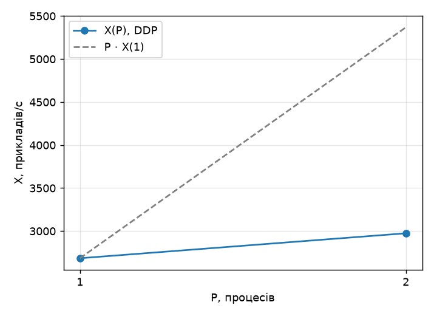

<div align="center">

Міністерство освіти і науки України<br>
Національний технічний університет України «Київський політехнічний інститут імені Ігоря Сікорського»

Факультет біомедичної інженерії<br>
Кафедра біомедичної кібернетики

# Звіт

**про виконання лабораторної роботи №6<br>
з дисципліни «Високопродуктивні розподілені обчислювальні системи»**

Тема роботи: «Розподілене навчання нейромережі за даними на CPU»<br>
Варіант № 8

</div>

**Виконав:** студент гр. ЗК-61мп Євтушенко Єгор<br>
**Прийняв:** Матвійчук О. В.

<div align="center">

Київ<br>
КПІ ім. Ігоря Сікорського<br>
2026

</div>

---

## Мета роботи

Навчити згорткову нейромережу для класифікації медичних зображень з набору MedMNIST у P паралельних процесах одного вузла за схемою паралелізму за даними. Реалізувати синхронізацію градієнтів вручну і перевірити, що паралельний крок дає той самий градієнт, що й крок одного процесу на всьому батчі. Замінити ручну синхронізацію на DistributedDataParallel і виміряти частку часу кроку, зайняту обміном. Виміряти strong і weak scaling навчання, перевірити вплив правила масштабування швидкості навчання на якість моделі і відновлення навчання з контрольної точки після аварійного завершення одного процесу.

## Варіант

| № | Датасет | Ширина | P_max | B | K_c | s_f |
|---|---|---|---|---|---|---|
| 8 | Д2 | Ш3 | 2 | 192 | 15 | 37 |

| Позначка | Датасет MedMNIST | Зображення | Класів K | Каналів C | Прикладів train / test | Файл |
|---|---|---|---|---|---|---|
| Д2 | BloodMNIST | мазок крові, клітини | 8 | 3 | 11959 / 3421 | bloodmnist.npz |

| Позначка | c1 | c2 | h |
|---|---|---|---|
| Ш3 | 64 | 128 | 512 |

## Середовище і реалізація

Усе навчання в `train.py` (додаток А), прогони кроків 1–5 у `scripts/run_all.sh` (додаток Б), таблиці й графік рахує `summarize.py` (додаток В). Цикл навчання написано вручну без готових обгорток.

- **Дані.** Файл `data/bloodmnist.npz` завантажено з Zenodo (`https://zenodo.org/records/10519652/files/bloodmnist.npz?download=1`). Функція `load_split` і мережа `Net` взяті з умови без змін. Навчальна частина складається з перших N = 7000 прикладів train, тестова з усіх 3421 прикладів test.
- **Навчання.** Оптимізатор SGD з моментом 0,9, η₀ = 0,02, `torch.manual_seed(0)` перед створенням моделі, n_ep = 3.
- **Швидкість.** 10 кроків прогріву і 50 вимірюваних кроків. t_step є медіаною часу 50 кроків процесу 0 за `time.perf_counter()`, X = 50 · B / t.
- **Запуск процесів.** `torchrun --nnodes=1 --nproc_per_node=P --rdzv-backend=static --master-addr=127.0.0.1 --master-port=29500 --node-rank=0` і змінна `GLOO_SOCKET_IFNAME=lo0`, група `init_process_group(backend="gloo")`. З `--standalone` torchrun на macOS не завершував рандеву: c10d намагався отримати адресу хоста через зворотний DNS-запит і чекав без кінця. Тому всі розподілені прогони використовують статичну адресу 127.0.0.1, ту саму, що вимагається для кроку 5.
- **Дані між процесами.** `DistributedSampler(dataset, num_replicas=P, rank=r, shuffle=True, seed=0)` з `set_epoch(epoch)` перед кожною епохою, `DataLoader(batch_size=b, drop_last=True)`.
- **Потоки.** n_th = ⌊C_phys / P_max⌋ = ⌊11 / 2⌋ = 5, `torch.set_num_threads(5)` на початку скрипта в усіх прогонах, зокрема в одному процесі.

Таблиця 1. Стенд (`results/info.json`)

| Процесор | Фізичних ядер C_phys | Логічних ядер | Памʼять, ГБ | ОС | Python | PyTorch | n_th | Датасет | K | C | c1 / c2 / h | n_params | M, МіБ | N | B | P_max |
|---|---|---|---|---|---|---|---|---|---|---|---|---|---|---|---|---|
| Apple M3 Pro (5 продуктивних і 6 енергоефективних ядер) | 11 | 11 | 18 | macOS 27.0.1 | 3.13.0 | 2.15.0 (CPU) | 5 | BloodMNIST | 8 | 3 | 64 / 128 / 512 | 3 291 528 | 12,56 | 7000 | 192 | 2 |

n_params = 9 · 3 · 64 + 64 + 9 · 64 · 128 + 128 + 49 · 128 · 512 + 512 + 512 · 8 + 8 = 3 291 528, що збігається з `sum(p.numel())` моделі (`assert` у `train.py`). M = 4 · n_params = 13 166 112 байт = 12,56 МіБ. Модель має 8 тензорів параметрів.

## Крок 1. Навчання в одному процесі

Без `torch.distributed`, батч B = 192, η₀ = 0,02, 3 епохи по ⌊7000 / 192⌋ = 36 кроків, разом 108 кроків оптимізатора (`results/step1_train.json`): ACC = 0,7773, AUC = 0,9593. Окремим прогоном за методикою вимірів швидкості (`results/step1_speed.json`): t_step = 70,17 мс, X(1) = 2715,8 прикладів/с. Ці числа є першим рядком таблиці 2.

## Крок 2. Ручна синхронізація і DDP на P_max процесах

На 2 процесах ваги процесу 0 розсилаються `dist.broadcast(p.data, src=0)` для кожного параметра. Батч процесу b = 192 / 2 = 96. Після `loss.backward()` градієнти синхронізуються вручну:

```python
for p in model.parameters():
    dist.all_reduce(p.grad, op=dist.ReduceOp.SUM)
    p.grad /= ctx.world
```

Перевірка еквівалентності (`train.py check`, `results/step2_check.json`):

1. Перший батч навчальної частини складається з прикладів 0 … 191. Процес 0 копіює модель і обчислює градієнт g на всьому батчі.
2. Процес r бере приклади r, r + 2, … того самого батча і обчислює ḡ ручною синхронізацією.
3. Найбільше за тензорами параметрів відношення max |g − ḡ| / max |g| дорівнює 2,72 · 10⁻⁶ (для 8 тензорів від 4,9 · 10⁻⁸ до 2,72 · 10⁻⁶). Це в межах похибки float32, наведеної в умові.
4. Після 50 кроків навчання з ручною синхронізацією кожен процес обчислює суму всіх ваг у float64, і процеси збирають ці суми через `all_gather`. Обидві суми дорівнюють −95,61185697186457, різниця 0.

t_sync вимірюється від першого виклику `all_reduce` до повернення з останнього. Далі ручну синхронізацію замінено на `DistributedDataParallel(model)` з типовим розміром кошика. t_step,ns виміряно окремим прогоном, у якому `backward()` виконується всередині `with model.no_sync():`, і t_comm,exp = t_step − t_step,ns.

Таблиця 2. Синхронізація градієнтів (`results/summary.json`)

| Режим | t_step, мс | Час обміну на крок, мс | Частка кроку в обміні | X, прикл./с |
|---|---|---|---|---|
| 1 процес, батч B | 70,17 | 0 | 0 | 2715,8 |
| P_max процесів, ручна синхронізація | 77,41 | 15,40 | 0,199 | 2449,6 |
| P_max процесів, DDP | 63,56 | 0,079 | 0,0012 | 2974,4 |
| P_max процесів, DDP, no_sync | 63,48 | 0 | 0 | 2991,1 |

| Показник | Значення |
|---|---|
| max \|g − ḡ\| / max \|g\| | 2,72 · 10⁻⁶ |
| Різниця сум ваг між процесами після 50 кроків | 0 |
| ACC, 1 процес | 0,7773 |
| ACC, DDP на P_max | 0,7784 |
| AUC, 1 процес | 0,9593 |
| AUC, DDP на P_max | 0,9594 |

З ручною синхронізацією 8 операцій all-reduce загальним обсягом 12,56 МіБ починаються лише після завершення backward і займають 15,4 мс, тобто 20 % кроку, і 2 процеси виявились повільнішими за один. DDP запускає all-reduce кошиків під час backward. Найбільший тензор (вага повнозвʼязного шару 6272 × 512, 3,2 млн параметрів) стоїть ближче до виходу мережі, тому його градієнт обчислюється першим, і обмін перекривається з обчисленням градієнтів згорткових шарів. Неперекритим лишилось 0,08 мс, тобто 0,12 % кроку. Втрату DDP-навчання на кожному кроці записано в `results/step2_ddp_train.json` (поле `losses`), вона використовується в кроці 5.

## Крок 3. Strong scaling

DDP, глобальний батч B = 192, батч процесу B / P. Прогін з P = 1 теж виконано через torchrun з DDP (`results/step3_p1.json`, `results/step3_p1_nosync.json`), рядок P = 2 взято з кроку 2. X(1) = 2684,4 прикладів/с.

Таблиця 3. Strong scaling, B = const

| P | b | t_step, мс | t_step,ns, мс | X, прикл./с | S | E | e | c |
|---|---|---|---|---|---|---|---|---|
| 1 | 192 | 70,63 | 70,62 | 2684,4 | 1 | 1 | − | 0,0002 |
| 2 | 96 | 63,56 | 63,48 | 2974,4 | 1,108 | 0,554 | 0,805 | 0,0012 |
| 3 | | | | | | | | |
| 4 | | | | | | | | |

Рядки з P > P_max = 2 не заповнюються.



Обмін майже не займає часу (c = 0,12 %), але прискорення лише 1,11. Процесор M3 Pro має 5 продуктивних і 6 енергоефективних ядер. Один процес з 5 потоками працює на продуктивних ядрах, а у двох процесів по 5 потоків частина потоків виконується на енергоефективних ядрах, і обидва процеси до того ж ділять ту саму памʼять. Тому крок процесу з половинним батчем 96 займає 63,6 мс, хоча один процес з тим самим батчем 96 робить крок за 37,8 мс (таблиця 4). Метрика Карпа-Флатта e = 0,805 показує, що за цих умов майже вся робота поводиться як послідовна.

## Крок 4. Weak scaling і правило масштабування швидкості навчання

Батч процесу b = 96, P = 1 і 2, глобальний батч P · b. Рядок P = 2 збігається з рядком таблиці 3, бо 2 · 96 = B (`results/step4_p1.json`).

Таблиця 4. Weak scaling, b = const

| P | B_P | t_step, мс | X, прикл./с | S_w | E_w |
|---|---|---|---|---|---|
| 1 | 96 | 37,80 | 2519,1 | 1 | 1 |
| 2 | 192 | 63,56 | 2974,4 | 1,181 | 0,590 |
| 3 | | | | | |
| 4 | | | | | |

Навчання n_ep = 3 епохи ще у двох режимах: P = 1 з батчем b = 96 і η₀ (`results/step4_p1_train.json`), і P = 2 з лінійним правилом η_P = η₀ · B_P / B₀ = 0,02 · 192 / 96 = 0,04 (`results/step4_p2_lr_scaled_train.json`). Режим P = 2 з η₀ взято з кроку 2.

Таблиця 5. Якість за різних глобальних батчів

| Режим | B_P | η | Кроків оптимізатора за n_ep епох | ACC | AUC | Найбільша втрата за останню епоху |
|---|---|---|---|---|---|---|
| P = 1 | 96 | 0,02 | 216 | 0,8392 | 0,9778 | 0,6890 |
| P = P_max, з кроку 2 | 192 | 0,02 | 108 | 0,7784 | 0,9594 | 1,0825 |
| P = P_max | 192 | 0,04 | 108 | 0,8047 | 0,9731 | 0,7086 |

З батчем 192 модель за 3 епохи робить удвічі менше кроків оптимізатора (108 проти 216), тому з тією самою η₀ навчається гірше: ACC 0,778 проти 0,839. Лінійне правило з η = 0,04 повертає більшу частину різниці: ACC 0,805, AUC 0,973, а найбільша втрата за останню епоху знизилась з 1,08 до 0,71. Розходження навчання без розігріву не виникло.

## Крок 5. Контрольні точки і відновлення

До DDP-навчання на 2 процесах додано контрольні точки кожні K_c = 15 кроків: процес 0 зберігає `model.state_dict()`, `opt.state_dict()`, `epoch`, `step_in_epoch` і `step` у `ckpt.tmp`, потім `os.replace` у `ckpt.pt`, а всі процеси чекають на `dist.barrier()`.

Під час старту кожен процес читає `ckpt.pt`, якщо файл існує, відновлює модель і оптимізатор, викликає `sampler.set_epoch(epoch)` і пропускає перші `step_in_epoch` батчів епохи. Процес з rank 1 на початку кроку s_f = 37 створює файл-позначку `fail.marker` і завершується `os._exit(1)`, а після перезапуску позначка не дає відмові повторитися.

Запуск:

```bash
torchrun --nnodes=1 --nproc_per_node=2 --max-restarts=1 \
  --rdzv-backend=static --master-addr=127.0.0.1 --master-port=29500 --node-rank=0 \
  train.py train --sync ddp --ckpt results/ckpt.pt --ckpt-every 15 --fail-step 37 \
  --marker results/fail.marker --events results/step5_events.jsonl --out results/step5_train.json
```

Події з часом записуються в `results/step5_events.jsonl`:

```
{"event": "checkpoint", "step": 15, "t": 1795610044.4250329}
{"event": "checkpoint", "step": 30, "t": 1795610045.511202}
{"event": "failure", "step": 37, "rank": 1, "t": 1795610045.9298282}
{"event": "restored", "step": 30, "t": 1795610047.9258409}
{"event": "first_step_after_restore", "step": 31, "t": 1795610048.0819972}
```

torchrun зафіксував завершення процесу і перезапустив групу (`results/run.log`):

```
failed (exitcode: 1) local_rank: 1 (pid: 52546) of binary: /Users/yehoryevtushenko/BPOC/Lab6/.venv/bin/python3.13
```

t_f − t_c = 45,930 − 45,511 = 0,419 с. t_r від відмови до завершення першого кроку після відновлення становить 48,082 − 45,930 = 2,152 с і складається із зупинки групи, старту процесів, створення групи і читання контрольної точки. t_lost = 0,419 + 2,152 = 2,571 с.

Таблиця 6. Відмова і відновлення

| K_c | s_f | Крок останньої контрольної точки | Кроків виконано повторно | t_lost, с |
|---|---|---|---|---|
| 15 | 37 | 30 | 6 (кроки 31–36) | 2,571 |

| Крок | s_f − 2 = 35 | s_f − 1 = 36 | s_f = 37 | s_f + 1 = 38 | s_f + 2 = 39 | ACC після n_ep епох |
|---|---|---|---|---|---|---|
| Втрата, прогін з відмовою | 1,275723 | 1,383523 | 1,645193 | 1,775410 | 1,696348 | 0,7784 |
| Втрата, прогін без відмови | 1,275723 | 1,383523 | 1,645193 | 1,775410 | 1,696348 | 0,7784 |

Втрата прогону з відмовою на кожному з 108 кроків збігається з втратою DDP-навчання без відмови з кроку 2 до останнього знака: найбільша різниця за всіма кроками 0 (`results/summary.json`, `max_abs_diff_all_steps`). Кроки 35 і 36 до відмови і після відновлення теж дали ту саму втрату. ACC і AUC обох прогонів однакові (0,7784 і 0,9594). Відновлене навчання пройшло ті самі приклади в тому самому порядку з тим самим станом оптимізатора і тією самою кількістю потоків.

## Висновки

У цій лабораторній роботі ми навчили згорткову мережу ширини Ш3 (3,29 млн параметрів, 12,56 МіБ градієнтів) на BloodMNIST в одному процесі і у двох процесах з паралелізмом за даними, бекендом gloo і torchrun. Перевірили, що середнє градієнтів двох процесів збігається з градієнтом одного процесу на всьому батчі з похибкою 2,7 · 10⁻⁶. Після 50 кроків ваги процесів однакові, бо різниця їхніх сум 0.

Ручна синхронізація після backward витрачає на обмін 15,4 мс, тобто 20 % кроку, і два процеси з нею повільніші за один. DDP перекриває обмін з backward, і неперекритого обміну лишається 0,08 мс (0,12 % кроку). Попри майже нульовий обмін, strong scaling на двох процесах дав лише S = 1,11 (E = 0,55), а weak scaling S_w = 1,18. Другий процес отримує енергоефективні ядра і ділить з першим памʼять, тому його крок довший, ніж крок одного процесу на тому самому батчі.

З батчем 192 і тією самою η = 0,02 модель за 3 епохи робить удвічі менше кроків і має ACC 0,778 проти 0,839 з батчем 96. Лінійне правило з η = 0,04 підняло ACC до 0,805 без розходження навчання. Після аварійного завершення процесу на кроці 37 torchrun перезапустив групу, навчання відновилось з контрольної точки кроку 30 і повторило 6 кроків. Втрачено 2,57 с, а втрата на кожному кроці і точність збіглися з навчанням без відмови.

## ДОДАТОК А. Лістинг `train.py`

```python
import argparse
import json
import os
import platform
import statistics
import subprocess
import sys
import time

import numpy as np
import torch
import torch.distributed as dist
from sklearn.metrics import roc_auc_score
from torch import nn
from torch.nn.parallel import DistributedDataParallel as DDP
from torch.utils.data import DataLoader, DistributedSampler, TensorDataset

DATASET, K, C = "bloodmnist", 8, 3
C1, C2, H = 64, 128, 512
P_MAX = 2
N_TRAIN = 7000
LR0 = 0.02
MOMENTUM = 0.9
EPOCHS = 3
WARMUP_STEPS = 10
MEASURE_STEPS = 50
C_PHYS = 11
N_TH = C_PHYS // P_MAX
DATA = os.path.join(os.path.dirname(os.path.abspath(__file__)), "data", f"{DATASET}.npz")


def load_split(path, split, n=None):
    d = np.load(path)
    x = d[f"{split}_images"][:n]
    y = d[f"{split}_labels"][:n].reshape(-1)
    if x.ndim == 3:
        x = x[:, None, :, :]
    else:
        x = x.transpose(0, 3, 1, 2)
    x = torch.from_numpy(np.ascontiguousarray(x)).float()
    x = (x / 255 - 0.5) / 0.5
    return TensorDataset(x, torch.from_numpy(y.astype(np.int64)))


class Net(nn.Module):
    def __init__(self, C, c1, c2, h, K):
        super().__init__()
        self.features = nn.Sequential(
            nn.Conv2d(C, c1, 3, padding=1), nn.ReLU(), nn.MaxPool2d(2),
            nn.Conv2d(c1, c2, 3, padding=1), nn.ReLU(), nn.MaxPool2d(2),
        )
        self.head = nn.Sequential(
            nn.Flatten(), nn.Linear(7 * 7 * c2, h), nn.ReLU(),
            nn.Linear(h, K),
        )

    def forward(self, x):
        return self.head(self.features(x))


def n_params_formula(C, c1, c2, h, K):
    return 9 * C * c1 + c1 + 9 * c1 * c2 + c2 + 49 * c2 * h + h + h * K + K


class Ctx:
    def __init__(self):
        self.distributed = "RANK" in os.environ
        if self.distributed:
            dist.init_process_group(backend="gloo")
            self.rank, self.world = dist.get_rank(), dist.get_world_size()
        else:
            self.rank, self.world = 0, 1

    def log(self, *a):
        if self.rank == 0:
            print(*a, flush=True)


def build(ctx, sync):
    torch.manual_seed(0)
    model = Net(C, C1, C2, H, K)
    if ctx.distributed and sync == "manual":
        for p in model.parameters():
            dist.broadcast(p.data, src=0)
    if ctx.distributed and sync == "ddp":
        return model, DDP(model)
    return model, model


def loader(ctx, dataset, batch, epoch, seed=0):
    if ctx.distributed:
        sampler = DistributedSampler(dataset, num_replicas=ctx.world, rank=ctx.rank, shuffle=True, seed=seed)
    else:
        sampler = DistributedSampler(dataset, num_replicas=1, rank=0, shuffle=True, seed=seed)
    sampler.set_epoch(epoch)
    return DataLoader(dataset, batch_size=batch, sampler=sampler, drop_last=True)


def manual_sync(ctx, model, times=None):
    start = time.perf_counter()
    for p in model.parameters():
        dist.all_reduce(p.grad, op=dist.ReduceOp.SUM)
        p.grad /= ctx.world
    if times is not None:
        times.append(time.perf_counter() - start)


def train_step(ctx, model, wrapped, opt, x, y, sync, no_sync=False, sync_times=None):
    opt.zero_grad()
    loss = nn.functional.cross_entropy(wrapped(x), y)
    if sync == "ddp" and no_sync:
        with wrapped.no_sync():
            loss.backward()
    else:
        loss.backward()
    if ctx.distributed and sync == "manual":
        manual_sync(ctx, model, sync_times)
    opt.step()
    return loss.detach()


def batches(ctx, dataset, b, start_epoch=0, skip=0):
    epoch = start_epoch
    while True:
        for i, (x, y) in enumerate(loader(ctx, dataset, b, epoch)):
            if epoch == start_epoch and i < skip:
                continue
            yield epoch, i, x, y
        epoch += 1


def evaluate(model, test):
    model.eval()
    with torch.no_grad():
        logits = torch.cat([model(x) for x, _ in DataLoader(test, batch_size=1024)])
    model.train()
    prob = torch.softmax(logits, dim=1).numpy()
    y = test.tensors[1].numpy()
    return {"ACC": float((prob.argmax(1) == y).mean()),
            "AUC": float(roc_auc_score(y, prob, multi_class="ovr", average="macro"))}


def save(path, data):
    os.makedirs(os.path.dirname(path) or ".", exist_ok=True)
    with open(path, "w") as f:
        json.dump(data, f, indent=2, ensure_ascii=False)
    print(json.dumps({k: v for k, v in data.items() if k not in ("losses", "step_times_ms")}, ensure_ascii=False), flush=True)


def speed(ctx, args, train):
    model, wrapped = build(ctx, args.sync)
    opt = torch.optim.SGD(model.parameters(), lr=args.lr, momentum=MOMENTUM)
    b = args.batch // ctx.world
    it = batches(ctx, train, b)
    times, syncs = [], []
    t_begin = None
    for k in range(WARMUP_STEPS + MEASURE_STEPS):
        _, _, x, y = next(it)
        measured = k >= WARMUP_STEPS
        if measured and t_begin is None:
            t_begin = time.perf_counter()
        start = time.perf_counter()
        train_step(ctx, model, wrapped, opt, x, y, args.sync, args.no_sync, syncs if measured else None)
        times.append(time.perf_counter() - start)
    t = time.perf_counter() - t_begin
    times = times[WARMUP_STEPS:]
    result = {"P": ctx.world, "b": b, "B": args.batch, "sync": args.sync if ctx.distributed else "none",
              "no_sync": args.no_sync, "n_th": torch.get_num_threads(),
              "t_step_ms": statistics.median(times) * 1000, "t_50_s": t, "X": MEASURE_STEPS * args.batch / t,
              "step_times_ms": [v * 1000 for v in times]}
    if syncs:
        result["t_sync_ms"] = statistics.median(syncs) * 1000
    if ctx.rank == 0:
        save(args.out, result)


def check(ctx, args, train):
    model, _ = build(ctx, "manual")
    x, y = train.tensors[0][:args.batch], train.tensors[1][:args.batch]
    ratio = None
    if ctx.rank == 0:
        ref = Net(C, C1, C2, H, K)
        ref.load_state_dict(model.state_dict())
        nn.functional.cross_entropy(ref(x), y).backward()
        g = [p.grad.clone() for p in ref.parameters()]
    model.zero_grad()
    nn.functional.cross_entropy(model(x[ctx.rank::ctx.world]), y[ctx.rank::ctx.world]).backward()
    manual_sync(ctx, model)
    if ctx.rank == 0:
        ratios = [((gi - p.grad).abs().max() / gi.abs().max()).item() for gi, p in zip(g, model.parameters())]
        ratio = max(ratios)
    opt = torch.optim.SGD(model.parameters(), lr=args.lr, momentum=MOMENTUM)
    it = batches(ctx, train, args.batch // ctx.world)
    for _ in range(50):
        _, _, xb, yb = next(it)
        train_step(ctx, model, model, opt, xb, yb, "manual")
    total = torch.tensor([sum(p.detach().double().sum().item() for p in model.parameters())], dtype=torch.float64)
    sums = [torch.zeros(1, dtype=torch.float64) for _ in range(ctx.world)]
    dist.all_gather(sums, total)
    if ctx.rank == 0:
        values = [s.item() for s in sums]
        save(args.out, {"P": ctx.world, "B": args.batch, "max_grad_ratio": ratio, "per_tensor_ratio": ratios,
                        "weight_sums": values, "weight_sum_diff": max(values) - min(values)})


def checkpoint(ctx, model, opt, epoch, i, step, path):
    if ctx.rank == 0:
        state = {"model": model.state_dict(), "opt": opt.state_dict(), "epoch": epoch,
                 "step_in_epoch": i + 1, "step": step}
        torch.save(state, path + ".tmp")
        os.replace(path + ".tmp", path)
        event(ctx, args_global.events, {"event": "checkpoint", "step": step, "t": time.time()})
    if ctx.distributed:
        dist.barrier()


def event(ctx, path, data):
    if path:
        with open(path, "a") as f:
            f.write(json.dumps(data) + "\n")


def train_run(ctx, args, train, test):
    model, wrapped = build(ctx, args.sync)
    opt = torch.optim.SGD(model.parameters(), lr=args.lr, momentum=MOMENTUM)
    b = args.batch // ctx.world
    start_epoch, skip, step = 0, 0, 0
    if args.ckpt and os.path.exists(args.ckpt):
        state = torch.load(args.ckpt)
        model.load_state_dict(state["model"])
        opt.load_state_dict(state["opt"])
        start_epoch, skip, step = state["epoch"], state["step_in_epoch"], state["step"]
        event(ctx, args.events if ctx.rank == 0 else None, {"event": "restored", "step": step, "t": time.time()})
    steps_per_epoch = len(loader(ctx, train, b, 0))
    total_steps = EPOCHS * steps_per_epoch
    losses = []
    first_after_restore = step > 0
    for epoch, i, x, y in batches(ctx, train, b, start_epoch, skip):
        if step >= total_steps:
            break
        if args.fail_step and step + 1 == args.fail_step and ctx.rank == ctx.world - 1 and not os.path.exists(args.marker):
            open(args.marker, "w").close()
            event(ctx, args.events, {"event": "failure", "step": step + 1, "rank": ctx.rank, "t": time.time()})
            os._exit(1)
        loss = train_step(ctx, model, wrapped, opt, x, y, args.sync)
        if ctx.distributed:
            dist.all_reduce(loss, op=dist.ReduceOp.SUM)
            loss /= ctx.world
        step += 1
        losses.append({"step": step, "epoch": epoch, "loss": loss.item()})
        if ctx.rank == 0 and args.events:
            event(ctx, args.events, {"event": "step", "step": step, "epoch": epoch, "loss": loss.item(), "t": time.time()})
        if first_after_restore:
            event(ctx, args.events if ctx.rank == 0 else None, {"event": "first_step_after_restore", "step": step, "t": time.time()})
            first_after_restore = False
        if args.ckpt_every and step % args.ckpt_every == 0:
            checkpoint(ctx, model, opt, epoch, i, step, args.ckpt)
    if ctx.rank == 0:
        last = [r["loss"] for r in losses if r["epoch"] == EPOCHS - 1]
        save(args.out, {"P": ctx.world, "b": b, "B": args.batch, "lr": args.lr, "sync": args.sync if ctx.distributed else "none",
                        "epochs": EPOCHS, "steps_per_epoch": steps_per_epoch, "optimizer_steps": step,
                        "max_loss_last_epoch": max(last) if last else None, **evaluate(model, test), "losses": losses})


def info(args):
    model = Net(C, C1, C2, H, K)
    n = sum(p.numel() for p in model.parameters())
    assert n == n_params_formula(C, C1, C2, H, K)
    d = np.load(DATA)
    sysctl = lambda key: subprocess.run(["sysctl", "-n", key], capture_output=True, text=True).stdout.strip()
    save(args.out, {"cpu": sysctl("machdep.cpu.brand_string"), "C_phys": int(sysctl("hw.physicalcpu")),
                    "logical": os.cpu_count(), "memory_GB": int(sysctl("hw.memsize")) / 2**30,
                    "os": platform.platform(), "python": sys.version.split()[0], "torch": torch.__version__,
                    "n_th": N_TH, "dataset": DATASET, "K": K, "C": C, "c1_c2_h": [C1, C2, H], "n_params": n,
                    "M_MiB": 4 * n / 2**20, "param_tensors": len(list(model.parameters())), "N": N_TRAIN,
                    "train_total": len(d["train_labels"]), "test": len(d["test_labels"]), "B": 192, "P_max": P_MAX})


args_global = None


def main():
    global args_global
    p = argparse.ArgumentParser()
    p.add_argument("mode", choices=["info", "speed", "check", "train"])
    p.add_argument("--sync", choices=["manual", "ddp"], default="ddp")
    p.add_argument("--batch", type=int, default=192)
    p.add_argument("--lr", type=float, default=LR0)
    p.add_argument("--no-sync", action="store_true")
    p.add_argument("--ckpt")
    p.add_argument("--ckpt-every", type=int)
    p.add_argument("--fail-step", type=int)
    p.add_argument("--marker", default="results/fail.marker")
    p.add_argument("--events")
    p.add_argument("--out", required=True)
    args = args_global = p.parse_args()
    torch.set_num_threads(N_TH)
    if args.mode == "info":
        return info(args)
    ctx = Ctx()
    train = load_split(DATA, "train", n=N_TRAIN)
    test = load_split(DATA, "test")
    {"speed": lambda: speed(ctx, args, train), "check": lambda: check(ctx, args, train),
     "train": lambda: train_run(ctx, args, train, test)}[args.mode]()
    if ctx.distributed:
        dist.destroy_process_group()


if __name__ == "__main__":
    main()
```

## ДОДАТОК Б. Лістинг `scripts/run_all.sh`

```bash
#!/usr/bin/env bash
set -euo pipefail
cd "$(dirname "$0")/.."
PY=.venv/bin/python
export GLOO_SOCKET_IFNAME=lo0
TR=".venv/bin/torchrun --nnodes=1 --rdzv-backend=static --master-addr=127.0.0.1 --master-port=29500 --node-rank=0 --nproc_per_node"
mkdir -p results

$PY train.py info --out results/info.json

$PY train.py train --out results/step1_train.json
$PY train.py speed --out results/step1_speed.json

$TR=2 train.py check --out results/step2_check.json
$TR=2 train.py speed --sync manual --out results/step2_manual.json
$TR=2 train.py speed --sync ddp --out results/step2_ddp.json
$TR=2 train.py speed --sync ddp --no-sync --out results/step2_ddp_nosync.json
$TR=2 train.py train --sync ddp --out results/step2_ddp_train.json

$TR=1 train.py speed --sync ddp --out results/step3_p1.json
$TR=1 train.py speed --sync ddp --no-sync --out results/step3_p1_nosync.json

$TR=1 train.py speed --sync ddp --batch 96 --out results/step4_p1.json
$TR=1 train.py train --sync ddp --batch 96 --out results/step4_p1_train.json
$TR=2 train.py train --sync ddp --lr 0.04 --out results/step4_p2_lr_scaled_train.json

rm -f results/ckpt.pt results/fail.marker results/step5_events.jsonl
.venv/bin/torchrun --nnodes=1 --nproc_per_node=2 --max-restarts=1 \
  --rdzv-backend=static --master-addr=127.0.0.1 --master-port=29500 --node-rank=0 \
  train.py train --sync ddp --ckpt results/ckpt.pt --ckpt-every 15 --fail-step 37 \
  --marker results/fail.marker --events results/step5_events.jsonl --out results/step5_train.json
$PY summarize.py
```

## ДОДАТОК В. Лістинг `summarize.py`

```python
import json
import os

import matplotlib

matplotlib.use("Agg")
import matplotlib.pyplot as plt

R = "results"
P_MAX = 2
S_F = 37


def load(name):
    with open(os.path.join(R, name)) as f:
        return json.load(f)


def main():
    one, one_train = load("step1_speed.json"), load("step1_train.json")
    manual, ddp, ddp_ns = load("step2_manual.json"), load("step2_ddp.json"), load("step2_ddp_nosync.json")
    check, ddp_train = load("step2_check.json"), load("step2_ddp_train.json")
    t_comm = ddp["t_step_ms"] - ddp_ns["t_step_ms"]
    table2 = {
        "one": {"t_step_ms": one["t_step_ms"], "comm_ms": 0, "c": 0, "X": one["X"]},
        "manual": {"t_step_ms": manual["t_step_ms"], "comm_ms": manual["t_sync_ms"],
                   "c": manual["t_sync_ms"] / manual["t_step_ms"], "X": manual["X"]},
        "ddp": {"t_step_ms": ddp["t_step_ms"], "comm_ms": t_comm, "c": t_comm / ddp["t_step_ms"], "X": ddp["X"]},
        "ddp_no_sync": {"t_step_ms": ddp_ns["t_step_ms"], "comm_ms": 0, "c": 0, "X": ddp_ns["X"]},
        "max_grad_ratio": check["max_grad_ratio"], "weight_sum_diff": check["weight_sum_diff"],
        "ACC_one": one_train["ACC"], "ACC_ddp": ddp_train["ACC"], "AUC_one": one_train["AUC"], "AUC_ddp": ddp_train["AUC"],
    }
    p1, p1_ns = load("step3_p1.json"), load("step3_p1_nosync.json")
    rows = {1: (p1, p1_ns), 2: (ddp, ddp_ns)}
    x1 = p1["X"]
    table3 = {}
    for p, (sp, ns) in rows.items():
        s = sp["X"] / x1
        table3[p] = {"b": sp["b"], "t_step_ms": sp["t_step_ms"], "t_step_ns_ms": ns["t_step_ms"], "X": sp["X"],
                     "S": s, "E": s / p, "e": None if p == 1 else (1 / s - 1 / p) / (1 - 1 / p),
                     "c": (sp["t_step_ms"] - ns["t_step_ms"]) / sp["t_step_ms"]}
    w1 = load("step4_p1.json")
    table4 = {1: {"B_P": w1["B"], "t_step_ms": w1["t_step_ms"], "X": w1["X"], "S_w": 1.0, "E_w": 1.0},
              2: {"B_P": ddp["B"], "t_step_ms": ddp["t_step_ms"], "X": ddp["X"],
                  "S_w": ddp["X"] / w1["X"], "E_w": ddp["X"] / w1["X"] / 2}}
    table5 = {}
    for name, f in (("P1_b", "step4_p1_train.json"), ("Pmax_lr0", "step2_ddp_train.json"),
                    ("Pmax_lrP", "step4_p2_lr_scaled_train.json")):
        d = load(f)
        table5[name] = {"B_P": d["B"], "lr": d["lr"], "steps": d["optimizer_steps"], "ACC": d["ACC"], "AUC": d["AUC"],
                        "max_loss_last_epoch": d["max_loss_last_epoch"]}
    events = [json.loads(line) for line in open(os.path.join(R, "step5_events.jsonl"))]
    failure = next(e for e in events if e["event"] == "failure")
    ckpts = [e for e in events if e["event"] == "checkpoint" and e["t"] < failure["t"]]
    last_ckpt = ckpts[-1]
    restored = next(e for e in events if e["event"] == "restored")
    first = next(e for e in events if e["event"] == "first_step_after_restore")
    after = {e["step"]: e["loss"] for e in events if e["event"] == "step" and e["t"] > failure["t"]}
    before = {e["step"]: e["loss"] for e in events if e["event"] == "step" and e["t"] < failure["t"]}
    base = {r["step"]: r["loss"] for r in ddp_train["losses"]}
    fail_train = load("step5_train.json")
    steps = list(range(S_F - 2, S_F + 3))
    table6 = {"K_c": 15, "s_f": S_F, "last_ckpt_step": last_ckpt["step"], "restored_step": restored["step"],
              "repeated_steps": failure["step"] - 1 - last_ckpt["step"],
              "t_f_minus_t_c_s": failure["t"] - last_ckpt["t"], "t_r_s": first["t"] - failure["t"],
              "t_lost_s": failure["t"] - last_ckpt["t"] + first["t"] - failure["t"],
              "loss_fail": {s: after.get(s, before.get(s)) for s in steps},
              "loss_fail_before_failure": {s: before.get(s) for s in steps if s in before},
              "loss_no_fail": {s: base[s] for s in steps},
              "max_abs_diff_all_steps": max(abs(after.get(s, before.get(s)) - base[s]) for s in base),
              "ACC_fail": fail_train["ACC"], "ACC_no_fail": ddp_train["ACC"],
              "AUC_fail": fail_train["AUC"], "AUC_no_fail": ddp_train["AUC"],
              "optimizer_steps_fail": fail_train["optimizer_steps"]}
    out = {"table2": table2, "table3": table3, "table4": table4, "table5": table5, "table6": table6}
    with open(os.path.join(R, "summary.json"), "w") as f:
        json.dump(out, f, indent=2)
    print(json.dumps(out, indent=2))
    ps = sorted(table3)
    plt.figure(figsize=(5.5, 4))
    plt.plot(ps, [table3[p]["X"] for p in ps], "o-", label="X(P), DDP")
    plt.plot(ps, [p * x1 for p in ps], "--", color="grey", label="P · X(1)")
    plt.xticks(ps)
    plt.xlabel("P, процесів")
    plt.ylabel("X, прикладів/с")
    plt.legend()
    plt.grid(alpha=0.3)
    plt.tight_layout()
    plt.savefig(os.path.join(R, "strong_scaling.png"), dpi=130)


if __name__ == "__main__":
    main()
```
